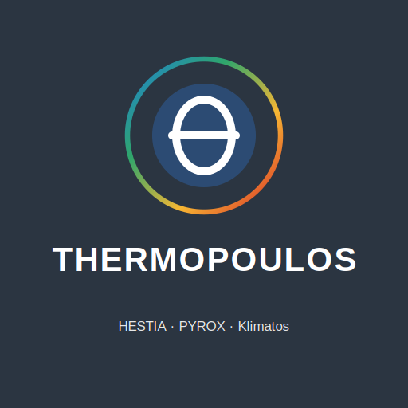

# Changelog — Thermopoulos: HESTIA · PYROX · Klimatos

Newest first. Each entry says what changed, why, and what was found, including
errors. "Author's decision" marks domain choices made by the author.
Entries up to 2026-10-24 were written during development; names of people
in personal communications have been replaced by their institution, and
results of individual field-test participants by group-level statements.

## [2026.10.27] Release

Second public release. Contains everything since 2026.10.25 (entries below), and:
- **Recent days in the hindcast no longer missing** (author's decision,
  2026-11-12). ERA5 (`models=era5_seamless`) runs about 5 days behind real
  time; a live request on 2026-11-12 for De Bilt returned 29 Oct-6 Nov but
  nothing for 7-11 Nov. The 14-day hindcast before a forecast (and any
  Historical_Custom or `individual_engine` period ending in the last days)
  therefore had about 5 empty days, and `thermopoulos_loader` turned a day
  without temperature into heat load 0.0 without a message: PYROX saw those
  days as cool (acclimatisation too low; a heatwave that had already begun
  was missed). `fetch_historical_data` now fills hours that are missing
  within 10 days of today from the forecast API's recent analyses
  (`past_days`), the same model chain as the forecast: `knmi_seamless`
  (HARMONIE) where available, otherwise Open-Meteo's default model.
  Filled hours are marked `from_forecast_api` and get no ERA5 coastal
  correction. If the forecast API fails, the gap stays and a warning is
  printed; the loader now also warns for any day without temperature data.
  New test `test_hindcast_gat.py` (no network). Older gaps (more than 10
  days ago) are not touched.
- **Klimatos: one fixed reanalysis source** (author's decision, 2026-11-06).
  The archive request now sends `models=era5_seamless` and
  `cell_selection=land` (`ARCHIVE_MODEL`). Without `models=` Open-Meteo serves
  "Best Match": measured on seven locations for 2007-2025
  (`klimatos_bronnen_test.py`, run by the author), that was exactly
  ERA5-Seamless up to 2016 and a different, finer grid from 2017, with a step
  of -0.3 to +1.5 degC in the mean July daily maximum and about +1 degC per
  decade of spurious trend at Den Helder and Falmouth. Results up to 2016 are
  unchanged; Klimatos results that include 2017 onwards should be rerun.
  New test `test_klimatos_bron.py`. Data Engine: outdated code note on the
  archive default corrected (no change in results). README Known issue 14:
  temperature too low near large water surfaces (Den Helder annual maximum
  4-6 degC below the finer source); comparison with KNMI stations planned.
  TECHNICAL_REFERENCE §5.1.
- **Maximum skin wettedness and dripping sweat as in HUTAS** (author's
  decision, 2026-11-04, after a comparison of HESTIA with HUTAS, N. Ravanelli,
  nicholasravanelli.ca/hutas). In JOS-3's evaporation (`jos3_leeftijd.py`):
  the whole-body skin wettedness is capped at w_max 0.72 unacclimatised,
  0.84 partly and 1.0 fully acclimatised (linear over the factor; JOS-3 had
  1.0 for everybody); sweat that does not evaporate (sweating efficiency
  1 - w^2/2, required sweat = required evaporation / efficiency; guards from
  the ISO 7933 PHS model in pythermalcomfort 4.6.2) drips and is added to the
  fluid loss in the main engine, the finish zone and the clinic
  reconstruction; it does not cool. `HUTAS_SWEAT_ENABLED = False` restores
  JOS-3. Emmen clinic (B3, cool): core unchanged, fluid loss -0.07 ->
  +0.09 %-point (model median 0.82 -> 1.04 % against 1.00 % measured),
  heart rate +0.4 -> +0.5 /min. Reference events (humid enough for the cap to
  bind): population T_rect max P95 DtD 40.52 -> 40.99 degC, Boston
  40.04 -> 40.55 degC; > 40.5 degC DtD 5.3-5.5 -> 15.2-16.1 %, Boston
  0.44 -> 5.66 %.
  Recalibrated (N=5000): ehs -11.082597 (was -9.130380; seed 42),
  hospitalisation -10.660990 (was -8.490417), first_aid -9.264148 (was
  -7.262350; sensitivity table refreshed), `EAC_LN_K` 3.972239 (was
  3.891821); DtD seeds 42/43. Raw results `intercept_controle_2026-11-04.json`.
  New test `test_hutas_zweet.py`; golden reference regenerated. Four tests
  adjusted to the change: `test_zweet_fix.py` now counts the dripped sweat;
  `test_hittegewenning.py` checks the sweat gain in humid heat with the cap
  off and adds the w_max effect (acclimatised 41.75 -> 40.42 degC);
  `test_cvr_freeze_fix.py` seeds both runs (the runner now drinks, randomly
  120-180 g); in `test_cv_ceiling.py` one non-drinking runner reaches the end
  of the 6.5-h weather window at 41.8 km.
  TECHNICAL_REFERENCE §4.2.2 and §4.4.4; README Known issue 13 (the cap is
  not yet checked against measurements in humid heat).
- **Walkers' population** (author's decision, 2026-11-02, after a population
  run of the Four Days Marches day 1, 18-07-2006, with the runners'
  population: nobody over 65, runners' fitness and BMI).
  `generate_base_population(population="wandelaars")` and a question in
  `run_hestia.py`: sex 58 % men and the finishers' age bands of the
  Vierdaagse 2019 (18-90 y, 35 % over 60); BMI of Terink et al. 2018;
  body fat from Deurenberg et al. 1991; VO2max from the LowLands Fitness
  Registry up to 65 y and from de Wild et al. 1995 (Four Days walkers
  69-87 y) above, SD 0.19 x mean. The runners' population is bit-identical;
  calibration unchanged. The event report states the population. New test
  `test_wandelaars.py`. TECHNICAL_REFERENCE §4.6.3.
- **Walking rows of the activity table aligned with the 2024 Compendium of
  Physical Activities** (author's decision, 2026-11-02). Rows 13-16 were one
  speed step too high: 4.0 km/h 3.5 -> 3.0 MET, 4.8 km/h 4.3 -> 3.8,
  5.6 km/h 5.0 -> 4.8, 6.4 km/h 6.0 -> 5.5 (codes 17170, 17190, 17200,
  17220). Four Days Marches walkers (4.6-4.8 km/h, Terink et al. 2018): row
  14, 3.8 MET. Rows 17-18 (uphill, backpack) not re-checked. Runs that chose
  a walking row from the table give lower heat production than before.
- **Heat acclimation in JOS-3 sweating and in the cardiac model** (author's
  decision, 2026-11-01, after a group run in which the two heat-acclimatised
  runners had the highest fluid loss and heart rate). Until now acclimation
  raised only the fluid bookkeeping (sweat factor 0.8 -> 1.1, +37.5 % water
  loss) and JOS-3 sweated the same: more water lost, no cooling. Now the
  JOS-3 sweat signal is x (1 + 0.20 x acclimatisation)
  (`jos3_leeftijd.ACCLIM_SWEAT_GAIN`; Buono et al. 2009: +20 %), and the CVR
  module raises stroke volume by 5 % x acclimatisation (plasma volume;
  `CVRModel.ACCLIM_SV_GAIN`; Snape et al. 2026 +7.3 %, Loeppky 2015 +2.9-5 %,
  1:1 onto stroke volume as a model choice); an equation-based resting heart
  rate falls by the same factor, a measured one is left alone. The sweat
  factor is 0.8 for everybody. Non-acclimatised runners are bit-identical.
  Group run (45 km, dry heat), the two acclimatised runners: core -0.12 degC,
  heart rate -10 /min, lowest reserve +1.6/+2.0 L/min, fluid loss 3.0/3.3
  -> 1.5/1.6 %. Emmen clinic (B3, six of eleven acclimatised): peak core
  +0.35 -> +0.34 degC, heart rate +0.9 -> +0.4 /min, fluid loss +0.09 ->
  -0.07 %-point (model median 0.98 -> 0.82 % against 1.00 % measured), chest
  skin -0.6 -> -0.9 degC.
  Recalibrated (N=5000): ehs -9.130380 (was -9.567524; seed 42 only, author's
  decision), hospitalisation -8.490417 (was -8.677948), first_aid -7.262350
  (was -7.471756; sensitivity table refreshed), `EAC_LN_K` 3.891821 (was
  3.970524); DtD seeds 42/43. DtD population T_rect max P50 39.64 degC,
  > 40.5 degC 5.3-5.5 %. Raw results `intercept_controle_2026-11-01.json`.
  New test `test_hittegewenning.py`; golden reference regenerated.
  Not modelled: lower sweat onset and set point, sweat sodium, decay and
  build-up of acclimation over days.
- **Globe temperature by the Liljegren et al. (2008) energy balance; urban
  humidity with urban temperature** (author's decision, 2026-10-31, after
  the question whether JOS-3 receives the correct globe temperature). JOS-3
  received the ISO 7726 MRT from a simplified globe model that was too low
  in strong sun. `thermal_env._globe_liljegren` now solves the full balance
  (direct, diffuse and ground-reflected short-wave; sky and ground
  long-wave; direct fraction from the clearness index), with the ISO 7726
  h_c for the 0.15 m globe; checked against the authors' compiled C code
  (wbgt.c, 0.001 °C on six cases). MRT clip Tg+15 → Tg+30, `calculate_mrt`
  limit 70 → 90 °C. `T_air_urban` is now paired with `RH_urban` in all
  loaders and the bridge (was the rural RH). The Data Engine writes
  `globe_model` in Metadata; older Data Engine files are recomputed on
  loading (`thermal_env.actualiseer_straling`); `DtD2024_Amsterdam_hindcast.xlsx`
  rewritten. Effect, sunny hours: DtD 2024 MRT 36.5 → 56.3 °C, WBGT
  19.4 → 21.5; Emmen clinic (B3, 10 runners) peak core error mean
  +0.46 → +0.35 °C, chest skin against CORE −2.9 → −0.6 °C, fluid loss
  −0.02 → +0.09 %-point, heart rate −0.3 → +0.9 /min.
  Recalibrated (N=5000, mean seeds 42/43): ehs −9.567524 (was −8.892508),
  hospitalisation −8.677948 (was −7.922109), first_aid −7.471756 (was
  −6.771391; sensitivity table refreshed), `EAC_LN_K` 3.970524 (was
  3.803705). DtD population T_rect max P50 39.75 °C (was 39.46), > 40.5 °C
  6.7–6.9 % (was 2.4 %). Raw results `intercept_controle_2026-10-31.json`.
  New test `test_globe_liljegren.py`; golden reference regenerated.
  Not modelled: ground hotter than air, cloud in the sky emissivity, shade.
- **Klimatos humidity default confirmed** (author's decision):
  `LIVEABILITY_PROJ_HUMIDITY = "constant_rh"`. Briefly set to
  `constant_vapour` the same day; reverted after checking the KNMI'23
  scenarios, in which summer relative humidity falls only 1-4 percentage
  points while the water-vapour content rises about 5-30 %. Constant vapour
  is right for the same air warming (urban heat island, daily cycle), not for
  a warmer climate. `constant_vapour` remains available as a lower variant.
- **Runner and group reports: much more data and the weather in full**
  (author's request, 2026-10-31). The display weather now carries humidity,
  wind at 1.5 and 10 m, solar radiation, cloud cover, globe and wet-bulb
  temperature, rural air temperature and pressure, plus the whole day around
  the run (`individual_engine.meteo_timeseries`, display only; the physiology
  inputs are unchanged and the golden test is identical). New figures per
  runner: weather during the run in three panels, weather over the whole day
  with the run shaded, a dashboard of all model quantities over time (core,
  heart rate, cardiac reserve, MET, pace, dehydration, RPE, net fluid loss in litres,
  with WBGT), every single run as a thin line, distributions of eight outcomes,
  and peak core against lowest reserve per run. The runner report gets a
  weather table and an appendix with all figures; the runner Excel gets
  sheets Weer_loop (per 10 min) and Weer_dag (per hour). The group report
  gets a weather chapter (figures and table), a figure with every runner's
  median over time, and per runner an Excel file as well. The core-temperature
  figure no longer says "gevalideerd voor sport".
- **Correction (second independent review, 2026-10-30):** the README and
  `criteria.json` called the 1.21 °C Emmen result "prospective" and the
  version "frozen before the clinic". That was wrong: the version dates from
  2026-10-21, four days after the clinic (17 October); it was computed after
  the clinic but before any adjustment to these data, and the peak-core
  measure is exploratory in `criteria.json`. Wording corrected in README,
  TECHNICAL_REFERENCE and `criteria.json` (drafting error of the AI
  assistant).
- **Group run: measured pace** (author's remark, 2026-10-30: all runners had
  the same pace because the sign-up list gives one estimated pace for
  everyone). New pace choices: `m` = the pace measured in the main part of
  the runner's earlier run (fit_uitvoer), `m+25%` = measured and 25 % slower;
  runners without a measurement keep the list pace and are marked "(lijst)".
- **Second run in Spyder failed** (author's report, 2026-10-30): Spyder reloads
  changed user modules between runs; `jos3_leeftijd` then took the already
  patched JOS-3 functions as "originals", could not read their source and
  stopped ("the JOS-3 age patch could not be built -- could not get source
  code"); the cardiac-index factor could also have been applied twice. The
  originals are now kept on the pythermalcomfort module, so re-importing is
  harmless. New test `test_herladen.py` (three reloads, identical result).
- `groep_lopers`: pace input "+25" (without %) is now read as 25 % slower,
  as are "+25%" and "25%"; an unreadable pace asks again instead of ending
  the run (it stopped with a ValueError).
- `aanmelding.py` (2026-10-30, after the author's first real use): e-mail
  cells with "mailto:" are recognised; matching also accepts one address
  contained in the other; a FIT file without a matching address can now be
  linked by hand to a row without a FIT file (the menu asks). `groep_lopers`:
  the computing-time estimate now grows with the distance (45 km, n = 100:
  about 5 min per runner; it said 7 min for 10 runners).
- `CORE_SENSOR.md`: Verdel et al. 2021 limits of agreement corrected to the
  values in the article (19 °C −0.38 to +0.72; 31 °C −0.62 to +0.59 °C;
  previously summarised as ±0.55–0.61).
- **`aanmelding.py`: sign-up list + FIT files to codes automatically**
  (author's request, 2026-10-29). FIT files arrive with names or e-mail
  addresses in their file names and the organiser keeps their own sign-up
  list. The module recognises the list's columns by their headings (Email,
  Leeftijd, Gender (M/V), Gewicht voor de start, Lengte, Verwacht tempo, ...),
  skips absent runners, links each FIT file to its row via the e-mail address
  in the file name ("-at-" = "@"), asks when two runners share an address,
  and gives codes tied to the Garmin set (Garmin001 -> G001; no FIT file ->
  N01). It writes the codelist `deelnemers.xlsx` (suite format, no names or
  addresses), `fit_uitvoer/` (fit_lezer exports under the code) and a local
  `PRIVE_koppeltabel.xlsx` (code -> row, e-mail; never in a report). Missing
  required values are asked for; kleding/hitte_gewend default to licht/n with
  a notice. A sign-up list named `deelnemers.xlsx` is renamed to
  `aanmeldlijst_PRIVE.xlsx` after confirmation. Menu 4 -> G, and
  automatically when such a list is chosen in 1 -> 3. Group run (1 -> 3) now
  also asks the pace and heat acclimatisation for the chosen run (one pace
  for all, or +x % slower than the list). New test `test_aanmelding.py`
  (invented data); checked end-to-end with generated FIT files.
- **Start menu working folder** (author's request, 2026-10-28): the working
  folder is now always the folder the menu was started from (in Spyder the
  script folder); `W` changes it for the session only. Previously it was
  remembered in `~/.thermopoulos_start.json`, so output could land in an old
  suite folder. Only the clinic folder is still remembered. The menu shows a
  warning when pythermalcomfort is not 4.6.2, and a clinic step that fails on
  a missing or wrong package now prints the install instruction instead of
  ending the menu.
- **Emmen reporting** (independent review, finding M1; author's decision):
  the README now reports the prospective result first (frozen 2026-10-21
  version +1.21 °C, outside the pre-registered 0.5 °C) and splits the
  improvement into the two corrections: rest core 37.0 °C (literature norm,
  no free parameter; +1.02 → +0.80 °C median) and the fitness-scaled age
  effect (literature-based, anchors chosen after the Emmen analysis;
  → +0.40 °C). `criteria.json`: primary variant B3 (the suite definition
  since 2026-10-19), with the history.
- **`CORE_SENSOR.md` §5 "Real-time display and safety"** (author's request,
  2026-10-28): live display of estimated core temperature on watches and
  workplace alert systems, why the error is largest at high core
  temperature, the manufacturer's disclaimer, scarce validation of alerts,
  and consequences for clinics, events and the suite's own colour signal.
- **`CHECKSUMS.txt`** now lists only the files in the release (it previously
  also listed local `__pycache__`/`.pytest_cache` files; found by the
  independent review).
- **`CORE_SENSOR.md`** (author's request): the CORE sensor as field
  reference: how it works, validation studies and their bias, the Emmen
  analysis, interplay with the model's cold-skin error, recommendations for
  the clinics. README: caveats in the Emmen section, Known issues 9 (cold
  skin in cool weather) and 10 (CORE reference error).
- **Main menu** (`start_thermopoulos.py`, author's request): one clear choice
  between HESTIA (event or one runner), PYROX, Klimatos and FIT files (one run
  recomputed with HESTIA, or the Thermo Clinic chain), plus weather and R =
  report from an earlier calculation.
- **Reports for every part:** after each calculation the suite asks whether to
  make the report now; the report data are always kept as
  `*_rapportpakket.pkl` (`rapportpakket.py`) so the report can be made later.
  `run_hestia.py`, `run_pyrox.py`, `Klimatos_ClimateShift.py` and
  `run_loper.py` save the package; the report text itself is unchanged.
- **`fit_loop.py`:** one run from a FIT file (or a fit_lezer export) with the
  weather of that day: HESTIA recomputes it with the measured pace (variants
  B3 and B4) and compares with measured heart rate, core and skin
  temperature; Excel, figure and a short Word report. New test
  `test_fit_loop.py`.
- **`groep_lopers.py`** (menu 1 -> 3): a list of known runners (the Deelnemers
  sheet of a clinic) sent through a chosen run (place, date, start, distance,
  Data Engine weather: archive for the past, forecast for the next ~16 days),
  each with own body, pace and fitness (test value, else derived from an
  earlier FIT run as in the Emmen/Dam tot Damloop report, else estimated).
  Overview in Excel and Word, optional per-runner reports, report package.
  Checked against the Emmen -> Dam tot Damloop 2024 hindcast: L05 39.68
  (was 39.68), L10 38.65 (38.67), L12 39.06 (39.09) degC; the small
  differences come from passing the measured HR max. New test
  `test_groep_lopers.py`. The overview shows the end-of-run slowdown from the
  model's pacing loops (core above 38.5 degC, cardiac reserve below 2 L/min
  with integral term, RPE stop).
Also:
Klimatos liveability floor and hours-per-year projection by temperature
shift; JOS-3 cold-skin limit as a setting (off by default); clinic variant
B4 and the skin-temperature measure; corrected calibration note in the
Klimatos report. With default settings all model results are identical to
2026.10.25 (golden-output test). Calibration unchanged.

## [2026-10-27] Cold-skin limit as a setting; clinic variant B4; skin measure

Author's decision after the CORE literature review and the deep-dive into
the model in cool weather (report "Hoe nauwkeurig is de CORE-sensor bij
hardlopen?", 27-10-2026, chapter 7).
- **Finding.** In JOS-3 (Stolwijk) a skin colder than its set point strongly
  suppresses skin blood flow and sweating. When running in cool weather the
  model skin ends up ~9 K below set point and the core runs too hot: at 70 %
  VO2max 39.9 degC at 5 degC against 39.2 degC at 20 degC, whereas measured
  core temperature during exercise hardly depends on ambient temperature
  over a wide band (Nielsen 1938; Lind 1963). JOS-3 was validated only at rest
  (Takahashi et al. 2020). In Emmen 17-10 the model chest skin was 2.9 degC
  colder than the CORE skin reading. The error is below 0.1 degC from WBGT
  about 18 at race intensity (about 20 for slow running), so heat-risk
  results at events are hardly affected.
- `jos3_leeftijd.COLD_SKIN_LIMIT_K` (default **None = off**, bit-identical),
  `set_cold_skin_limit()`, environment variable `HESTIA_COLD_SKIN_LIMIT_K`
  for worker processes: limits the skin error to >= -x K in JOS-3's
  skin-blood-flow and sweating functions only. The value 2.0 K is the
  diagnostic value, not fitted; with it the Emmen model chest skin is 0.5
  degC colder than the CORE reading and the model peak core 0.06 degC above
  the CORE.
- `hestia_reconstructie`: variant **B4** = B3 with the limit at 2 K
  (exploratory, added after the clinic). `clinic_validatie` runs B1-B4 by
  default; the clinic report shows B4 and the measure `huid_borst_bias`
  (model chest skin minus CORE skin; CORE measures under the sensor).
  `criteria.json` version 2026-10-27: B4 and `huid_borst_bias` added as
  exploratory, existing limits unchanged.
- **Calibration check** (N=1000, seed 42, same populations, limit off vs 2 K):
  intercepts EHS (Boston) -8.93195 vs -8.93160, hospitalisation (DtD 2024)
  -8.11977 vs -8.11963, first aid -6.89633 vs -6.89617, EAC ln K 3.80310 vs
  3.80308; mean peak T_rect 39.2246/39.2246 (Boston) and 39.5073/39.5073 degC
  (DtD). Both reference events are warm, so the limit does not shift the
  calibration; no recalibration needed if it is switched on.
- New test `test_koude_huid.py`. Golden-output test unchanged (limit off).

## [2026-10-26] Klimatos liveability hours: projection by temperature shift

Author's decision: project the liveability hours to 2030 and 2040 with the
same method as the EHS-evolution module instead of extending the counts.
- `build_annual_maxima()` stores, for each 1995-2025 year, the raw hours that
  could become a liveability hour after warming (rural T >= 25 - 6 (UHI) - 12
  degC), and a new yearly value `T_air_warm_season` (`warm_season_tmax()`:
  mean daily maximum of the 25% warmest days, rural).
- `run_liveability_projection()`: every stored year is warmed by
  slope x (target year - year), with the Theil-Sen slope of
  `T_air_warm_season` over 1995-2025 (central; low and high from its 95% CI);
  `process_weather_data()` recomputes UHI, globe/MRT and wet-bulb, and
  `liveability_year_metrics()` counts the hours again; the result is the mean
  over the years (also the 10th/90th percentile). Unwarmed, it reproduces the
  observed mean exactly (tested).
- Humidity under warming is a setting, `LIVEABILITY_PROJ_HUMIDITY`:
  `constant_rh` (default, same as the EHS module: relative humidity
  unchanged, water vapour rises) or `constant_vapour` (RH falls). HEAT-Lim's
  evaporation limit depends on the vapour pressure, so the choice matters;
  constant water vapour gives fewer hours.
- `plot_liveability_hours()` shows this projection (diamonds with the
  low-high bar, square = mean of the unwarmed years); the least-squares
  extension remains only as a fallback. New Excel sheet
  `Liveability_Hours_Projection`; report section 9 describes the method and
  gives the table.
- Not yet run on real data in this environment (the ERA5 archive is not
  reachable from here); `test_leefbaarheid_uren.py` covers it on synthetic
  summers.

## [2026-10-26] Klimatos liveability: rest floor made visible; hours per year projected

Found by the author while reading the worst-hour liveability plot ("older
adults will have a very hard time after 2030").
- **What was wrong.** HEAT-Lim computes Mmax as rest plus the heat that can
  still be lost, so Mmax cannot fall below the resting rate (1.8 W/kg =
  1.47 MET). An hour that is worse gets Mmax = NaN ("not liveable") and
  dropped out of the yearly minimum (`nanmin`). For older adults the
  worst-hour Mmax has sat on that floor in 13 of 72 years (Amsterdam,
  most of them since 1990), so the plot could no longer show further
  worsening, and its trend line and projection ran below rest, which has no
  physical meaning.
- `plot_liveability_timeseries()`: floor drawn (shaded, "rest = floor"),
  trend line and projection clipped at the floor (`add_trend_projection(...,
  floor=)`), note under the plot with the number of years at the floor.
- New `rest_floor_met()`, `liveability_hours_trend()` and
  `plot_liveability_hours()`: hours per year below 3 MET and hours not
  liveable (even rest not sustainable), per profile, with a least-squares
  trend over 1995-2025 (same anchor as the event window) extended to 2030
  and 2040 with the 95% band of the slope, clipped at 0 h. Theil-Sen was not
  usable: the "not liveable" hours are zero in most years and Sen's slope is
  then 0 although Mann-Kendall finds an increase (p = 0.026); a log-linear
  (Poisson) fit was rejected for extrapolation (2040 band up to ~270 h).
  New Excel sheet `Liveability_Hours_Trend`; report section 9 has the floor
  note, the hours table and the projection table.
- Amsterdam (author's run of 25 Oct 2026), older adults, outdoors in the sun:
  hours below 3 MET 29 per year (1951-1980) -> 79 (1995-2025 mean) -> 107
  (2030) and 120 (2040); hours not liveable 0.5 -> 3.2 -> 8.8 and 11.6.
  Straight-line extrapolation, not a climate scenario; the trend in hours
  below 3 MET is not significant (Mann-Kendall p = 0.11).
- New test `test_leefbaarheid_uren.py`. No other result changed (golden test
  passes).

## [2026.10.25] Publication release

Prepared for public release after an independent review of the frozen
calibration version of 2026-10-24. **No model result changed**: a golden-output
test (`tests/test_golden.py`) compares weather pipelines, event engine, runner
module, clinic reconstruction, calibration reference weather and PYROX with
the 2026-10-24 version (relative tolerance 1e-9).

Code
- `thermal_env.py`: one shared implementation of the wind profile, Oke UHI,
  solar position, ISO 7726 globe temperature and MRT, geocoding and location
  choice, used by the Data Engine and Klimatos (each had its own copy; the
  copies differed only in input guards and were verified numerically identical
  on valid inputs before merging; the merged version keeps all guards).
- `hestia_model.py` split: the interactive console moved to
  `hestia_console.py`, the console figures to `hestia_model_plots.py`
  (old imports keep working). The physics core stays in one module because
  other modules patch its module-level settings at run time.
- No `input()` in library code: `load_weather_from_thermopoulos_excel()` takes
  a `timezone` argument instead of asking; `thermal_env.select_city()` takes a
  `choice` and asks only in an interactive terminal; the calibration script
  asks about a cached population only in a terminal.
- Reproducible by default: seed 42 at the user-facing entry points
  (`run_hestia`, console), `random` for a fresh draw.
- `jos3_leeftijd.py`: pythermalcomfort must be exactly 4.6.2; any other
  version stops with a clear error (a silently unpatched JOS-3 would change
  every result). Docstring corrected: functions are replaced in memory.
- Reports: absolute collapse probabilities rounded to 2 significant digits
  with the calibration band, and a note that they suit relative comparison.
- Wording: the Boston endpoint is "calibrated", not "validated"; all endpoint
  statuses PROVISIONAL.
- Portable paths: no fixed `/home/...`, `/mnt/...` or `/tmp/...` paths; tests
  write to temporary folders only.

Tests and packaging
- pytest (`tests/`), slow scripts marked `slow`, GitHub Actions workflow;
  `requirements.txt` is an exact lock of the tested set, `pyproject.toml`
  holds metadata, compatible ranges and pytest settings.
- Not shipped any more: `node_modules/` (run `npm install` for Word export),
  test images, superseded calibration result files, Word copies of the
  documentation, the assistant instruction file and the Dutch change summary
  of 2026-10-14.

Documentation
- `generate_klimatos_report.py`: outdated note "calibrated on reduced N"
  replaced by "calibrated on one reference event, N=5000".
- README: new section *Authorship and the role of AI assistance* (the author's
  ideas and decisions; Claude as programming and research assistant).
- README, TECHNICAL_REFERENCE, CHANGELOG and MANIFEST in English and up to
  date; new `DATA_SOURCES.md` (Open-Meteo CC BY 4.0, Copernicus ERA5,
  calibration targets) and `CITATION.cff`.
- Names of people from personal communications replaced by their institution;
  no personal data of runners or of the author; field results at group level
  only. Dam tot Damloop 2024 incident numbers credited as "data provided by
  GHOR Noord-Holland Noord and Le Champion".
- Third-party code: `HEATLim.py` is ASU/USYD HEAT-Lim (Guzman-Echavarria,
  Vanos et al.), CC BY 4.0, Zenodo doi:10.5281/zenodo.15642387; attribution
  in `THIRD_PARTY_LICENSES.md` (an earlier note in the code called it MIT).
- After a second independent review: the collapse-score weights are now stated
  as expert judgement (only the intercept is calibrated); remaining first names
  removed from docstrings; one switch `HESTIA_NONINTERACTIVE`; tests clean up
  their temporary files; pickle warning; Open-Meteo free-API terms
  (non-commercial) in `DATA_SOURCES.md`; SHA-256 checksums.

## [2026-10-24] Measured/forecast solar radiation first; DtD reference = real weather; recalibration (author's decision) — FROZEN VERSION

Details: `TECHNICAL_REFERENCE.md` §4.4 and §4.4.1.
- `hestia_model.radiation_series()`: Data Engine radiation/globe/MRT →
  measured or forecast ghi (globe and MRT computed from it) → cloud estimate
  only as last resort. Used by both simulation paths, `analyze_met_thresholds`
  and the 5-day WBGT export. `interpolate_weather` tolerates entries without
  the optional dicts.
- `load_weather_from_thermopoulos_excel` carries `solar_radiation`,
  `solar_elevation`, `T_globe`, `MRT`, `T_wetbulb`, `WBGT`, `UTCI`;
  `get_weather_forecast` requests `shortwave_radiation_instant`.
- Runner module, event reports and clinic reconstruction already used the
  Data Engine radiation: their results are unchanged (Emmen clinic and the
  per-runner DtD expectations included).
- `intercept_estimation.REF_CONDITIONS_DTD` replays
  `DtD2024_Amsterdam_hindcast.xlsx` (Data Engine hindcast 22-09-2024, raw,
  new file in the suite folder) through `hestia_bridge.build_interp_data`,
  instead of the synthetic 19.5→21.5 °C ramp without radiation. ERA5 gave
  89–99 % cloud, measured radiation was 450–550 W/m²; the cloud estimate
  gave ~145 W/m².
- Recalibrated (N=5000, mean seeds 42/43): hospitalisation −7.922109 (was
  −7.510106), first_aid −6.771391 (was −6.402039; sensitivity table
  refreshed), `EAC_LN_K` 3.803705 (was 3.786865). ehs unchanged
  (−8.892508): the Boston reference has no weather file; a 60-runner
  Boston calibration gives bit-identical results with the 23-10 and 24-10
  code.
- Check through the production path (`run_hestia.monte_carlo_adult`, real
  DtD file, N=2000, seed 42): hospitalisation 1.48/1000 (target 1.43),
  first aid 4.36/1000 (target 4.29), EAC 1.50/1000 (target 1.50).
- Warm test day (smoke-test weather −4 °C, WBGT 28.1), same population
  N=300, 23-10 code vs 24-10 code: collapse 40.7 vs 38.9 per 1000, EAC
  26.8 vs 23.3 per 1000.
- Test: `test_straling.py` (16 checks), added to `run_all_tests.py`;
  `test_plausibility_2026_10_14.py` intercept updated.
- Open (author decides): Data Engine `shortwave_radiation` is the mean of
  the preceding hour (Open-Meteo), stored at the hour stamp (~30 min lag).

## [2026-10-23] Rest core 37.0 °C and fitness/heat-dependent age decrement (author's decision)

Following the ThermoClinic Emmen of 17 Oct 2026 and two core analyses
(Word reports "Kernverschil_ThermoClinic_Emmen_2026-10-22" and
"Kernverschil_tweede_analyse_2026-10-23"). Details:
`TECHNICAL_REFERENCE.md` §4.1.2–4.1.3.
- `JOS3_REST_CORE_SHIFT`, `JOS3_REST_CORE_C` = 37.0, `_shift_rest_core()`:
  `maak_jos3()` shifts the deep nodes and core set points so that the pelvis
  core at rest is 37.0 °C (was 37.2–37.7 for the clinic runners).
- `jos3_leeftijd`: `FITNESS_CURVE_ENABLED`, `FIT_FULL_DECREMENT` 0.80,
  `FIT_NO_DECREMENT` 1.00, `HEAT_ACCLIM_REDUCTION` 0.5, `vo2max_norm()`,
  `person_factor()`, `set_person()`, `reset_person()`. `weight()` and
  `ci_factor()` scale with the person factor.
- Hooks: `calculate_indices_jos3_adult` (VO2max, age, sex, the event's
  acclimatization_factor); paediatric path `reset_person()`;
  `hestia_reconstructie.reconstrueer_varianten` (HESTIA/Garmin VO2max,
  hitte_gewend).
- Clinic, real weather, 9 runners: median peak +0.40 °C (was +1.02).
- Tests: `test_loper.py` adapted to the new rest behaviour (two checks
  rewritten, one added); `test_jos3_leeftijd.py` section 5 (8 checks).
- Recalibrated (N=5000): ehs −8.892508 (was −9.210416), hospitalisation −7.510106 (was −8.080096), first_aid −6.402039 (was −6.926663), EAC_LN_K 3.786865 (was 3.808518). Amsterdam test: median peak T_rect 39.18 (was 39.38), collapse 0.199/1000 (was 0.200). Hot test day: collapse at WBGT 22.6 / 26.3 / 28.1 now 0.60 / 5.1 / 32.6 per 1000 (was 1.19 / 10.8 / 46.4); EAC unchanged within 10 %.

## [2026-10-20, late] EAC-staan: core counted up to 38.3 °C, heat-independent base (author's decision)

Following the second EAC analysis (Claude Docs "EAC bij hitte — tweede
analyse"): the EAC curve was 5–10× too steep against field data. Details:
`TECHNICAL_REFERENCE.md` §4.3.6.
- `EAC_CORE_CAP = 38.3`: `eac_tolerance()` counts the core only up to the
  highest core temperature tested by Pearson 2017.
- `EAC_BASE_P = 0.0010`: `eac_probability()` = base + (1 − base)·Φ(…). EAC is
  principally postural (Asplund 2011); Naidoo 2022 found no WBGT effect at
  12–18.
- `EAC_LN_K` recalibrated to 3.808518 (seeds 42/43: 3.808401 / 3.808634;
  was 4.234274). `calibrate_eac_ln_k()` includes the base share.
  Hospitalisation and first_aid intercepts reproduced exactly (regression
  check); ehs not affected.
- `EAC_WBGT_VALID_MAX = 28`: new statistics `wbgt_race_max_p50` and
  `eac_buiten_bereik`. Above 28 °C the console and the event report
  (section 6, now "30 minutes after the finish") show "zeer hoog" ("very high")
  instead of a number (no field data). Below 28 °C the number carries
  "voorlopig: gekalibreerd op één referentiepunt, niet gevalideerd"
  ("provisional: calibrated on one reference point, not validated"); the
  runner report says the same. [2026-10-21] Wording corrected at the author's
  remark: the first version said "outside the validated range", which
  suggested the range below 28 °C was validated.
- Tests: `test_cv_ceiling.py` section 8, three new checks. `test_zweet_fix.py`
  now counts race records only (the finish zone runs on in the same JOS-3
  model).
- Results: Amsterdam test 1.22 EAC per 1000 (was 0.13). Hot test day by WBGT: 15.4 → 1.28, 19.0 → 1.88, 22.6 → 4.03, 26.3 → 12.4, 28.1 → 24.4 ("zeer hoog"), 31.7 → 97.7 ("zeer hoog"); before 0.36 / 2.8 / 19 / 107 / 231 / 615.

## [2026-10-20, evening] Finish zone with JOS-3 and EAC-staan (author's decision)

Following the study "Collaps na de finish" (option B). Full description:
`TECHNICAL_REFERENCE.md` §4.3.6.
- `PF_JOS3`, `simulate_post_finish_jos3()`: 30 min of JOS-3 after the finish
  or RPE stop in the finish-zone weather. Timeline: 5 min walking at 2.8 MET
  (`PF_WALK_MIN`, `PF_MET_WALK`), 5 min standing (`PF_STAND_MIN`), then
  sitting or lying. Sweat and drinking continue; after-glow on each drop in
  load; lagged heart.
- The 3 % standing deficit on CO_reserve was removed.
- EAC-staan: `eac_tolerance()`, `eac_probability()`, `EAC_K_SKIN`
  0.176 and `EAC_K_CORE` 0.387 (Pearson 2017), `EAC_K_DEHY` 0.20 (Schlader
  2015), `EAC_SIGMA` 0.35 (model choice), `EAC_LN_K` 4.234274 (calibrated
  to 1.5/1000, Naidoo 2022, on the DtD reference). Export `eac_kans`,
  `eac_staanbelasting`, `eac_tolerantie_min`; statistic `eac_per_1000`.
- The old EAC criterion is replaced in `individual_engine` (`eac_hit`,
  `eac_dose`, `eac_fraction` read EAC-staan) and kept as
  `eac_hit_legacy` / `eac_dose_legacy`. `hestia_loper` exports `eac_kans`.
- `intercept_estimation.py`: `calibrate_eac_ln_k()`, written to
  `intercept_estimation_eac.json` on every DtD run.
- Intercepts re-estimated: ehs −9.210416 (Boston, N=5000 seed 42; was −9.428980), hospitalisation −8.080096 (was −8.553130), first_aid −6.926663 (was −7.355230); the last two are the mean of DtD seeds 42/43.
- Amsterdam test (N=1000): 0.13 EAC per 1000, 0.20 collapses per 1000. Hot test day (N=200, warming steps): 22 °C 2.8, 26 °C 19, 30 °C 107, 36 °C 615 EAC per 1000. Above about 26 °C this is an extrapolation and not credible as an absolute number; bounding it is open for the author's decision.

## [2026-10-20] Collapse risk counts the finish zone (author's decision)

- `COLLAPSE_INCLUDES_POSTFINISH = True`, `collapse_extremes()`: the collapse
  logistic reads max T_rect and min CO_reserve over race + post-finish window;
  `intercept_estimation.run_calibration_simulation()` uses the same function.
- Export column `cvr_co_reserve_min_incl_postfinish`.
- At the old intercepts: Amsterdam 2.20 → 2.24 per 10,000 (200 runners); hot
  test day 29.5 → 40.8 %.
- Intercepts re-estimated (N=5000): ehs −9.151532 → −9.428980 (Boston, seed 42); hospitalisation −7.899772 → −8.553130 and first_aid −6.764406 → −7.355230 (Dam tot Damloop, mean of seeds 42/43). The Dam tot Damloop intercepts move most: on a short, fast course with a warm finish the finish zone carries a large part of the risk.
- Heart-rate level gap and cardiovascular after-glow: left until data from
  an event on a paved surface (author's decision).
- `test_cv_ceiling.py` section 7.

## [2026-10-20] Heart lags the load (author's decision)

- `CV_LAG_ENABLED`, `CV_TAU_RISE_MIN` = `CV_TAU_FALL_MIN` = 3.0 min (clinic 11 Oct;
  pilot 5.6 min as sensitivity), `cv_met_lag()`: the CVR module gets a
  first-order lagged MET; start at `PF_MET_RUST`.
- `simulate_post_finish(met_cv_finish=…)`: the lagged MET decays to rest after
  the finish or RPE stop instead of jumping.
- Amsterdam: post-finish CO_reserve median 1 min after the finish 11.1 → 4.3
  L/min. Hot test day (36 °C, 16.1 km): post-finish EHS conjunction 2.5 →
  11.5 %, EAC 1.0 → 1.5 %. Race values and `cvr_p_collapse_pct` unchanged;
  intercepts not re-estimated.
- `test_cv_ceiling.py` section 6. Full description: `TECHNICAL_REFERENCE.md`
  §4.3.4.

## [2026-10-19, night] Foundation repair, drinking bug, RPE from the CVR heart rate (author's decision)

After the suite assessment. Full description: `TECHNICAL_REFERENCE.md` §4.3.3.
- Foundation = clinic variant B3: `JOS3_PAR_FROM_BMR` (par = MET × 58.2 /
  BMR), `T_RECT_FROM_PELVIS` (pelvis core), `CHSI_CORE_FROM_PELVIS` (same core
  in the CVR module, beyond B3). The no-op `t_core[:] = 37.0` is removed.
  Helpers `jos3_par`, `jos3_t_rect`, `jos3_core_for_chsi`.
- Drinking bug: after the first drink nobody drank again (0.04 L/h). Now a
  thirsty runner drinks every step (`DRINK_EVERY_STEP_WHEN_THIRSTY`); intake
  0.42 L/h, net loss 1.8 % (Zouhal 2011: 2.3 %; Beis 2012: 0.55 L/h).
- `RPE_FROM_CVR_HR`: `calculate_adult_rpe_from_hr()`, Borg 6 + 14 × %HRR with
  the CVR heart rate; no separate heat penalty.
- Motivation sign bug in both RPE formulas fixed (motivated runners stopped
  earlier).
- Stop limit `rpe_stop_threshold()` = 19.5 + `RPE_STOP_MOTIVATION_SPAN` (2.0)
  × max(0, mf − 0.5) (domain choice).
- `WIND_ANGLE_AVERAGED = True` (model choice): the convective effect of the
  relative wind is averaged over all headings. A fixed per-runner angle let a
  runner with a tailwind equal to his speed run for hours at ~0.1 m/s air
  flow; with the repaired heat production this gave runaway T_rect at 13 °C
  (40.1 → 42.9 °C in 70 min). Amsterdam share > 40.5 °C 4.0 → 1.3 %.
- Boston calibration now with sampled pace over 42.195 km
  (`intercept_estimation.py`), like the event runs.
- Amsterdam 2026-10-18 (N=1000): start T_rect 36.6 → 37.2 °C; > 40 °C
  3.6 → 5.7 %; net fluid loss 2.7 → 1.8 %; RPE stops 65 (median 30 min) →
  27 (150 min); forced to slow 35 → 0; mean collapse risk 2.86 → 2.11 per
  10,000.
- Intercepts (fresh, N=5000): ehs −9.356118 → −9.151532 (Boston, sampled
  pace); hospitalisation −7.238066 → −7.899772 and first_aid −6.135430 →
  −6.764406 (Dam tot Damloop, mean of seeds 42/43).
- `test_cv_ceiling.py`: section 2 uses runners made to reach the ceiling (no
  drinking, no pacing, full motivation); new section 5 (37 checks in
  total).

## [2026-10-19, evening] Race length, RPE stop and after-glow on slowing (author's decision)

The three open points of the forced-ceiling entry below. Full description:
`TECHNICAL_REFERENCE.md` §4.3.2.
- `RACE_DISTANCE_MODE = True`: with a planned pace the race ends at the
  distance (Daniels & Gilbert speed from the current MET), not at the planned
  time; the last step is shortened to the minutes needed.
  `run_monte_carlo_adult` passes the whole window.
- `RACE_SWEEP_FACTOR = 1.25` (domain choice) with `race_window_hours()`, used
  in `run_hestia.py` (2×), `intercept_estimation.py` and
  `generate_event_report.py`.
- `RPE_STOP_ENDS_RACE = True`: the race ends at the RPE stop; the post-finish
  module follows the runner (no frozen rows).
- `SLOWDOWN_AFTERGLOW = True`: each MET drop adds
  `PF_DELTA_T_NAGLOED × ΔMET / (MET_initial − PF_MET_RUST)` to the JOS-3 core
  (model choice).
- New result fields `afterglow_c`, `distance_km`, `dt_min`; last-row fields
  `race_*`, `dnf_cutoff`, `stop_min`, `afterglow_*`; export columns
  `race_actual_h`, `race_extension_min`, `race_distance_km`,
  `race_finished`, `dnf_cutoff`, `gestopt_rpe`, `stop_min`,
  `nagloei_vertraging_totaal_c`, `nagloei_vertraging_max_c`.
- Amsterdam 2026-10-18 (N=1000, seed 42): 35 runners forced; race longer
  than planned median 1.8 min, P95 3.8, max 11.6; none swept; 65 RPE stops
  (median 30 min, now followed post-finish); after-glow median 0.005 °C, max
  0.40 °C (one runner in the crossed regime). Mean collapse risk 2.53 → 2.86
  per 10,000 (each at its own calibrated intercepts; 2.44 before 19-10).
- Finding: 6.5 % early RPE stops in mild weather, previously hidden by the
  freeze; to be reviewed by the author.
- Intercepts re-estimated: ehs −9.410130 → −9.356118; hospitalisation −7.244301 → −7.238066; first_aid −6.141658 → −6.135430.
- `test_cv_ceiling.py` section 4 (27 checks in total).
- Side finding, not changed: `jos3_model.t_core[:] = 37.0` is a no-op (the
  property returns a copy); runs start at T_rect ≈ 36.5 °C.

## [2026-10-19] Forced pace reduction at the cardiovascular ceiling (author's decision)

Author: CO_reserve has a hard limit at 0; a runner who reaches it slows down
whether he wants to or not. Full description: `TECHNICAL_REFERENCE.md` §4.3.1.
- `HESTIA_CVR_Module_v2.py`: new `CVRModel.met_at_ceiling()` (MET where
  VO2 = heat-reduced VO2max, i.e. CO_reserve = 0; 0 in the crossed regime
  where resting CO exceeds the reduced maximum).
- `hestia_model.py`: `CV_CEILING_FORCED = True`, `CV_CEILING_ANTICIPATE = True`
  (feed-forward on the ceiling's fall). MET is capped each step after the
  voluntary pacing terms. New result field `met_forced_reduction`; export
  columns `cv_plafond_stappen`, `cv_plafond_max_met`.
- **Domain choice to confirm:** `CO_RESERVE_CEILING_TOL = 0.05` L/min, helpers
  `at_cv_ceiling()` and `ceiling_depth()`. Used in every race-window
  conjunctive test (EHS race + post-finish, EHE, conjunction export,
  already-flagged check, `pct_true_ehs_criterion`, `pct_zero_or_negative`,
  `individual_engine` EHS/EHE and dose-scatter zone, Klimatos scatter). Deficit
  doses measure depth from this line. EAC and the post-finish TCF dose are
  unchanged.
- Amsterdam 2026-10-18 (N=1000, seed 42): 26 runners forced, largest cut
  1.13 MET; runners below −0.05 L/min 26 → 2; EHE 1.2 % → 0.3 %; mean
  collapse risk 2.44 → 2.33 per 10,000 at the old intercepts.
- Intercepts re-estimated (N=5000, seed 42): ehs (Boston) −9.492313 → −9.410130;
  hospitalisation −7.255277 → −7.244301 and first_aid −6.151324 → −6.141658
  (Dam tot Damloop; paired shift seed 42 ceiling on − off, added to the
  previous values). Amsterdam mean collapse risk at the new intercepts:
  2.53 per 10,000 (2.44 before the change): the ceiling lowers the tail, the
  recalibration to Boston restores the absolute level.
- New test `test_cv_ceiling.py` (19 checks), added to `run_all_tests.py`;
  test weather `testdata/Thermopoulos_TestAMS.xlsx` (Amsterdam forecast for 2026-10-18).
- Open limitations: slowing does not lengthen the race; the RPE stop freezes
  the state; JOS-3 shows no T_rect overshoot after slowing; one-step lag
  when the ceiling falls fast.

## [2026-10-17, late evening] Nocturnal recovery ON by default (author's decision)

Author: "The night is not something you simply switch off; night-time
conditions must always count."
- `run_pyrox.assess_population(use_nocturnal_recovery=True)` by default; the
  b/u/a console question and the side-by-side comparison of the previous
  entry are removed; the console prints the nights instead.
- `generate_pyrox_report.py`: section 1 states that the night counts;
  section 2b lists night minimum and sleep quality per day; all report plots
  (trajectories, feedback race, heat map, uncertainty band) get the same
  sleep-quality series (`sleep_quality=` parameter added in `pyrox_plots.py`;
  the uncertainty band shifts daytime temperatures only).
- Paris validation plot: solid = with nocturnal recovery, dashed = the
  paper's full recovery.
- `use_nocturnal_recovery=False` remains for `verify.py` (paper reproduction)
  and the conceptual three-regime plot (constant load).
- `test_nocturnal_recovery.py` updated (13 checks).

## [2026-10-17, evening] PYROX nocturnal recovery: offered, timing fixed, Paris 2003 re-checked

**Finding.** `use_nocturnal_recovery` existed but no script ever switched it
on (start menu, `run_pyrox.py`, reports, Klimatos): PYROX always assumed full
recovery every night. Effect on the smoke-test week (night minima 18→28 °C),
group 65–85 y: peak strain 0.92 → 1.50.

**Timing.** Day *d* in PYROX = exposure then recovery, so q[d] belongs to the
night after day *d*. The loader used the calendar-day minimum (mostly the
night before). New `t_night_min` = min over 18:00 d → 08:00 d+1 local;
fallback to the day's own minimum for the last day.

**Changes.**
- `thermopoulos_loader.py`: `t_night_min`, `NIGHT_WINDOW_*`, sleep quality
  from the night after.
- `run_pyrox.py`: console choice b/u/a (default both); `print_night_comparison`;
  `assess_population` records `nocturnal_recovery`, `sleep_quality`,
  `t_night_min`.
- `generate_pyrox_report.py`: section 1 states the variant; new section 2b
  (night minima, sleep quality, peak/danger/emergency without vs with);
  emergency text 95 % → 90 % (the code uses 0.90 × Σ_critical).
- `paris2003.py`: measured Paris-Montsouris Tmin and Tmax 1–20 Aug 2003
  (Météo-France station 07156 via meteociel.com; Tn of day J ≈ night before
  J), `paris_2003_night_min()`, `paris_2003_sleep_quality()`.
- `pyrox_plots.py`: Paris plot drew strain one day late (x = index + 1) —
  fixed; dashed lines with nocturnal recovery added.
- New `test_nocturnal_recovery.py` (12 checks); added to `run_all_tests.py`.

**Paris 2003.** 65–85 y: emergency 9 → 8, critical 10 → 9; 85+: day 5 both;
correlation with excess deaths 0.83 (65–85) in both. Baseline unchanged.
Making it the default is the author's choice (TECHNICAL_REFERENCE §3.5).

## [2026-10-17, afternoon] Follow-up of an external review (version 2026-10-16c)

An external written review (AI-assisted; received via the author) was checked
point by point against the suite. Confirmed and fixed:
- **PYROX DOI in README** was `rs-6826369`; the code and TECHNICAL_REFERENCE
  use `rs-8626369`, which Crossref resolves to the author's preprint ("A
  Control-Theoretic Framework for Dynamic Heat Risk Assessment…", posted
  2026-02-10). README corrected (two places).
- **"One weather pipeline feeds three models"** overstated: Klimatos fetches
  its own climate series. README reworded.
- **pytest**: `test_fit_lezer.py` called `sys.exit()` at module level, which
  aborts pytest collection. Now guarded by `if __name__ == "__main__"`, plus a
  `test_fit_lezer()` entry point.
- **Reproducible test procedure**: new `run_all_tests.py` (dependency check,
  each script in its own process, summary table; `--quick`).
- **Model risk vs diagnosis**: `generate_event_report.py` section 5 now states
  that the collapse risk is a calibrated model quantity and that the threshold
  criteria are screening criteria. Endpoint label `ehs` → "Model risk
  calibrated on clinical EHS (Boston Marathon, Breslow 2021)".
- **Calibration vs validation data**: Sewry 2017–2019 is reserved for the
  hindcast and is not used for calibration (the Sewry summary document was
  changed accordingly; the figures are already known, so the test is not blind).
- **Pace–VO2max correlation** re-measured: −0.835 (marathon), within sex
  −0.81/−0.78, against the copula's −0.63 (documented −0.764 was from before
  the ceiling). Documented in TECHNICAL_REFERENCE §4.6.2 as open; no change.
- **Version naming**: the suite folder is renamed to the release date
  (`HESTIA-PYROX-Suite-2026-10-17`); it still carried 2026-08-29.

Already fixed before the review arrived: the Boston EHS target (entry below).
Agreed but not changed now (planned after the clinic, or author's choice):
JOS-3 `par` = MET and the T_rect definition (variants B1–B3), heart-rate
dynamics, hindcast DtD 2017–2019, PYROX evidence status per group,
Klimatos ensemble size of 5, sensitivity to nocturnal recovery.

## [2026-10-17] Boston EHS target corrected: 9.0 → 4.5 per 10,000; reference fixed

**Finding (reported by the author, checked in Crossref and Semantic Scholar).**
The `ehs` endpoint — the default `ACTIVE_ENDPOINT` behind every HESTIA and
runner-module collapse risk — used p_obs = 9.0/10,000 with the reference
"Breslow RG et al. (2021) Am J Sports Med 49(10):2696–2703, Boston Marathon
2012–2019 pooled (8 editions), per finisher".
- That reference does not exist: in Am J Sports Med 49(10) pages 2689–2696
  and 2697–2706 are two ankle-surgery papers (Crossref).
- The real paper: Breslow RG, Collins JE, Troyanos C, Cohen MC, d'Hemecourt
  P, Dyer KS, Baggish A. Exertional heat stroke at the Boston Marathon:
  demographics and the environment. Med Sci Sports Exerc 2021;53(9):1818–1825,
  doi:10.1249/MSS.0000000000002652, PMID 33756522.
- It reports Boston 2015–2019 (5 editions, no 2012), 50 EHS in 136,161
  starters = 3.7/10,000 (exact Poisson 95 % CI 2.7–4.8). All cases occurred
  at races with mean WBGT 17–20 °C; higher risk under 30 y and in the first
  two start waves; sex not associated; ~1/3 hospital transport; 29 %
  post-treatment hypothermia; no deaths.
- 9.0/10,000 appears nowhere in it. The rev11 docstring (April 2026) also
  called 2017 "cool, low incidence", contradicting the suite's own reference
  scenario for 2017 (18→22 °C). The reference was listed under "Verified core
  references" in PROJECT_INSTRUCTIONS without having been looked up.

**Decision (author).** Target 4.5/10,000. Reasoning: the reference scenario
is one warm edition (Boston 2017), so the rate under those conditions exceeds
the 5-year mean; if all 50 cases fell in the 3 warmer editions (~81,700
starters) the rate is ~6.1/10,000 (95 % CI 4.5–8.1; own inference — the
per-year table of the full text has not been read). 4.5 lies at the top of
the pooled interval and the bottom of the warm-edition interval. To be
replaced by the 2017 rate once the per-year table is available.

**Changes.**
- `hestia_model.py`: `COLLAPSE_ENDPOINTS['ehs']` p_obs 4.5/10,000, label,
  source, notes; correction notes in the rev11 docstrings (history kept);
  reference list fixed; "Breslow's time-integrated thermal dose" (AUC
  comment) no longer attributed to Breslow (not in the paper).
- `intercept_estimation.py`: target, label, source, reference block.
- `pyrox_groups.py`: the "118–170 per 1,000 finishers (Breslow et al., cited
  above)" comment is marked as a wrong attribution (source still to be
  identified; no number depends on it).
- `generate_event_report.py`: docstring example of `documented_reference`.
- `hestia_model.py`: "Ronneberg K et al. (2021) Br J Sports Med 55(1):9-16" (EHS ≈ 10–20 % of
  heat incidents) marked NOT verified — not found in a literature search; only
  used as explanatory text, no number depends on it.
- Recalibration (Boston, N=5000, seed 42): ehs −8.795967 → −9.492313
  (expected shift ln(4.5/9) ≈ −0.69; measured −0.696 on the identical population). Raw values:
  `intercept_controle_2026-10-17.json`.
- Tests: `test_plausibility_2026_10_14.py` +2 checks (target, source); 32.
- Docs: README (recently fixed), TECHNICAL_REFERENCE §4.4, PROJECT_INSTRUCTIONS
  (facts; reference list with a look-up rule), MANIFEST, WIJZIGINGEN; Word
  versions regenerated.

**Effect.** Every absolute collapse risk based on `ehs` halves (factor
9/4.5); comparisons between days, start times or groups are unchanged; the
Dam tot Damloop endpoints (hospitalisation, first_aid) are unaffected.
Earlier reports (including the Amsterdam 2026-10-18 runs) used the old value.

## [2026-10-16, late evening] NSAID: no thermal effect (K_P_NSAID_FACTOR 0.50 → 1.0)

**Why.** A Radboudumc exercise physiologist (pers. comm. 2026-10-16) questioned the mechanism
"NSAID suppresses PGE2 and dulls the perception of heat, so the runner keeps
pace". Literature check (details in TECHNICAL_REFERENCE §8a):
ibuprofen, naproxen or aspirin alone do not change exercise core temperature
(Emerson et al. 2021 systematic review, 7 of 9 studies; naproxen at 35.7 °C
no effect); RPE and thermal sensation are unchanged (Veltmeijer, Bongers et
al. 2016; Nieman 2006). A ~0.3 °C *lower* Tc, consistent with a lower set
point, is shown only for rofecoxib (Bradford 2007) and ibuprofen +
paracetamol (Veltmeijer 2016). The documented NSAID risks are non-thermal:
gut barrier injury (van Wijck 2012) and hyponatraemia (Wharam 2006).

**Model test (Amsterdam synthetic weather, n=1000, seed 42, identical
participants).**

| | factor 0.50 | factor 1.0 |
|---|---|---|
| NSAID users: mean peak T_rect | 39.33 °C | 39.32 °C |
| NSAID users: ≥ 40 °C | 6.2 % | 6.2 % |
| NSAID users: collapse per 10,000 | 4.30 | 4.35 |
| whole field: collapse per 10,000 | 4.89 | 4.91 |
| NSAID users in hottest 25 | 12 (48 %) | 11 (44 %) |

Paired change in NSAID users' peak T_rect: −0.008 °C mean. The thermal pacing
term (0.10 MET/°C above 38.5 °C) is too weak at these temperatures for the
factor to matter. The NSAID over-representation in the tail persists at
factor 1.0, where the flag is inert, so it is chance: among the 25 most
intense runners the NSAID share across seeds 42–61 is 12–44 % (mean 24 %);
seed 42 is the highest.

**Changes.**
- `hestia_model.py`: `K_P_NSAID_FACTOR = 1.00` (author's decision; 0.50 only
  as sensitivity scenario); comments and docstring updated; the binomial
  draw is kept, so every population is unchanged; console label "NSAID flag
  (no model effect)".
- `generate_event_report.py`: row "% NSAID-gebruik in deze groep" removed
  from section 8 (sampling noise).
- `hestia_loper_rapport.py`: NSAID input row now says it has no effect on the
  computed temperature but does load gut and kidneys and raises the risk of
  low sodium.
- `individual_engine.py` imports the same constant, so the runner module
  follows automatically.
- Tests: `test_plausibility_2026_10_14.py` +3 checks (30).
- Control calibration (N=5000, seed 42): ehs −8.790142 (N=1000) → −8.795967 (N=5000, first production-scale ehs run, so this also absorbs N=1000 noise); DtD seed 42 shifted by +0.0108 (hospitalisation) and +0.0107 (first_aid) relative to the identical seed-42 run before the change; that paired shift is added to the two-seed means: hospitalisation −7.266031 → −7.255277, first_aid −6.162057 → −6.151324 (sensitivity table shifted the same way). Raw values:
  `intercept_controle_2026-10-16c.json`.
- Docs: README (issue 9, recently fixed), TECHNICAL_REFERENCE §8a (NSAID
  item rewritten; new item "thermal pacing is weak"), PROJECT_INSTRUCTIONS,
  MANIFEST, WIJZIGINGEN; Word versions regenerated.

## [2026-10-16, evening] Pace follows absolute fitness; DtD recalibration; documentation refresh

**Problem.** In `generate_base_population(sample_pace=True)` the Gaussian
copula (PACE_VO2MAX_CORRELATION = −0.63) coupled pace to the z-score of VO2max
*within the runner's own age/sex group*: `(vo2max − vo2max_mu)/vo2max_sigma`,
where `vo2max_mu` already includes the age correction 0.5·max(0, age−35).
A fit 62-year-old therefore drew the same pace quantile as a fit 30-year-old;
the age decline of VO2max never reached the finish time
(corr(age, finish) = 0.09; 60+ runners finished mid-field). a Radboudumc exercise physiologist
(pers. comm. 2026-10-16) expected clearly fewer 60+ runners among fast
finishers.

**Fix.** New helper `_pace_fitness_z()` with switch `PACE_FITNESS_ABSOLUTE = True`:
the z-score is taken against the sex-level distribution before the age
correction, widened by the spread of that correction
(`AGE_VO2_CORRECTION_MEAN = 3.31`, `AGE_VO2_CORRECTION_SD = 3.62` mL/kg/min,
population mean/SD of 0.5·max(0, age−35)). The overall pace distribution is
unchanged; only its allocation over age changes. The Boston fixed-pace path
(ehs calibration) does not use the copula and is unaffected.

**Measured (marathon, n=5000, seed 42).**

| | before | after |
|---|---|---|
| corr(age, finish time) | 0.09 | 0.22 |
| median finish 18–40 / 40–50 / 50–60 / 60+ y | 4:19 / 4:28 / 4:31 / 4:18 | 4:15 / 4:26 / 4:43 / 5:00 |
| median finish male / female | 4.15 / 4.76 h | 4.13 / 4.73 h |
| 60+ among 2:30–3:30 finishers | 4 | 0 |
| median %VO2max | 0.733 | 0.734 |
| share 60+ in sampled field | 1.3 % | 2.1 % |

Side effect: the rejection sampling of §4.6.2 used to discard proportionally
more older runners (an old runner paired with a young-runner pace is
implausible), so the 60+ share was depressed to 1.3 %. It is now 2.1 %, closer
to the documented age distribution (5045 → 5007 attempts for 5000 profiles).
Dam tot Damloop 16.1 km: corr(age, finish) 0.26.

**Amsterdam 2026-10-18, synthetic weather, n=1000, seed 42 (before → after).**
Median finish by age 18–40 4.28 → 4.19 h, 60+ 4.46 → 5.17 h; 60+ runners in
the hottest 2.5 % 3 → 1 of 25; tail median finish 4.0 → 3.89 h (the tail is
the fast runners); share with peak T_rect ≥ 40 °C 4.0 → 3.5 %; mean collapse
risk 4.69 → 4.89 per 10,000; min CO_reserve median 1.85 → 1.95 L/min.

**Recalibration (DtD endpoints).** hospitalisation and first_aid were
re-estimated with `intercept_estimation.py` (HESTIA_CAL_KEYS=dtd, N=5000,
seeds 42 and 43, mean). ehs (Boston fixed pace) unchanged at −8.790142.

| Endpoint | 2026-10-16 (variant C) | now |
|---|---|---|
| hospitalisation | −7.279916 | −7.266031 |
| first_aid | −6.175971 | −6.162057 |

Seed spread: hospitalisation 0.006, first_aid 0.004 (−7.2688/−7.2632 and −6.1643/−6.1598); the age–pace change shifts them by only ≈ 0.014. Raw values: `intercept_controle_2026-10-16b.json`.

**Tests.** `test_plausibility_2026_10_14.py`: two new checks (corr(age,
finish) > 0.15; 60–65 y median finish later than 18–40 y by > 0.3 h);
hospitalisation intercept check updated; 27 checks.

**Documentation refresh.** README (known issues 5 and 6 updated, new issues
9–12: NSAID mechanism, age effect size, too few very hot runners / flat
cool-side slope, hypothermia and 2.0 L/min threshold; *Recently fixed* list;
next steps), TECHNICAL_REFERENCE (§4.4 intercepts, new §4.6.4, §8 notes,
§8a known issues marked fixed or added), MANIFEST, PROJECT_INSTRUCTIONS
(established facts 2026-10-14..16), WIJZIGINGEN_2026-10-14.md, and all
Word versions in `docs_word/` regenerated.

## [2026-10-16] Gradual JOS-3 age decrement (variant C) and recalibration

Trigger: review of the Amsterdam 2026-10-18 run with Radboudumc
(Radboudumc). 7 of the 12 participants aged 60+ were in the hottest 2.5%
while their finish times were mid-field.

**Cause.** JOS-3 (pythermalcomfort, Takahashi et al. 2020) applies age as
steps: sweat signal x0.40-0.75 and skin vasodilation x0.31-0.91 from exactly
60 y; cardiac index x1.00/0.85/0.75/0.70 for <50/50s/60s/>=70. One runner,
3 h at 11 MET, 12 degC: T_rect 39.42 (59 y) -> 40.41 degC (60 y), plus +0.3
degC at 50 y. Still present in 4.6.2 (a model choice, not the #435 bug).

**Literature.** Larose et al. 2013 (PLoS ONE 8:e83148): heat-loss decrements
during exercise from 40-44 y. Bongers et al. 2014 (Age 36(6)): exercise-
induced core-temperature rise 1.2 vs 0.7 degC in 80- vs 60-year-olds.
Radboudumc (pers. comm. 2026-10-16): decline is gradual, from ~60 y onward in
most literature, rate unknown.

**Change (variant C, chosen by the author).** New `jos3_leeftijd.py`, activated on
import of `hestia_model.py` (so also in worker processes on Windows):
sweat/vasodilation decrement = 1 - w(age)(1 - JOS-3 factor), w linear 0 at
40 y -> 1 at 75 y; cardiac index linear through JOS-3's group values at the
mid-points 45/55/65/75 y. JOS-3's own magnitude kept; pythermalcomfort not
modified (two functions rebuilt from their source, anchors checked; on a
mismatch nothing is patched and a warning is printed). Identical to JOS-3
at <= 40 and >= 75 y.

Variants tested (prototype, pythermalcomfort 4.6.2):

| Variant | Largest jump | March 81 vs 60 y rise (obs. +0.5) | Larose 40-55 y (obs. +35-42% storage) |
|---|---|---|---|
| JOS-3 step | 0.99 degC in 1 y | -0.09 | -4..+2% |
| A 50->70 | 0.25 / 5 y | +0.09 | -4..0% |
| B 60->80 | 0.19 / 5 y | +0.16 | -4..-1% |
| C 40->75 | 0.22 / 5 y | +0.07 | -4..+3% |

**Known limitation.** The age effect is probably still too small: JOS-3
never lowers heat loss beyond its single >=60 factor, so neither the
middle-age effect (Larose) nor the 80-vs-60 difference (Bongers et al. 2014) is
reproduced. A variant continuing the decline past 75 needs own data.

**Effect.** Single runner (HESTIA, 2 h, smoke weather), peak T_rect
before -> after: 59 y 40.52 -> 41.05; 60 y 41.80 -> 41.09; 65 y 41.91 ->
41.34; 45 y 40.52 -> 40.60. Amsterdam (synthetic weather, n=1000, seed 42):
60+ in tail 6 -> 3 of 12; tail share 61-65 y 56% -> 22%; 50-55 y 4.9% ->
7.4%; field collapse 4.9 -> 4.7 per 10,000.

**Not affected:** PYROX (no JOS-3; age via group parameters, Paris 2003
calibration) and Klimatos liveability (HEAT-Lim, two fixed profiles 18-40 /
65+). Klimatos EHS evolution uses the HESTIA runner population (18-65 y):
small effect, as for the marathon. Known limitation in HEAT-Lim: no profile
between 40 and 65 y although Larose shows decrements from 40.

**Recalibration** (N=1000 Boston / 2 x N=5000 DtD, seeds 42/43):
ehs -8.809 -> -8.790142; hospitalisation -7.448 -> -7.279916 (seeds -7.286 /
-7.274); first_aid -6.295 -> -6.175971 (-6.181 / -6.171); first_aid
sensitivity table re-run. The DtD seeds now agree within 0.012 (were 0.22
apart): much of the earlier seed spread came from the few 60-65-year-olds
the step pushed into the tail. Raw values: `intercept_controle_2026-10-16.json`.

**Also:** `requirements.txt` -> `pythermalcomfort>=4.6.2` (issue #435 fix);
`test_loper.py` set-point test made version-aware (4.6.2 no longer shows the
bug). New `test_jos3_leeftijd.py` (12 checks). All tests pass.

## [2026-10-15, after the author's Amsterdam re-run] Report/plot corrections

Review of `HESTIA_Report_Amsterdam_2026-10-18_n1000` produced with the
corrected suite (collapse 0.73/1,000, EHE 1.0%, clinical 0.1% -- versus
3.43/1,000, 8.3%, 0.6% before).
- `pacing_reductie_pct` was computed against `implied_met`, which is BEFORE
  the training_offset (training_factor x 5% of MET). With training_factor
  0.5 every runner showed a spurious ~2.5% (report: median 3.5%). Now
  relative to the runner's own start MET (first step). Re-run with
  training/acclimatisation 0.5: median 1.0% / P95 2.7%.
- Report section 1 now shows training_factor / acclimatization_factor
  (passed from run_hestia.py). They change MET, RPE and sweat response and
  explain why the user's runs and the 2026-10-14 test runs (factor 0)
  differed in mean peak RPE (15.2 vs 17.0); a test run at 0.5/0.5 gives 15.1.
- Plot 5 (conjunctive scatter): the explanation box covered the x tick
  labels and x-axis label, and the two text boxes overlapped depending on
  matplotlib style. Layout is now measured in inches (box heights after a
  draw) and the figure height set from that; legend moved to upper right.

## [2026-10-15] Control round on the intercept recalibration

Repeat of the 2026-10-14 calibration to check it (all runs Newton-converged;
raw values in `intercept_controle_2026-10-15.json`).

1. **Reproducibility bug found and fixed.** Two identical seed-42 runs gave
   ehs -8.8081 vs -8.8091. Cause: the drink size inside each participant's
   simulation (`np.random.uniform(120, 180)` g) was drawn from the RNG state
   the Pool workers inherited, in scheduling order. `worker_monte_carlo_adult`
   now seeds per participant from the participant's own profile (CRC32 of
   height/weight/age/vo2max/pct_vo2max/wind angle). Two runs are now
   bit-identical, serial or parallel.
2. **Seed spread at N=1000** (seeds 42/43/44):
   ehs -8.809 / -8.778 / -8.784 (range 0.03 -- stable);
   hospitalisation -7.483 / -7.257 / -7.929 (range 0.67, ~2x in odds);
   first_aid -6.318 / -6.152 / -6.502 (range 0.35).
   The DtD endpoints rest on the 0.3-1.1% of participants above 40.5 degC,
   so N=1000 is too small for them.
3. **DtD at N=5000** (seeds 42/43): hospitalisation -7.557 / -7.339,
   first_aid -6.370 / -6.219. Stored = mean of the two logits (approximates a
   pooled N=10,000 fit): **hospitalisation -7.448264, first_aid -6.294638**
   (sensitivity table likewise averaged). Residual uncertainty ~+/-0.1-0.2.
4. **ehs with the final code** (N=1000, seed 42): **-8.809350**.
5. `intercept_estimation.py`: `HESTIA_CAL_SEED`, `HESTIA_CAL_KEYS` (calibrate
   one reference scenario only); report/sensitivity steps skip endpoints not
   in the subset.
6. `test_plausibility_2026_10_14.py`: +3 checks (worker reproducibility,
   stored intercepts) -- 25 checks. All other tests pass.

## [2026-10-14, second round] Integral pacing ON, ceiling in calibration path, intercepts recalibrated

Decisions by the author: Daniels-Gilbert ceiling accepted; post-finish after-glow
0.40 degC total is the intended value (fix stands); integral pacing term ON.

- `K_I_PACING_CV = 0.02` (was 0.0). Effect measured in the first round:
  WARM collapse 56 -> 46 per 10,000, CO_reserve P05 -1.53 -> -0.88, pacing
  reduction P95 4.5% -> 8.9%; AMS essentially unchanged.
- Duration ceiling now also applied in `generate_base_population()`'s
  fixed-marathon-pace path (met_value=None, sample_pace=False) -- the path
  `intercept_estimation.py` uses for the Boston/ehs calibration population.
  Duration = the runner's fixed pace (5:00 / 6:00 min/km) over 42.195 km;
  only vo2max is redrawn. That population had 13.5% at >=85% VO2max; now
  median 0.685, max 0.79, demographics 57% male / median age 39.
- `intercept_estimation.py`: the DtD block now records `sample_pace=True`,
  `event_dist_km=16.1` and widens the window, matching how the 2026-09
  hospitalisation/first_aid values were documented as being produced (the
  script as shipped silently used sample_pace=False). `HESTIA_CAL_N` and
  `HESTIA_CAL_NONINTERACTIVE` environment variables for unattended runs.

### Intercept recalibration (N=1000, seed 42, Newton, converged)

| Endpoint | Stored | Snapshot 2026-10-10 model | Current model |
|---|---|---|---|
| ehs (Boston) | -8.803572 (07-27, N=200) | -9.553528 | **-8.808083** |
| hospitalisation (DtD) | -7.829262 (09, N=800) | -8.061109 | **-7.482225** |
| first_aid (DtD) | -6.707273 (09, N=800) | -6.908951 | **-6.316693** |

The stored values were already stale before this round (CVR below-zero
change 2026-10-04 and sweat fix 2026-10-09 post-date them): the old ehs
intercept overstated risk ~2x in odds under the snapshot model. The new ehs
value landing next to the old one is a coincidence of two opposite shifts.
first_aid sensitivity table re-run as well. All three remain PROVISIONAL
(N=1000, not production scale; no bootstrap CI run).

## [2026-10-14] Plausibility fixes after review of the Amsterdam 2026-10-18 marathon run

Trigger: review of `HESTIA_Report_Amsterdam_2026-10-18_n5000` + its Excel
export (marathon, `sample_pace=True`, seed 42). At WBGT 9-11 degC the run
gave 76.9% "decompensation risk", 8.3% EHE, 0.60% clinical criterion and a
collapse rate of 34/10,000 (3.8x the Boston-pooled calibration target).
The per-participant export showed the dominant driver directly:
`pct_vo2max` correlated r=-0.85 with minimum CO_reserve; 28.5% of the
field ran at >=85% VO2max and 13.8% at >=90% for 3-5 hours.

### 1. Duration-dependent intensity ceiling (`hestia_model.py`)
- New `sustainable_vo2max_fraction(duration_min)`: Daniels & Gilbert (1979)
  drop-dead curve (same source the module already uses for VO2-pace),
  ~0.86 at 90 min, ~0.82 at 3 h, ~0.81 at 4 h; capped at 0.95.
- `generate_base_population(sample_pace=True)`: a (vo2max, pace) pair whose
  required intensity exceeds the ceiling for that runner's OWN duration is
  redrawn. **Only the fitness/pace pair is redrawn, for the same person**
  (gender, age, body unchanged). The previous whole-draw rejection had
  silently shifted the field (marathon: male 58% -> 62%, median age 40 -> 37;
  with the ceiling it would have become 68% / 36). Now 58-59% / 39.
- Economy noise (sigma 0.04) is truncated at the ceiling (redrawn, not
  clipped) -- no pile-up.
- Switch: `USE_DURATION_INTENSITY_CEILING = True` (False = previous behaviour).
- Not applied to the shared-`met_value` path (no per-person duration there),
  so `intercept_estimation.py`'s calibration population is unchanged.
- Measured (marathon, n=5000, seed 42): %VO2max median 0.79 -> 0.73,
  P95 0.94 -> 0.80, share >=0.85 28.5% -> 0%. Pace-vo2max r = -0.82
  (was -0.74; literature range quoted in TECHNICAL_REFERENCE 4.6.1: 0.63-0.84).
  Finish-time medians: men 4:09, women 4:46 (was 4:01 / 4:37).
- [flagged for review] Daniels-Gilbert is an all-out-race curve of trained
  runners; used as an upper bound, not a target.

### 2. Post-finish after-glow units error (`simulate_post_finish`)
`warmte_in = PF_DELTA_T_NAGLOED * exp(-t/tau) * dt` treated the documented
"peak amplitude 0.40 degC" as a rate (degC/min): total after-glow was
0.40 x tau = 0.80 degC, plus ~13% Euler overshoot at dt=0.5 -> ~0.90 degC.
Effect in the Amsterdam export: post-finish peak > race peak for 99.2% of
participants, +0.53 degC on average; >42 degC count 2 -> 7.
Fixed with the exact per-step integral; total after-glow now equals
PF_DELTA_T_NAGLOED. [flagged for review] If 0.80 degC total was intended,
set PF_DELTA_T_NAGLOED = 0.80. Note: PF_POOLING_FRAC_OF_COMAX (0.06) and the
Falmouth-2015 post-finish check were tuned with the old after-glow.
The collapse z-score uses the race peak only, so the intercepts are not
affected by this fix.

### 3. Optional integral term in the CV pacing loop (default OFF)
`K_I_PACING_CV = 0.0` (off). Background: the existing CV pacing term is
P-only on met_initial; with the model's own dCO/dMET ~1.15 L/min per MET,
kp_cv = 0.10 gives a loop gain of ~0.12 (a runner at CO_reserve -3 settles
near -2.5). An I-term on |CO_reserve| below 0 removes the steady-state
error; decays above CO_RESERVE_PACING_THRESHOLD (tau 30 min); anti-windup
at 40% of met_initial. Tested at 0.02 (see table): affects only the tail.
Switched ON in the second round (see above). Known limitation unchanged: with sample_pace the
exposure duration is fixed by the sampled pace, so slowing down does not
lengthen the race.

### 4. Report and export (`generate_event_report.py`, `run_hestia.py`,
`hestia_plots.py`, `hestia_model.py`)
- Section 1: distance; actually simulated window (widened duration);
  simulated %VO2max/MET distribution; finish-time distribution.
- Section 2: covers the whole widened window.
- Section 3: per-participant PEAK values instead of "end of window" (with
  sample_pace the last timestep only contained the slowest runners);
  peak incl. post-finish; pacing reduction; `percent_ehbo` (never existed,
  always n.b.) replaced by the screening flag under its real definition.
- Plot 1: "% First Aid" relabelled "% screening-vlag (geen EHBO-voorspelling)";
  caption explains it and the shrinking tail-mean denominator.
- Section 8: tail-group mean peak was always n.b. (time series whose last
  value is NaN) -- now mean of members' own peak.
- Section references 10 -> 11 fixed; "gevalideerde criteria" -> "bestaande
  (conjunctieve) criteria"; section 11 states that both criteria are
  simultaneous, EHE race-only, clinical race + 10 min post-finish (explains
  30 = 23 race + 9 post-finish - overlap in the Amsterdam run).
- Collapse histogram: log-spaced bins, log axes.
- Excel export: new columns `pace_min_per_km`, `finish_time_h`,
  `pct_vo2max_ceiling`, `pacing_reductie_pct`, `max_t_rect_incl_postfinish`.

### Plausibility check (synthetic weather; marathon; sample_pace; seed 42)
AMS = weather rebuilt from the report table (T 9-13 degC, RH 70-85%, wind
3-5 m/s, MRT 12-30 degC). COLD = 3-7 degC overcast. WARM = 18-29 degC sunny.

| Metric | AMS before | AMS after | COLD before | COLD after | WARM before | WARM after | WARM after + K_I 0.02 |
|---|---|---|---|---|---|---|---|
| n | 1000 | 1000 | 1000 | 600 | 1000 | 600 | 600 |
| %VO2max median / P95 | 79 / 94 | 73 / 80 | 79 / 94 | 73 / 80 | 79 / 94 | 73 / 80 | 73 / 80 |
| min CO_reserve median (L/min) | 1.36 | 1.89 | 2.16 | 2.97 | 0.18 | 0.23 | 0.22 |
| min CO_reserve P05 | -0.49 | 0.24 | 0.18 | 1.09 | -2.08 | -1.53 | -0.88 |
| % CO_reserve < 0 | 10.9 | 2.0 | 2.5 | 0.2 | 41.2 | 35.0 | 35.7 |
| % CVS-index > 0.9 | 64.4 | 49.5 | 46.5 | 19.0 | 91.4 | 89.3 | 89.0 |
| Peak HR median | 170 | 164 | 164 | 156 | 177 | 175 | 175 |
| Post-finish minus race peak (degC) | +0.56 | +0.10 | +0.59 | +0.16 | +0.75 | +0.28 | +0.27 |
| Clinical criterion post-finish % | 0.0 | 0.0 | 0.0 | 0.0 | 3.0 | 0.17 | 0.50 |
| Collapse mean per 10,000 | 5.7 | 5.1 | 3.1 | 2.1 | 65.9 | 56.3 | 45.7 |

Ordering COLD < AMS < WARM preserved; COLD near the intercept floor
(1.5/10,000). The synthetic AMS weather does not reproduce the user's own
run exactly (that export had mean water loss 3.5% and mean peak RPE 16.1,
here 2.2% / 18.0 with identical population sampling) -- the local working
copy may differ from the 2026-10-10 snapshot these fixes were made against.

Still open (not changed): the 2.0 L/min "decompensation risk" threshold
flags ~50% of the field even at WBGT ~11 degC (24% at 5 degC), so it has
little discriminating power for marathon effort; PACE_MIN_PER_KM_CEILING
(7.45, a DtD 2-h limit) is not distance-scaled, so 5% of a marathon field
sits at exactly 5:14.

Tests: new `test_plausibility_2026_10_14.py` (22 checks). All existing
tests pass: suite_smoke_test, verify, test_recent_features (27/27),
test_individual_engine (10/10), test_cvr_freeze_fix, test_new_modules,
test_end_to_end, test_uncertainty, test_zweet_fix, test_loper, test_clinic.
Full report pipeline (Monte Carlo -> Excel -> 11 plots -> Markdown -> .docx)
run end to end.

## [2026-10-13] README rewritten for GitHub; LICENSE added

- `README.md` rewritten: what the suite is, status (research software, not
  validated for operational warnings), a table of known issues, the
  validation set-up and preliminary results, next steps, quick start, licence.
- The long file list and session history of the old README moved to
  `MANIFEST.md` and this changelog. `LICENSE` (MIT) added.

## [2026-10-12] Data Engine fixes, start menu, mode B with a separate weather file

- **End of daylight saving time.** Fetching the 7-day forecast around
  25 Oct 2026 failed ("Cannot infer dst time"): Open-Meteo returns the
  repeated 02:00 hour once. `Thermopoulos_Data_Engine._lokaliseer()` now tries
  `ambiguous='infer'` and falls back to summer time (as `individual_engine`
  does). Open: `hestia_loper._zoek_blad()` still uses 'infer' (only relevant
  for an event in exactly that night).
- **Coastal correction only at the coast.** An inland ERA5-Land grid cell
  5.1 km from the location (just above the 5.0 km threshold) switched on the
  coastal correction (up to +3 °C around noon). Inland that distance is
  normal (up to half a cell diagonal, ~6.5 km). `main()` now asks whether the
  course is coastal (`KUSTLOCATIE`); other callers keep the old behaviour.
- **Empty archive.** A custom historical period not yet in the ERA5 archive
  (~5 days behind) came back empty and crashed the processing; now a clear
  message with the date on which it can be retried.
- **Start menu** `start_thermopoulos.py`: every part of the suite in the right
  order (weather -> analyses; clinic steps a -> b -> c -> d), with order
  checks for the clinic chain. Remembers only folder paths
  (`~/.thermopoulos_start.json`).
- **Mode B with a separate weather file** (`clinic_validatie.vergelijk(...,
  weerbestand=...)`, `--weer`): reconstruct with archive weather without
  touching the participant file (which would break its checksum). Output in
  `validatie_uitvoer_<weather file>`; the difference between both runs is the
  weather-forecast error.

## [2026-10-10] Exploratory measures of level and dynamics; heart-rate dynamics

- New `dynamiek.py`: per runner, for model and CORE alike, a first-order
  system with dead time driven by the measured effort (gain K, dead time,
  tau; tau separately for rise and fall), peak within main segment + 20 min,
  and the share of minutes with heart rate staying high while effort drops.
- `clinic_validatie.py` / `clinic_rapport.py`: these measures per variant;
  `criteria.json` (2026-10-10) with exploratory measures without limits.
- Heart rate as output (`dynamiek.hartslag_dynamiek()`): in the pilot the
  measured heart-rate tau was 5.6 min against 0.6 min in the model, and after
  the main segment the heart rate stayed ~22 /min above the model: the CVR
  module restores the reserve almost at once when effort drops.
- Damping: no overshoot in JOS-3, CORE or heart rate (overdamped). The
  model's pacing loops have a loop gain of 0.03–0.1 per step.
- Design recorded (TECHNICAL_REFERENCE §8a), not built before the clinic:
  dynamic cardiac reserve, possibly a slower fall of T_rect, then
  recalibration. Frozen validation version: `HESTIA-PYROX-Suite-2026-10-10-validatie`.

## [2026-10-09] FIT reader, clinic validation chain, sweat rate per step

- **`fit_lezer.py`** reads Garmin/CORE FIT files with `fitdecode` and keeps
  only an allow-list of fields (GPS, serial numbers, user profile, HRV and all
  unknown fields are dropped); clock time becomes seconds from the start;
  altitude only relative to the start; output named by a chosen code (Garmin
  file names contain e-mail addresses and are never copied).
- **CORE quality field decoded** (CORE BLE Service Specification v2.2 and
  CORE developer documentation): lowest bits 0 invalid … 4 excellent; +16 =
  the sensor uses a heart-rate signal (sports algorithm). Without heart rate
  the estimate during hard exercise is much poorer. One of the two pilot
  recordings had a heart-rate signal only 2 % of the time and an
  implausible post-exercise fall (39.2 -> 37.3 °C in 8 min): excluded from
  validation. The Garmin VO2max estimate (message 140, field 7, undocumented)
  is read with a warning.
- **Clinic validation chain** (new files only): `clinic_invoer.py`,
  `inspanning_uit_fit.py`, `hestia_reconstructie.py`, `clinic_validatie.py`,
  `clinic_rapport.py`, `criteria.json`, `test_clinic.py`. Enforced order:
  `voorspel` (mode A, frozen with timestamp, participant-file hash and suite
  fingerprint) before `vergelijk` (mode B, three pre-registered variants
  B1/B2/B3).
- **Sweat rate per step** (`calculate_indices_jos3_adult`): the sweat rate is
  now the mean over the current step's minutes, not over the whole history,
  which lagged behind rising sweating (19–28 % too little fluid loss). Median
  net dehydration 1.30 -> 1.58 % (22 °C) and 1.52 -> 1.86 % (30 °C);
  T_rect unchanged. New test `test_zweet_fix.py`.

## [2026-10-08] JOS-3 set-point repair (error in pythermalcomfort 4.6.0)

- **Found** in test runs for an older, tall, light runner: T_rect stayed at
  37.0 °C during a 1:45 run. JOS-3 derives its set points from the operative
  temperature at which PMV = 0 for 1.25 × BMR; for a low BMR per m² (older,
  tall and light people) that temperature lies above 30 °C, `pmv_ppd_iso()`
  returns NaN (ISO 7730 limits) and the core set point falls to ~35.5 °C
  (NaN from ~86 y). The whole run then regulates around a core ~2 °C too low.
- **Repair** `hestia_model.maak_jos3()`: if the pelvis core set point is
  < 36.5 °C or NaN, the same equilibrium is recomputed with the PMV = 0
  temperature found by bisection without the ISO limits. Where JOS-3 was
  right nothing changes. Works with pythermalcomfort 3.x and 4.x.
- Population runs (age 18–65) are hardly affected; the runner module is, for
  every runner from ~70 y. Reported upstream (fixed in pythermalcomfort
  4.6.2, issue #435).
- Also: `ResourceWarning: unclosed file` from `weer_uit_excel()` fixed; the
  runner module caps an over-ambitious planned pace at 95 % VO2max for the
  distance and finish time too (`vo2_anker()`, `haalbaar_tempo()`).

## [2026-10-06] Personal runner module (`hestia_loper`)

- New `hestia_loper.py`, `hestia_loper_plots.py` (9 figures),
  `hestia_loper_rapport.py` (Dutch Word report), `run_loper.py`,
  `loper_invoer_voorbeeld.json`, `test_loper.py`: one runner enters own data
  and gets a risk analysis (Roberts dose, TCF, point of no return, EHE/EAC,
  collapse probability, dehydration, pacing, finish time), a traffic-light
  signal with reasons, a pace sensitivity and an Excel export. No physiology
  duplicated: everything runs through `individual_engine.py`.
- Backward-compatible additions: measured `hr_max`/`hr_rest` in
  `RunnerProfile`; `weather_override` and `profile_hook` in
  `run_individual_assessment()`. T_rect, CO_reserve and HR of three reference
  profiles bit-identical to the previous version.
- Findings recorded for review: missing weather data were computed silently
  as NaN in the population paths; the last partial 10-min step was dropped;
  the post-finish after-glow was applied as a rate (integral 0.8 °C instead of
  the documented 0.40 °C; fixed 2026-10-14).

## [2026-10-05] Documentation check

- MANIFEST and CHECKSUMS completed; outdated code comments corrected (source
  of K_P_PACING: Ely BR et al. 2010, not the non-existent "Ely 2007").

## [2026-10-04] CVR module below zero (author's request)

- Only for an effort fraction f > 1 (beyond the heat-reduced VO2max); above
  zero nothing changed. The clip of f at 1.15 was removed (it made the reserve
  below zero non-monotonic); heart rate capped at HR_max (was 1.05 × HR_max,
  González-Alonso & Calbet 2003); below zero CO_reserve = −g0 × (VO2 −
  VO2max_heat). MODEL CHOICE, NOT VALIDATED. Earlier TCF numbers belong to the
  old module.

## [2026-10-01] Review follow-up

- Half-hour clamp in `thermopoulos_loader.get_hourly_weather` fixed: a start at
  09:30 now uses the weather interpolated between 09:00 and 10:00 (before: the
  next full hour for the first 30 minutes).
- `test_recent_features.py` added; minimum Python version recorded;
  `test_pyrox_report.py` uses a temporary folder.

## August–September 2026 (condensed)

The original log of this period was written in Dutch. It is condensed here to
one line per entry; the full original is kept with the author's frozen
calibration archive.

**September 2026**
- 2026-09-11 — Last research round of the session: the "immune" PYROX groups
  re-checked; all 23 population groups examined (3 paper-validated prototypes
  untouched; 20 extrapolated groups each checked against literature: 8
  corrected, 5 confirmed, the athlete/worker tier documented with usage flags).
- 2026-09-11 — VO2max lower bound derived from the organisational time limit;
  the correct fix is rejection sampling instead of clipping (`sample_pace`).
- 2026-09-11 — Cardiovascular outcomes of `sample_pace` checked against field
  data; automatic circularity warning added to the event report.
- 2026-09-11 — Two crashes from live runs fixed (`plot_adult_results()` with
  `sample_pace=True`; `hestia_bridge._summarize_results()`).
- 2026-09-11 — Documentation also as Word files; two PYROX block diagrams
  (causal-loop and control-engineering notation) with a block-by-block
  explanation; three connection errors and a missing clip in the diagram fixed.
- 2026-09-11 — `sample_pace`: individual pace, MET and exposure time instead of
  one value for the whole population.
- 2026-09-11 — `run_pyrox.py`: group choice in the console.
- 2026-09-11 — Klimatos liveability matrix: the white gap was an unnamed third
  zone, not a rendering error.
- 2026-09-11 — `equilibrium_strain()`: "safe" and "runaway" returned the same
  `None`; now distinct.
- 2026-09-11 — "Two loops racing each other" was a wrong reading of the PYROX
  model: there is one reinforcing loop.
- 2026-09-11 — Klimatos: MET from pace was self-calibrating, now
  physiologically derived (ACSM).
- 2026-09-11 — Adjustable event distance (HESTIA, PYROX console, Klimatos).
- 2026-09-11 — Wind profile: the "urban" terrain option silently gave 0 m/s
  wind (z0 equal to the 1.5 m target height); guarded.
- 2026-09-06 — UHI applied without a matching humidity correction; RH now
  follows the warmer urban air at constant vapour content.
- 2026-09-06 — Rural WBGT/UTCI computed and shown next to the urban values;
  report states that air temperature is the UHI-corrected urban value;
  meteorological conditions added to the HESTIA report.
- 2026-09-06 — Conjunctive-risk scatter plot: explanation table, EHE threshold
  and zone, and the medical meaning of EHE/EHS added.
- 2026-09-05 — Root cause of "empty plots": missing source data at
  `forecast_days=16`, not a simulation bug. Three NaN-related crashes from a
  mild scenario fixed, and a silent corruption of population statistics found.
- 2026-09-01 — All eleven HESTIA plots embedded in the factual report with
  plain-language explanations; Klimatos report extended with plots; two column
  name bugs and a section-3 bug (27 rows instead of 1) fixed.

**August 2026**
- 2026-08-31 — Node fallback after repeated WinError 2; `node_modules`
  bundled in the zip at the time (no longer bundled since 2026-10-25).
- 2026-08-30 — Fourth report generator (`generate_pyrox_report.py`); Word
  export (.docx) for all report generators; `TECHNICAL_REFERENCE.md` written.
- 2026-08-29 — Large reconciliation: the Streamlit branch merged; README
  updated (Klimatos was missing).
- 2026-08-28 — Third report generator (trial): `generate_recommendation_report.py`,
  with an explicit baseline/reference period and a chapter on choosing a
  responsible date; section 7 explains the distance to the threshold;
  documentation files restored after an own clean-up error.
- 2026-08-27 — New report generator `generate_klimatos_report.py`.
- 2026-08-26 — Klimatos.ClimateShift integrated as an independent second entry
  point; section 9 (Falmouth EHS / EHE / clinical criterion) in the event
  report; geocoding fix; explicit KNMI forecast model with automatic fallback
  outside the Netherlands/Belgium.
- Undated August entries (in order of the original log, newest first):
  `run_hestia.py` gave only a demo when run directly; Excel output did not land
  in the suite folder; conjunctive criterion as a time integral (plot 8 and the
  individual plot); plot 7 (top-10 T_rect and bottom-10 CO_reserve, race +
  post-finish); plots added; deduplication on Windows; activity/clothing table
  in the CLI; the CVR/tail-plot version of HESTIA became the suite version, with
  a bug fixed in `HESTIA_ControlFailure_Module.py`, `run_hestia.py` rewritten
  for the rev10 contract and a Monte Carlo step in the smoke test; post-finish
  TCF dose was silently held at zero; "Marathon, competition pace" is not a
  calibration-consistent choice; the chosen activity/MET did not drive the
  Monte Carlo population; strong sex distribution in the extreme tails
  (observation, not a bug); identical collapse risk for all 1000 participants
  explained (no trigger crossed); body-fat percentage sampled per individual
  (was fixed 25 %/15 %); PYROX groups recalibrated on direct thermoregulation
  literature (obesity, cardiovascular disease, unacclimatised travellers,
  pregnancy trimesters [structural], children/youth, severe mental illness,
  dementia, chronic comorbidities, physical disabilities, medication-impaired,
  outdoor/indoor workers, middle-aged); HESTIA uses Thermopoulos' own solar
  radiation and MRT; WBGT/UTCI chain closed on Thermopoulos' own values; a time
  zone bug in the previous fix found in a real hindcast; Environmental Thermal
  Indices panel rebuilt; three cumulative-dose plots added (AUC_klinisch,
  AUC_thermisch, CO_reserve deficit dose); pacing also responds to
  cardiovascular load; two bugs found in the first real hindcast (Dam tot
  Damloop, Amsterdam, 22 Sept 2024).

## [2026-07] New: generate_event_report.py -- fixed, factual report template

Added at the user's explicit request, ahead of running Utrecht, Enschede,
Leiden, and Maastricht marathon simulations: a standardized report
generator (`generate_event_report.py`, `generate_report()`) that turns any
`monte_carlo_adult()` output into a structured Markdown report with a
FIXED section order, so reports from different events are directly
comparable. Written in Dutch (the target audience -- GHOR, race
organizers -- as with the user's other external-facing documents),
separate from the English-language codebase.

**Deliberately contains facts only, no recommendations or advice** -- per
the user's explicit requirement that organizations and emergency services
must be able to draw their own conclusions. Every line states a computed
value and its source/definition; nothing is phrased as "should" or
"recommended."

Sections (fixed order): (1) simulated scenario metadata (event, location,
start time, duration, activity, N, which collapse-risk endpoint was used
and its calibration status/source, plus an optional free-text field for
the event's own documented reference incidence, stated without comparison
or judgement); (2) thermal outcomes; (3) cardiovascular outcomes; (4)
collapse risk; (5) post-finish outcomes; (6) thermoregulatory control
failure (Roberts AUC); (7) vulnerable-tail cohort; (8) model provenance
and known status (which equations, which endpoint calibration status,
that wind direction is not measured and is Monte-Carlo-sampled per
participant instead) -- stated as facts about the model's current state,
not caveats framed as advice.

**Bug found and fixed during testing:** several `stats` fields
(`mean_t_rect`, `lower_t_rect`, `upper_t_rect`, `t_rect_p975`, `t_rect_p99`,
`mean_rpe`, `percent_stopped`, `percent_ehbo`, `percent_unliveable`) are
time series (one value per simulated time step), not scalars -- the first
version's formatter crashed calling `np.isnan()` on an array. Fixed by
having `_fmt()` take the final value of any array input (end of the
simulated window) and relabelling the relevant table section accordingly
("at the end of the simulated period" rather than assuming these
represent a peak, which is not necessarily true for every field).

**Verified:** ran end to end on real Amsterdam DtD 2024 weather data
(N=300, `hospitalisation` endpoint) -- all eight sections populated
correctly, `expected_collapses_per_1000` matches the value obtained in
earlier manual testing of the same endpoint/scenario (1.945), confirming
the report generator reads the same `stats` dict correctly rather than
recomputing anything independently.

## [2026-07] intercept_estimation.py restructured to a generalizable, per-endpoint reference-conditions architecture

Found while investigating a duration-scaling question (does the incidence
literature imply a general duration-vs-AUC relationship between events of
different length, e.g. Boston ~4h vs. DtD ~1.63h). Plotting
`intercept - logit(p_target)` for all three endpoints showed it was nearly
constant (-1.915 / -1.791 / -1.787) -- initially mistaken for a real
finding about duration scaling. It wasn't: checked the calibration script
and found all three endpoints (`ehs`, `hospitalisation`, `ehbo`) were being
fit against a single, shared, module-level `REF_CONDITIONS` dict -- Boston's
own reference scenario (4h, 18-22 degC, MET 11.0) -- even though
`hospitalisation` and `ehbo` are DtD-observed numbers from DtD's own,
quite different real conditions (~1.63h, Amsterdam September 2024). The
near-constant offset was a direct, guaranteed consequence of all three
intercepts sharing one z-distribution, not a discovery about how
incidence relates to duration.

**Explicitly generalizable fix (not a DtD-specific patch), per the user's
request:** every calibration target must be fit against the reference
conditions under which that target's real-world incidence was actually
observed -- never a scenario borrowed from a different event.
Restructured `intercept_estimation.py`:
- `REF_CONDITIONS` (single, shared) replaced by `REF_CONDITIONS_BOSTON` and
  a new `REF_CONDITIONS_DTD` (1.63h, 19.5-21.5 degC, MET 9.8, matching the
  DtD scenarios run elsewhere this project -- itself an approximation, in
  the same spirit as Boston's own synthetic reference block, not a literal
  replay of the fetched Thermopoulos weather file for that day), collected
  in `REF_CONDITIONS_BY_KEY`.
- Each `ENDPOINTS[*]` entry gained a `ref_conditions_key` naming which
  block matches its own real origin: `ehs` -> `'boston'`;
  `hospitalisation` and `ehbo` -> `'dtd'` (correctly shared, since both
  genuinely are DtD 2024 numbers -- sharing a scenario across endpoints
  from the SAME real event was never the bug; sharing one ACROSS
  different events was).
- `main()` now loops over the distinct `ref_conditions_key` values actually
  needed, running one population-generation + simulation per distinct
  real scenario (population cache files are now keyed by `ref_key` too,
  since training/acclimatization factors differ between scenarios and
  affect the generated population itself), then calibrates each endpoint
  against its own matched `sim_out`. `get_population()`,
  `run_calibration_simulation()`, `print_final_report()`, and
  `save_results_json()` all updated to take `cfg`/`ref_key` explicitly
  instead of reading the old global.
- Adding a future calibration point (a fourth event, say) means adding one
  `REF_CONDITIONS_*` block and one `ENDPOINTS` entry naming it -- no other
  code changes needed. This is what makes the fix a general architectural
  principle rather than a one-off correction for Boston vs. DtD
  specifically.

**Verified the fix worked as intended:** after recalibration,
`intercept - logit(p_obs)` for `hospitalisation` and `ehbo` now match each
other closely (-0.733, -0.731 -- correctly, since they share one real
event) while clearly differing from `ehs` (-1.791 -- correctly, since it's
a different real event with different reference conditions). The previous
"near-constant across all three" pattern is gone, replaced by consistency
exactly where the underlying events genuinely match and divergence exactly
where they genuinely don't -- the expected signature of a correctly
decoupled calibration.

**New intercepts** (N=200, seed=42, same feasibility-run caveat as every
other calibration this project -- rerun at production scale before
treating as final): `ehs` unchanged (-8.803572, Boston's own conditions
didn't change); `hospitalisation` -8.340358 -> **-7.282445**; `ehbo`
-7.235395 -> **-6.179056**.

**Verified:** `python -m py_compile` on the modified files; `verify.py` and
`suite_smoke_test.py` both pass (smoke test uses the unaffected `ehs`
default, so its output is unchanged); the full calibration script itself
re-run end to end, producing the new intercepts above and the
per-reference-condition sanity check described.

## [2026-07] Post-finish CO_reserve could never recover -- simulate_post_finish() rebuilt to recompute via CVRModel.compute_step()

Found via an exploratory line of investigation into whether "sustained
duration of conjunctive control failure" could be a usable severity marker
(motivated by the user's hypothesis that sudden, hard-to-predict collapses
might be explained by such clustering). That investigation is documented
here in full, including a dead end, because the dead end itself surfaced
the real bug.

**Dead end (documented, not deleted):** an apparent "gap" in the
duration distribution -- almost nobody with a brief (1-5 min) post-finish
episode, most clustering at 5-12 min -- looked like evidence of a
self-sustaining "vicious cycle" (bistability). Checked by extending the
fixed post-finish window from 10 to 30 minutes: the median duration
scaled proportionally (9.0 -> 19.75 min) and the maximum landed exactly on
the new window edge both times -- the classic signature of right-censoring,
not a real fixed-duration process. The apparent "gap" was an artifact of
the window length, not evidence of anything physiological.

**What that dead end surfaced:** the user asked directly why CO_reserve
doesn't recover once T_rect (which can and does decline post-finish) drops
back down. Checked the code: it structurally could not.
`co_res -= pooling_rate * dt` with `pooling_rate >= 0` always -- CO_reserve
was mathematically monotonically non-increasing for the entire post-finish
window, with no mechanism of any kind to raise it again. This was
inconsistent with the same-day CVR rebuild on Lloyd et al. (2022): a
declining T_rect should lower the Cardiac Heat Strain Index, raising
CO_max back up, and MET dropping to resting level post-finish should
sharply cut CO_demand -- both of which should let CO_reserve recover, given
time.

**Fix:** `simulate_post_finish()` now takes an optional `cvr_model`
(the same `CVRModel` instance used during the race), `t_skin_finish`, and
`dehydration_kg_finish`. At each post-finish step, CO_max/CO_demand are
recomputed via the same `CVRModel.compute_step()` used during the race,
fed the (unchanged) declining T_rect and a new `PF_MET_RUST = 1.5`
constant (resting-ish MET, not zero -- finishers are rarely fully
motionless). T_skin is approximated by holding the T_core-T_skin gap
observed at the finish line constant as T_core declines (no detailed
post-finish skin-temperature model exists). The acute venous-pooling term
is kept, unchanged, as an *additive* perturbation on top of this
recomputed baseline rather than being the entire update -- it represents a
real, distinct, short-lived phenomenon (the muscle pump stopping
abruptly) that Lloyd's steady-state relationship does not itself capture,
and removing it would lose the previously-validated acute dip (see the
entry below this one). Falls back to the old pooling-only, non-recovering
formula if no `cvr_model` is supplied (backward compatible).

**Verified three ways:**
1. Individual trajectory inspection (Falmouth 2015 and Amsterdam DtD 2024):
   both show the expected dip-then-recover shape (e.g. Amsterdam: CO_reserve
   -0.18 -> -0.58 by t=6.5min -> -0.50 by t=10min -- recovery clearly
   underway, just not completed within the 10-minute window).
2. Falmouth 2015 (MET 9.8, N=300): % with any post-finish episode dropped
   from 20.7% (old, non-recovering formula) to 0.3% -- most finishers who
   dip now correctly recover within the window instead of being stuck.
3. Re-ran the window-extension falsifiability test that exposed the
   original bug: at PF_DUUR_MIN=60 (MET 11.0, 2h, heavier scenario to get
   enough crossings), most of the 14 crossers recovered within 2-45 min
   (median 29.5 min) rather than all piling up at the window edge --
   though 4/14 (~29%) still reached the 60-min boundary, which may be a
   genuine "does not recover quickly even given an hour" finding for the
   most severe cases, or may still be partially window-bound -- flagged as
   not fully resolved, not claimed as settled.
4. Confirmed consistent (low, physiologically sensible) behaviour on
   Falmouth 2003 (0% any episode) and Amsterdam DtD 2024 (0.3%, one
   participant, recovery clearly underway at window end) -- not just an
   artifact of the one scenario used to build the fix.

`verify.py` and `suite_smoke_test.py` both pass unchanged throughout.

## [2026-07] Collapse-risk endpoint selection was unreachable from the CLI actually run -- added to run_hestia.py's real entry point

Found when the user reported never seeing the endpoint-selection prompt
described earlier the same day, despite it existing in the codebase.

**Root cause:** the prompt lives in `hestia_model.py`'s own `main()` (its
`if __name__ == "__main__":` block) -- but that is not the entry point
users actually run. The real, documented entry point is `run_hestia.py`,
which has its own, completely separate `_run_cli()` function. That
function never referenced `ACTIVE_ENDPOINT` or `COLLAPSE_ENDPOINTS` at
all, so it silently always used the hard-coded default (`'ehs'`) with no
way to select `'hospitalisation'` or `'ehbo'` from the CLI a user actually
interacts with. Two parallel, similarly-named CLI entry points existed;
only one of them had ever received this feature.

**Fix:** added the equivalent endpoint-selection prompt to
`run_hestia.py`'s `_run_cli()`, positioned right after mode selection
(matching where it sits in `hestia_model.py`'s version). Since
`run_hestia.py` already does `import hestia_model as hestia`, the choice
is applied via `hestia.ACTIVE_ENDPOINT = chosen_key` -- confirmed this
correctly propagates to `monte_carlo_adult()`/`simulate_individual_adult()`,
because `hestia_model.py`'s own stats-building code reads
`COLLAPSE_ENDPOINTS[ACTIVE_ENDPOINT]` as a live module-global lookup at
call time (not a value captured once at import time), so mutating the
module attribute from outside works exactly as intended.

**Verified two ways:** (1) called `monte_carlo_adult()` directly, cycling
`hestia.ACTIVE_ENDPOINT` through all three keys (N=30, real Falmouth 2003
weather) -- each run correctly reported its own intercept and label
(ehs: -8.804, hospitalisation: -8.340, ehbo: -7.235); (2) ran
`run_hestia.py` itself with piped stdin through the full prompt sequence
and confirmed the new prompt renders in the correct position with the
correct content. `suite_smoke_test.py` and `verify.py` both still pass
unchanged.

## [2026-07] Thorough re-sweep for remaining Dutch text (requested explicitly, second full pass)

Earlier translation passes this same day covered `hestia_model.py`,
`HESTIA_CVR_Module_v2.py`, `HESTIA_CVR_Console.py`, and `intercept_estimation.py`'s
main body, but this re-sweep found real, previously-missed Dutch text in
two places that hadn't been fully swept:

**`hestia_plots.py` (not touched by any earlier pass):**
- Two console-facing plot labels/titles that appear directly in the PNGs
  the user has been reviewing all day: `plot_co_deficit_dose_extreme_cohorts()`'s
  title/axis labels ("CO_reserve-tekortdosis cumulative", "T_rect-onafhankelijk;
  NIET klinisch geijkt", "CO-tekortdosis... referentie") and
  `plot_auc_thermisch_extreme_cohorts()`'s title ("diagnostische maat,
  39,0°C-drempel, geen klinische cutoff"), plus `plot_auc_klinisch_extreme_cohorts()`'s
  "Roberts klinische drempel" legend label and "stippellijn/punt = postfinish-totaal,
  geen tussenreeks" subtitle. All translated; the `totaal` local variable in the
  first function renamed to `total` (this is a local variable, not a
  dataframe/Excel column name -- `auc_klinisch_totaal` as a column name was
  deliberately left unchanged since renaming a data-contract field now would
  break consistency with already-exported real result files).

**`intercept_estimation.py`'s report generator (`print_final_report()`),
missed by the earlier pass despite being run several times today:**
Full calibration report header ("KALIBRATIERAPPORT", "Gegenereerd",
"N_populatie", "Condities", "duur=", "Simulatietijd"), the "ja"/"NEE"
convergence-status strings, the "EP3 gevoeligheidsrange" sensitivity-table
header, the "PLAK-KLAAR" paste-ready-block header (which also still
referenced the pre-rev17 filename `HESTIA_Data_Engine_CVR_v8.py` --
corrected to `hestia_model.py`, consistent with the earlier import-path fix
to this same script), and the `label_map`/`source_map` dictionaries used to
build the pasteable `COLLAPSE_ENDPOINTS` block. Also two standalone print
statements ("Simuleer N deelnemers...", "Bouw referentie-meteorologie...").

A comprehensive re-scan (broadened Dutch-word list, applied to every `.py`
file in the suite) found no further real matches after these fixes --
remaining hits were verified false positives: "percentage"/"maximum"/"minimum"
(identical in English and Dutch), "met" (either the English past tense of
"meet", or the legitimate `"met"` dict key = MET abbreviation used
throughout the activity tables), and proper-name citations ("Koos de Boer",
"van de Kamp & Daanen 2025", "Andrade, de Lira &
Knechtle 2021").

**Verified:** `python -m py_compile` on every modified file; `verify.py`,
`suite_smoke_test.py`, and the CVR module's own demo all pass with output
identical to immediately before this sweep (`collapse intercept_kal =
-8.804` unchanged).

## [2026-07] Fresh-eyes cleanup pass -- two code-hygiene issues found and fixed; this snapshot kept as the baseline version

Requested explicitly as an unbiased re-read of the day's cumulative changes,
independent of the iterative process that produced them. Found two real,
if behaviourally harmless, inconsistencies left over from same-day
revert cycles -- exactly the kind of thing that accumulates during rapid
iteration and is easy to miss from inside the process that created it:

1. **Orphaned field with a misleading comment.** `RunnerProfile.pct_vo2max`
   (in `HESTIA_CVR_Module_v2.py`) was added during the same-day
   intensity-dependent a-vO2diff experiment (see the CVR-rebuild entry
   below) and its docstring still referenced `CVRModel._a_v_diff_for_intensity()`
   -- a method that no longer exists, removed during the Lloyd-equation
   rebuild. The field was still being threaded through from
   `hestia_model.py`'s `RunnerProfile(...)` construction, doing nothing.
   Removed the field entirely and the now-pointless argument at the call
   site. (Note: this is distinct from `AdultParticipantProfile.pct_vo2max`,
   which is real and still used for the MET calculation -- only the
   CVR-module-local, unused copy was removed.)

2. **Reintroduced Dutch naming after the translation pass.** `SV_rust`,
   `HR_rust`, `CO_rust` (Dutch "rust" = rest) were written during the later
   CVR rebuild, after the full English translation pass earlier the same
   day had already been completed and reported as done. Renamed to
   `SV_rest`, `HR_rest`, `CO_rest`.

Neither issue affected any computed value -- verified byte-for-byte
identical output before and after (smoke test: `collapse intercept_kal =
-8.804` unchanged; CVR module's own demo unchanged). Both are exactly the
kind of debris that accumulates from same-day iterate-test-revert cycles
and would otherwise confuse a future reader (including the project owner,
months from now) into thinking a mechanism is active when it is not, or
that a translation pass was more complete than it was.

**This snapshot is being kept as the project's baseline version** going
forward -- the point to diff future changes against, not a random
intermediate state in an ongoing session.

**Verified:** `python -m py_compile` on both modified files; `verify.py`,
`suite_smoke_test.py`, and the CVR module's own standalone demo all pass
with output identical to immediately before this cleanup pass.

## [2026-07] Post-finish venous-pooling formula fixed (dead zone for positive CO_reserve)

Found by asking directly: "does CVR data correctly propagate through the
conjunctive step?" Traced the full path (`compute_step()` -> `results[idx]['co_reserve']`
-> `res_min = np.nanmin(res_sims, axis=1)` -> collapse-risk z-function) and
confirmed no propagation bug -- the population-level collapse-risk
calculation correctly reads the rebuilt CVR module's output. But a *separate*
bug was found in `simulate_post_finish()`, made newly relevant by the CVR
rebuild above.

**The bug:** venous pooling after the finish line was modeled as
`pooling_rate = PF_DELTA_CO_POOLING * max(0.0, co_res) * exp(-t/tau)` --
a fraction (30%) of co_res *itself*. Since the decrement is proportional to
the (shrinking) current value, this has the same mathematical shape as
radioactive decay: a positive starting value asymptotically approaches zero
but can never actually cross it. Verified directly: starting values of
+0.2/+1.0/+3.0/+6.0 L/min ended a 10-minute post-finish window at
+0.12/+0.58/+1.73/+3.45 -- never below zero. Before the CVR rebuild above,
`co_reserve_finish` was often already negative or near-zero, so this dead
zone rarely mattered in practice. After the rebuild (healthier baseline,
medians +1 to +6 L/min at finish), it meant the well-documented
"collapses minutes after crossing the line, despite looking fine at the
finish" phenomenon (Roberts 1998, cited in this function's own docstring)
could no longer be captured for the majority of participants.

**Fix:** rescaled the pooling magnitude to a fraction of `CO_max` (an
absolute quantity tied to the person's own cardiovascular ceiling) instead
of a fraction of the shrinking `co_res`, removing the self-referential decay
entirely. `simulate_post_finish()` gained a new `co_max_finish` parameter
(sourced from `cvr_ts.states[-1].CO_max`), and the constant was renamed
`PF_POOLING_FRAC_OF_COMAX`. Tested a range (0.04-0.18) for the best
differentiation across starting reserves; settled on **0.06** (provisional,
not literature-derived): modest finishers (+0.2 to +1.0 L/min) tip into
deficit within 0.5-1 min; borderline-healthy finishers (~+3 L/min) sit right
at the edge; clearly healthy finishers (+6 to +10 L/min) stay positive but
visibly reduced. Higher values (e.g. 0.18) drove most finishers straight to
the -5.0 numeric floor within a minute or two -- the same kind of resolution
loss the earlier co_reserve clip removal (see below) was meant to avoid, so
a lower value was chosen deliberately.

**Verified (Falmouth 2015, MET 9.8, N=300):** 30.7% of participants who
finished with a *positive* CO_reserve were subsequently pushed to <=0 by
pooling within the 10-minute window -- this was 0% (mathematically
impossible) before the fix. Overall post-finish EHS-trigger rate
(T_rect>40.5 AND CO_reserve<=0): 55.0%, versus a rate driven almost
entirely by already-negative-at-finish participants before. Median
CO_reserve moved from +1.15 L/min at finish to -0.64 L/min after 10 minutes
-- a moderate, differentiated decline rather than an all-or-nothing jump to
the floor.

**Also tested in this session:** re-ran Falmouth 2003 and 2015 with matched
terrain-corrected weather data and identical MET (9.8) for a clean
comparison (previous test used mismatched terrain data and different MET
per year). Result: 2003 CVS>90%=48.7%, expected/1000=0.37; 2015
CVS>90%=65.0%, expected/1000=48.46 (at a 10:00 local start time -- a
09:00 start for the same 2015 scenario gave 9.75/1000 in an earlier test,
showing the result is highly sensitive to exact start time, itself a
useful finding). The model's ordering (2015 more severe than 2003) now
matches the documented EHI (all heat-illness) ordering (7.57 -> 9.45 per
1000) but not the narrower EHS-specific ordering (6.58 -> 3.93 per 1000,
i.e. reversed) -- plausibly because the CVR/conjunctive criterion tracks
something closer to broad cardiovascular-heat strain than to narrowly
defined clinical heat stroke, which is the endpoint the calibration
reference (Boston) actually targets. Flagged for further investigation,
not resolved in this session.

**Verified:** `python -m py_compile` on the modified file; `verify.py` and
`suite_smoke_test.py` both pass; a dedicated test script exercising the
post-finish pathway directly on real Falmouth 2015 data, and the isolated
numeric behavior of the pooling formula checked outside the full pipeline
before and after the fix.

## [2026-07] Runner's own forward speed added to the wind fed into JOS-3, with direction uncertainty as a Monte Carlo variable

Follow-up to comparing Falmouth 2003 vs. 2015 with matched terrain-corrected
weather and identical MET (see the CVR-rebuild entry below): even after that
rebuild, the model showed 2015 (calm wind, ~1.0 m/s) as 35x more severe than
2003 (windier, ~1.85 m/s) -- the documented EHS-specific literature shows
the opposite direction, with 2003 about 1.7x more severe than 2015.

**Root cause:** `select_met_activity()` computes each activity's forward
speed (`speed_kmh`) but both call sites discarded it (`_`). `jos3_model.v`
was fed ambient wind alone (`max(0.1, wind_1_5m[i])`), with no contribution
from the runner's own motion through the air. Verified this creates a large
day-to-day asymmetry: JOS-3's convective coefficient (Ichihara et al. 1997,
`hc = 15.0 * v^0.62`) differed ~47% between the two race days on ambient
wind alone (22.0 vs. 15.0 W/m2K); once a representative running speed
(9.6 km/h / 2.67 m/s, matching the MET used) is combined with the ambient
wind, that gap narrows to 8-19% depending on assumed wind direction --
consistent with the much smaller (~1.7x) real-world difference between the
two years.

**Why direction can't just be picked:** wind direction is not fetched
anywhere in `Thermopoulos_Data_Engine.py` (only speed magnitude), and
course heading/heading changes along the route are not modelled. Verified
this matters: assuming a pure headwind for both years gives one ranking;
assuming a pure tailwind for both years *reverses* it entirely (2015 becomes
the calmer-feeling year). Falmouth Road Race is confirmed point-to-point
(Woods Hole to Falmouth Heights, not a loop -- so the "a full loop
samples all headings" simplification does not apply either), so there is
no physical averaging happening within a single race that would justify
picking one deterministic combination rule.

**Fix:** `compute_relative_wind(v_ambient, v_running, angle_rad)` added to
`hestia_model.py`, implementing the standard apparent-wind law-of-cosines
formula (sailing/aerodynamics convention; running-specific precedent in
Pugh 1971 and Davies 1980, classic treadmill-in-wind-tunnel studies that
established a runner's own forward motion generates self-induced relative
airflow even in still air). Rather than pick one deterministic angle,
`AdultParticipantProfile` gained a `wind_angle_rad` field sampled
`Uniform[0, 2*pi)` independently per participant in
`generate_base_population()` -- so the *population* mean recovers the
Pythagorean estimate (`sqrt(v_run^2+v_wind^2)`, which is exactly
`E[v_rel^2]` under a uniform-random angle, since `E[cos(angle)]=0`), while
individual participants span the full headwind-to-tailwind range as
population spread rather than a single hidden assumption. Running speed is
derived from each timestep's *current* MET (via the ACSM running-speed
relationship, `speed_m_min = 17.5*(MET-1)`), so a participant who paces
down under thermal/CV strain is also correctly modelled as generating less
self-wind. Single deterministic (non-Monte-Carlo) individual runs use
`angle_rad = pi/2` (cos=0), matching the population mean exactly since
there is no population to sample across. Not extended to the child
simulation path (out of scope: no `wind_angle_rad` field on the child
profile, and this investigation was scoped to adult road-race scenarios).

Also checked, per a supporting literature search: Air speed and direction
affect metabolic and thermoregulatory responses during walking and running
(J Appl Physiol, 2024) found wind-direction effects on metabolic cost fall
within ordinary inter-individual variation below ~4 m/s ambient wind --
both Falmouth race days are in that regime, which supports representing
the direction uncertainty as population spread rather than a resolved
point estimate. The same paper's finding that outdoor running provides a
higher cooling rate than treadmill running "due to the self-generated
wind" independently corroborates the core mechanism this fix restores.
Note: Davies (1980) found tailwind provides only ~35-45% of the benefit an
equivalent headwind costs for aerodynamic drag (which scales with v^2) --
this asymmetry has NOT been separately established for JOS-3's convective
heat transfer coefficient (v^0.62) and is deliberately not applied here;
only the underlying relative-velocity (law-of-cosines) framework is
carried over, not the drag-specific asymmetry magnitude.

**Result (Falmouth 2003 vs. 2015, MET 9.8, N=300, matched terrain-corrected
weather, identical start time):**

| | 2003 | 2015 | Ratio (2015/2003) |
|---|---|---|---|
| Before this fix | 0.39/1000 | 13.88/1000 | 35.6x |
| After this fix | 0.40/1000 | 0.60/1000 | 1.5x |
| Documented (EHS) | 6.58/1000 | 3.93/1000 | 0.60x (2003 higher) |

The direction of the remaining discrepancy (model still shows 2015
slightly more severe; documented data shows 2003 more severe) is not
resolved by this fix and is plausibly attributable to the EHS/EHI
definitional issues and non-overlapping source studies discussed in the
CVR-rebuild entry below, rather than to wind handling specifically --
the magnitude gap that wind handling *was* responsible for has closed
from 35x to 1.5x.

**`COLLAPSE_ENDPOINTS['*']['intercept_kal']` re-derived a fourth time**
(same `intercept_estimation.py`, N=200 single-core feasibility run,
unchanged script logic): ehs -8.927111 -> -8.803572, hospitalisation
-8.464080 -> -8.340358, ehbo -7.360089 -> -7.235395 (small shifts, all in
the same direction and of similar magnitude -- consistent with a modest,
population-wide change rather than a structural one).

**Verified:** `python -m py_compile` on all modified files; `verify.py`
and `suite_smoke_test.py` both pass; a dedicated test script comparing
Falmouth 2003 vs. 2015 under matched conditions, before and after the fix.

## [2026-07] CVR module rebuilt on Lloyd et al. (2022) Eq. 12-31 -- JOS-3's own cardiac_output is no longer the demand signal

Follow-up to the two entries below (roughness fix, clip removal). After both,
Falmouth 2015 (MET 9.8) still showed implausible population-level strain
(~75% CVS index > 90%, ~74% decompensation, ~10% mean collapse risk --
documented real-world EHS incidence for this event is 0.4-0.9%). Investigated
further at the author's request ("this is a far-reaching conclusion... look
for scientific papers that could offer a solution").

**Two same-day attempts were tried and reverted -- kept here as documented
dead ends, not deleted, since both critiques were individually valid:**

1. *Intensity-dependent a-vO2diff.* Real a-vO2diff rises with relative
   exercise intensity rather than being fixed at a fitness-scaled near-
   maximal value. True, but mathematically any correction of this kind can
   only *increase* co_demand relative to the old (optimistic) fixed value --
   tested, made results worse (mean collapse risk 10.00% -> 17.34% linear,
   -> 10.96% concave), reverted.

2. *Direct MET-based VO2 (bypassing jos3.cardiac_output entirely).* Looked
   like a breakthrough in testing (expected collapses/1000: 92.7 -> 4.8) but
   was a misdiagnosis. Verified directly: JOS-3's own cardiac_output rises
   ~80% (712 -> 1285 L/h) between tdb=20degC and tdb=38degC at a FIXED MET --
   a large, genuine heat-driven cardiovascular signal (extra skin blood flow
   for cooling) that a MET-only calculation cannot see. The "improvement"
   came from silently deleting that signal -- dangerous for a project whose
   whole point is characterizing heat-driven cardiovascular risk. Reverted.

**Root cause, found via literature search:** Lloyd A, Fiala D, Heyde C,
Havenith G (2022, J Appl Physiol 133:247-261) -- the SAME paper this module
already cited for Eq. 6-11 -- states explicitly in its introduction that
thermophysiological models like JOS-3 derive cardiac output "from the tissue
oxygen needs... and skin blood flow necessary to regulate body temperature,"
and that "neither of these values account for cardiac strains imposed by...
the heat-induced competitive redistribution of blood flow." Their own
measured exercise-heat data (their Fig. 2D) shows CO changes only -3% to
+15% during exercise in heat -- nothing like JOS-3's +80% at fixed effort.
The paper's whole point is that a thermal model's own cardiac output should
NOT be used as the cardiovascular demand signal; their CVR Model computes
CO/SV/HR independently from workload and environmental strain, validated
against real heart-rate data from 101 individuals (R2=0.82-0.97).

**Fix:** `HESTIA_CVR_Module_v2.py`'s `compute_step()` rebuilt to implement
Lloyd 2022's workload-response and heat-strain equations (Eq. 12-13, 22-32)
directly, instead of reading `jos3.cardiac_output` at all:
- Workload fraction from current MET relative to this person's own
  VO2rest (Mifflin-St Jeor, Eq. 4.1/4.2) and VO2max.
- A Cardiac Heat Strain Index (CHSI, additive form, Eq. 22.2) from mean
  body temperature (0.2*Tskin + 0.8*Tcore) and dehydration %.
- CO_max and SV_max **decrease** with heat (-8.3%/degC CHSI); CO_rest and
  SV_rest **increase** (+31.3%/degC and +2.5%/degC respectively) -- these
  are independently fitted, not mirror images, per Lloyd's own regression.
- Final HR/CO/SV via linear interpolation between heat-adjusted rest and
  max, driven by the workload fraction (Eq. 29-31).
`jos3.cardiac_output` is retained only as a legacy fallback for callers with
no MET signal (the standalone demos in this file and in
`HESTIA_CVR_Console.py`). Added `current_met` and `t_skin_mean` fields to
`JOS3Outputs`; `RunnerProfile` gained an optional `pct_vo2max` field (unused
by the final fix, kept from the reverted a-vO2diff attempt since it's
harmless and may be useful later).

**Result (Falmouth 2015, MET 9.8, N=300, single-core feasibility run):**

| Metric | Before this fix | After | Documented |
|---|---|---|---|
| CVS index > 90% | 74.7% | 60.3% | -- |
| % decompensation | 73.7% | 63.7% | -- |
| Mean collapse risk | 9.27% | 0.97% | -- |
| Expected per 1000 | 92.7 | **9.75** | 3.93-9.45 |

Falmouth 2003 (MET 11.0, N=300) gave 0.72/1000 against a documented 6.58/1000
-- still an order of magnitude low, and the 2003-vs-2015 relative ordering
remains reversed versus the real data. Not fully resolved: the 2003 test run
still uses the pre-terrain-fix weather file (z0=0.8; regenerating it needs
live Open-Meteo access not available in the environment this was tested in)
and a different MET (11.0 vs. 9.8) than the 2015 run, so it is not a clean
like-for-like comparison. The underlying physiological signal did move the
correct direction, though (CVS>90%: 74.3% for 2003 vs. 60.3% for 2015 --
2003 correctly reads as more severe at the per-participant level even though
the calibrated collapse probability does not yet fully reflect that).

**`COLLAPSE_ENDPOINTS['*']['intercept_kal']` re-derived a third time** via
`intercept_estimation.py` (unchanged script -- it uses the same z-function
formula regardless of how the CVR module computes co_reserve underneath, so
no changes were needed there). N=200 (single-core feasibility run) once
again -- rerun at production scale (N=10,000-50,000) before treating these
as final. See the updated `notes` fields in `COLLAPSE_ENDPOINTS` for the
full per-endpoint detail.

**Verified:** `python -m py_compile` on all modified files; `verify.py` and
`suite_smoke_test.py` both pass; the CVR module's own standalone demo run
directly and inspected; Falmouth 2003, Falmouth 2015, and the smoke-test
individual/population scenarios all tested end to end with real weather
data before and after each change described above.

**Open for next session:** production-scale recalibration; the 2003-vs-2015
ordering; whether the "additive" CHSI form (used here) or the "synergistic"
form (Eq. 22.1, fit only on young trained male runners) is more appropriate
for a mixed-age recreational population; and the user's planned validation
runs against DtD 2024, Falmouth 2003, and Falmouth 2015.

## [2026-07] Terrain-roughness and coastal-correction fixes (Thermopoulos_Data_Engine.py)

Found while investigating why a Falmouth Road Race 2015 hindcast produced an
implausible collapse-risk result (mean collapse probability ~43%, versus a
documented real-world incidence on the order of 0.4-0.9%).

**Bug 1 — roughness length chosen from population, not terrain.** The
10m->1.5m wind-speed correction (`wind_speed_at_height()`) used
`roughness_z0 = 0.8 if city.get("population", 0) > 0 else 0.1` — a binary
check that has nothing to do with the actual terrain at the race course.
Virtually any named place has `population > 0`, so open-coast courses (e.g.
Falmouth's beachfront Surf Drive) were treated as suburban/built-up terrain
(z0=0.8) regardless of what the ground actually looks like. Combined with an
already-low reference wind speed for the 2015 date (wind_10m ~1.2-1.8 m/s,
versus ~7.4-8.0 m/s for the 2003 comparison run), this crushed the 1.5m wind
to near-zero (~0.3-0.4 m/s), which in turn pushed UTCI well above WBGT
(a 6-8 degC gap, versus 1-3 degC for the 2003 run) because UTCI's underlying
Fiala model is highly sensitive to near-calm forced convection.

**Fix:** replaced the population-based heuristic with an explicit,
per-run terrain choice. New `ROUGHNESS_Z0_TERRAIN` table (six standard
Davenport/Wieringa categories, from open water at z0=0.0002 to dense urban
at z0=1.5) and a new `select_terrain_roughness()` CLI prompt, in the same
style as the existing `get_custom_historical_period()` prompt. Re-running
Falmouth 2015 with "open coast, beach, short grass" (z0=0.03) instead of the
default 0.8 raised the simulated 1.5m wind from ~0.3-0.4 to ~0.8-1.2 m/s
(reduction factor 10m->1.5m improved from ~0.25 to ~0.67) — much closer to
what open terrain should produce.

**Bug 2 — coastal-correction flag shared across datasets via a module
global.** `COASTAL_CORRECTION_ACTIVE` was set as a side effect inside
`fetch_historical_data()` based on that call's own ERA5 grid-distance check,
then read back inside `process_weather_data()` via
`globals().get('COASTAL_CORRECTION_ACTIVE', False)`. Because `main()` fetches
the forecast first but processes all three datasets (forecast, hindcast,
custom-historical) afterward, the forecast — processed first in that later
step — actually read whatever value the *hindcast or custom-historical*
fetch call had most recently left in the global. The forecast uses a
different, higher-resolution model with no equivalent land/sea dilution
problem, so it should never inherit this correction at all, let alone from
an unrelated dataset's fetch call.

**Fix:** `fetch_historical_data()` and `fetch_hourly_forecast()` now both
return `(df, coastal_active)` as an explicit tuple — no shared global. The
forecast fetch always returns `coastal_active=False` (documented reason: its
model doesn't need the correction). `process_weather_data()` takes
`coastal_active` as a required parameter instead of reading a global, and
`roughness_z0` as a required parameter instead of the removed
population-based branch. `main()` unpacks and threads each dataset's own
flag through to its own `process_weather_data()` call.

**Verified:** `python -m py_compile` on the modified file, and a full
`suite_smoke_test.py` run, both pass unchanged.

## [2026-07] Removed an undocumented hard clip on co_reserve / cvs_index (HESTIA_CVR_Module_v2.py)

Found via the same Falmouth 2015 investigation above, after the roughness
fix alone did not fully explain the implausible collapse-risk result.

**The clip:** `co_reserve = max(-4.0, co_max - co_demand)` and
`cvs_index = clip(co_demand / co_max, 0.0, 1.0)` — with no comment, no cited
source, and no reference to any of this project's other explicitly-sourced
constants (Roberts 2010, Rowell 1974, Gonzalez-Alonso 2008). Confirmed by
running the same population through two structurally different scenarios
(different MET, different duration, different terrain roughness): both
independently produced a spike of participants sitting at exactly
`co_reserve = -4.0` and exactly `cvs_index = 1.0` — the signature of a hard
numeric bound, not a physiological distribution.

**Why it mattered beyond the two clipped fields themselves:** the
collapse-risk z-function (`HESTIA_CVR_Console.py` / `hestia_model.py`)
includes the term `W_C * clip(2.0 - co_reserve, 0, None)`, which is
unbounded on the high side. With `co_reserve` clipped at -4.0, this term
topped out at `0.8 * 6.0 = 4.8` for the most extreme participants; without
the clip, a participant with (for example) `co_reserve = -20` contributes
`0.8 * 22 = 17.6` instead — a much larger, and much better differentiated,
contribution for exactly the extreme-cohort tail this whole project is
built to characterize.

**Design intent, per discussion with the suite owner:** `co_reserve` is
deliberately meant to express a continuous "distance from safe" quantity —
not something that is ever directly observed at -4.0 L/min in the real
world (no one survives long enough for that gap to manifest), but a
relative severity ranking that should differentiate a participant who would
theoretically reach -4.5 L/min from one who would reach -20 L/min. The old
clip made those two indistinguishable, which is the opposite of the
intended purpose.

**Fix:** removed both clips.
`co_reserve = co_max - co_demand` (unbounded);
`cvs_index = co_demand / co_max` (unbounded above 1.0, meaningfully so — a
value like 1.4 now legibly means "40% over capacity" instead of being
silently capped at 100%). A small robustness fix was needed alongside this
in `HESTIA_CVR_Console.py`'s `_bar()` helper (used for the console's ASCII
bar charts): it previously assumed its input was always within a bounded
range (true when the clip existed) and could silently overflow the bar
width for very negative inputs; now explicitly clamped to `[0, width]`.

**Consequence — recalibration required.** `COLLAPSE_ENDPOINTS['*']['intercept_kal']`
in `hestia_model.py` was fit (at some earlier point) using the clipped
version of this z-function term. Applying that old intercept to newly
unclipped (and therefore systematically larger) z-values would have made
collapse-risk estimates *more* wrong, not less, until the intercept itself
was re-derived consistently. `intercept_estimation.py` (previously
referenced in code comments but not included in any prior snapshot — now
added) uses the identical z-function formula and was re-run after the clip
removal. Because this sandbox environment has a single CPU core,
`N_POPULATION` was temporarily reduced from the documented production value
(10,000-50,000) to 200 for a feasibility run; it converged, producing:

| Endpoint | Old intercept (clipped) | New intercept (unclipped, N=200) |
|---|---|---|
| ehs | -7.903186 | -8.396342 |
| hospitalisation | -7.438276 | -7.932990 |
| ehbo | -6.324813 | -6.827266 |

All three shifted by a very similar amount (~-0.49 to -0.50), consistent
with a systematic change in the z-function's distribution rather than
noise. These values are marked **PROVISIONAL** in `COLLAPSE_ENDPOINTS` and
should be treated as a placeholder, not a final calibration — rerun
`intercept_estimation.py` at the documented production N on a multi-core
machine and paste the resulting block over these values before using them
for GHOR reporting or any other decision-relevant output.

`intercept_estimation.py` itself needed one fix before it would run against
this snapshot: `_import_engine()` still looked for the pre-rev17 file names
`HESTIA_Data_Engine_CVR_v8`/`_v7`, which no longer exist under those names
(the engine is `hestia_model.py` in this snapshot). Updated to try
`hestia_model` first, falling back to the old names (with a warning) only
for anyone still running a pre-integration snapshot.

**Verified:** `python -m py_compile` on all modified files;
`suite_smoke_test.py` and `verify.py` both pass unchanged after the clip
removal, after the intercept update, and again after the subsequent
translation pass below.

## [2026-07] Full English translation pass

All Python source files in this snapshot — identifiers (function, method,
and field names), comments, docstrings, and printed console/demo output —
have been translated from Dutch to English. This was a mechanical pass with
manual verification, not a content change:

- Cross-file identifiers (e.g. `co_reserve` field names, `decompensating`,
  `link_cvr_to_jos3`, the `COLLAPSE_ENDPOINTS`-adjacent stats-dict keys like
  `hr_peak_p50`/`pct_high_collapse_risk`) were renamed consistently across
  every file that references them (`hestia_model.py`, `HESTIA_CVR_Module_v2.py`,
  `HESTIA_CVR_Console.py`, `intercept_estimation.py`), not just where they
  were first defined, to avoid breaking the shared data contract between
  modules.
- `HESTIA_CVR_Console.py` keeps its existing backward-compatible Dutch
  function-name aliases (`print_cvr_populatie_samenvatting`, etc.) exactly
  as before — this translation pass did not touch that design choice.
- `PROJECT_INSTRUCTIES.md` was translated and renamed to
  `PROJECT_INSTRUCTIONS.md`.
- This changelog (`CHANGELOG.md`) was **not** fully translated:
  only this new top section and the entries above it are in English. The
  pre-2026-07 history below the rule is unmodified Dutch. See the
  translation-status note at the very top of this file.

**Verified:** `python -m py_compile` on every `.py` file in the snapshot;
`suite_smoke_test.py` and `verify.py` both pass unchanged; the CVR
console/demo scripts (`HESTIA_CVR_Module_v2.py`, `HESTIA_CVR_Console.py`)
were each run standalone and their output inspected directly.

