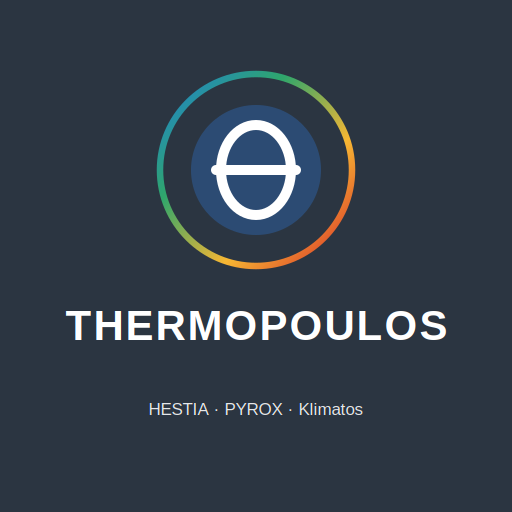

<p align="center"></p>

# Thermopoulos: HESTIA · PYROX · Klimatos

A heat-risk modelling suite for mass-participation events, outdoor work and
heatwaves. It starts from the human body, not from a weather index alone.
One weather pipeline feeds three models:

| Component | Scale | What it does |
|---|---|---|
| **HESTIA** | individual | JOS-3 thermophysiology (pythermalcomfort) plus a cardiovascular module: core temperature, sweat and fluid loss, heart rate, cardiac-output reserve (CO_reserve), exertional heat stroke (EHS) and exhaustion endpoints, personal runner analysis |
| **PYROX** | population | control-theoretic strain dynamics for 23 population groups during heatwaves ([preprint](https://doi.org/10.21203/rs.3.rs-6826369/v1)) |
| **Klimatos** | climate | trends in WBGT, UTCI and related indices over sliding 30-year windows, with HESTIA risk evolution for recurring events |

The suite is developed by **Koos de Boer** (Schagen, NL), a retired
servo/maintenance engineer, independently and non-commercially. Thermoregulation
is treated as a control loop: core temperature is the process variable and the
cardiac-output reserve is the actuator margin.

> **Status: research software. Not validated for operational heat warnings.**
> Read *Known issues* and *Validation* below before using any output for a
> decision about people's safety.

---

## Known issues (October 2026)

These are known, documented and not yet fixed, unless stated otherwise. The
fixes will be made together in one frozen version after the second Thermo
Clinic (18 October 2026), so that both clinics are assessed with the same
version. Full detail is in `TECHNICAL_REFERENCE.md` §8a and
`INTEGRATION_CHANGELOG.md`.

| # | Issue | Effect | Affects |
|---|---|---|---|
| 1 | **JOS-3 activity ratio.** The suite passes MET as JOS-3's `par`. JOS-3 expects a multiple of the person's *own* basal metabolic rate. | Metabolic heat production during exercise is about **24–33 % too low**. | every HESTIA path (events, runner module, Klimatos via HESTIA) |
| 2 | **Core-temperature definition.** T_rect = mean of the 17 JOS-3 core segments + 0.5 °C. | During exercise this partly offsets issue 1. At rest it cools far too much (to about 34 °C after long standing). | every HESTIA path; runs with long rest or waiting periods |
| 3 | **Heart rate responds instantly.** The cardiovascular module (Lloyd et al. 2022) is algebraic. | Model heart-rate time constant about 0.3–0.6 min, against 3–5.6 min measured. After effort, measured heart rate stays well above the model. CO_reserve therefore recovers too fast. | heart rate, CO_reserve, EHS/EHE endpoints |
| 4 | **No terrain or surface factor.** MET is derived from speed as if on a flat road. | Soft sand costs roughly 1.2× more energy when running. The likely explanations for heart rate about 15 /min too low and VO2max 23 % too low at the sand clinic. | runner module, clinic reconstruction |
| 5 | **After-glow too large.** The runner module adds a post-finish core-temperature rise (`PF_DELTA_T_NAGLOED`). | Model rise 0.66 °C against 0.23 °C measured (one clinic, mild weather). | runner module |
| 6 | **Endpoint calibration.** The EHS/collapse intercepts were calibrated on distributions produced *with* issues 1–2. `intercept_estimation.py` is not yet updated to the per-endpoint `REF_CONDITIONS_BY_KEY` structure. | Absolute risk numbers will shift once 1–2 are fixed. Relative comparisons (day vs day, start time vs start time) are more robust than absolute rates. | HESTIA event risk, Klimatos EHS evolution |
| 7 | **Weather archive and coast.** The ERA5 archive (Open-Meteo) lags about 5 days. ERA5(-Land) has a known coastal warm/cold bias of several °C. | Hindcasts within 5 days are incomplete. The Data Engine now asks whether a course is coastal and applies its coastal correction only then. | Data Engine, all hindcasts |
| 8 | **PYROX validation is shape-based.** Validated on the Paris 2003 mortality curve. UK July 2022 is a qualitative shape check only. One published parameter (acclimatisation capacity) was rescaled; see `TECHNICAL_REFERENCE.md` §3.3. | Population results are indicative. | PYROX |

**Recently fixed**
- 2026-10-10: the sweat rate was the mean over the whole history instead of
  the current step (19–28 % too little fluid loss). Fixed suite-wide.
- 2026-10-12: Data Engine crash at the end of daylight saving time, and an
  empty-archive crash.

---

## Validation

### Set-up

HESTIA is being validated against real runners at the **Thermo Clinic** of
**Joost Fonville**. Participants wear a Garmin watch with heart-rate strap and a
**CORE** body-temperature sensor. Body data are provided pseudonymised (codes
only; the key list stays with the Thermo Clinic, raw FIT files stay local).

The approach follows a test procedure:

1. **Pre-registration.** The validation schema, measures and acceptance limits
   (`criteria.json`) are fixed before any data are seen.
2. **Mode A, the real prediction.** The unchanged runner module predicts
   every participant from the weather forecast and body data. It is frozen with
   a timestamp, a SHA-256 of the participant file and a fingerprint of the suite
   files, *before* any FIT file is opened. `clinic_validatie.py` refuses to
   compare without it.
3. **Mode B, the reconstruction.** Minute by minute with the *measured* speed,
   and with archive weather once available, in three pre-registered variants:
   - B1: as the suite;
   - B2: activity ratio corrected;
   - B3: B2 plus the pelvis core as T_rect.
4. **Level and dynamics apart.** `dynamiek.py` fits gain, dead time and time
   constants to model and sensor alike. A slower sensor is then not mistaken
   for a wrong model.

The approach was presented at Radboudumc at the invitation of **Coen Bongers**
and Joost Fonville, with **Jasmijn Lau** (movement scientist) among the
audience.

### Results so far (preliminary)

| | Pilot, 18 Sep 2026 (1 runner) | Thermo Clinic Soestduinen, 11 Oct 2026 (6 runners with valid core data) |
|---|---|---|
| Core temperature, main segment | B3 bias +0.21 °C, RMSE 0.24 °C | B3 bias +0.05 °C, RMSE 0.18 °C |
| Core temperature, whole session | B1 starts far too cold (issue 2) | B3 +0.34 °C too warm; B1 −1.18 °C (issue 2) |
| Peak core temperature | model 38.65 vs sensor 38.66 °C | mode A predicted 38.8 °C, measured 38.4 °C |
| Dynamics | sensor slower: tau 28 vs 19 min, +3 min dead time | sensor lag not replicated |
| Heart rate | tau 5.6 vs 0.6 min | about 15 /min too low; tau about 3 vs 0.3 min |
| VO2max from run | – | 23 % below Garmin (terrain, issue 4) |
| After-glow | – | 0.23 °C measured vs 0.66 °C mode A |
| Fluid loss | – | one runner with post-weight: 0.99 vs 1.08 % |

**How to read this.**
- Small numbers, mild weather, one terrain (loose drift sand).
- Mode B still used the forecast weather; the archive rerun follows.
- The CORE sensor is itself an estimate, not a rectal probe.
- A good core temperature can come from two errors that cancel (issue 1
  against missing terrain cost). It only counts as evidence when core
  temperature, heart rate and fluid loss agree at the same time.
- The group verdict in the schema requires at least 8 runners. Until then,
  results are descriptive.

### Next steps

1. Second clinic on 18 October 2026 with the *same* frozen version
   (`HESTIA-PYROX-Suite-2026-10-10-validatie`):
   - post-weight for everyone;
   - the sensor's ANT+ ID entered on the watch;
   - surface sections (sand or path) recorded.
2. Mode B for both clinics with archive weather.
3. One repair round for issues 1–6, then independent review and a new freeze.
4. Test the new version on fresh data, preferably in warm conditions.

---

## Quick start

Python 3.10 or newer (tested on 3.12), Windows or Linux.

```bash
pip install -r requirements.txt
python verify.py            # PYROX reproduces the paper
python suite_smoke_test.py  # end-to-end check
```

The easiest way in is the start menu. Open `start_thermopoulos.py` in Spyder
and press F5, or run `python start_thermopoulos.py`. It lists every step in the
right order:
- weather (Data Engine);
- PYROX, HESTIA and the runner analysis;
- Klimatos;
- the Thermo Clinic chain (a → b → c → d), which blocks steps that come too
  early;
- the FIT reader and the tests.

Step by step:

```bash
python Thermopoulos_Data_Engine.py          # weather -> Thermopoulos_*.xlsx
python run_pyrox.py                         # population assessment
python run_hestia.py                        # individual / Monte Carlo
python run_loper.py --nieuw mijn_loop.json  # personal runner analysis
python Klimatos_ClimateShift.py             # climate trends (fetches its own weather)
python clinic_validatie.py                  # Thermo Clinic validation
```

```
Thermopoulos_Data_Engine.py ─► Thermopoulos_*.xlsx ─► thermopoulos_loader ─┬─► run_pyrox  ─► PYROX
                                                                            └─► run_hestia ─► HESTIA
Klimatos_ClimateShift.py ─► own weather fetch ─► hestia_bridge ─► HESTIA
```

Some console prompts and the personal reports are in Dutch.

## Documentation

| File | Contents |
|---|---|
| `MANIFEST.md` | every file and what it does |
| `TECHNICAL_REFERENCE.md` | architecture, equations, block diagrams, validation chapter (§8a), abbreviations |
| `INTEGRATION_CHANGELOG.md` | every change, why, and what was found, including errors |
| `CHECKSUMS.txt` | MD5 of the frozen files |
| `docs_word/` | Word versions of the documentation |

## Licence and citation

MIT License; see `LICENSE`.

If you use the suite, please cite the PYROX preprint
(doi:[10.21203/rs.3.rs-6826369/v1](https://doi.org/10.21203/rs.3.rs-6826369/v1))
and mention the version (frozen folder name or `CHECKSUMS.txt`).

## Acknowledgements

- JOS-3 via [pythermalcomfort](https://github.com/CenterForTheBuiltEnvironment/pythermalcomfort)
  (Tartarini & Schiavon).
- Weather from [Open-Meteo](https://open-meteo.com) (ERA5 / ERA5-Land, forecast models).
- Field data: Thermo Clinic (Joost Fonville) and its participants.
