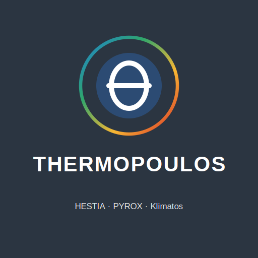

<p align="center"></p>

# Thermopoulos: HESTIA · PYROX · Klimatos

**Release 2026.11.24** · research software · MIT licence

A heat-risk modelling suite for mass-participation events, outdoor work and
heatwaves. It starts from the human body, not from a weather index alone.

| Component | Scale | What it does |
|---|---|---|
| **HESTIA** | individual and event population (runners, or walkers of a Four Days Marches type event), and outdoor workers over a working day | JOS-3 thermophysiology (pythermalcomfort) plus a cardiovascular module: core temperature, sweat and fluid loss, heart rate, cardiac-output reserve (CO_reserve), exertional heat-illness endpoints, a personal runner analysis and a field-validation chain |
| **PYROX** | population groups | control-theoretic heat-strain dynamics for 19 population groups during heatwaves ([preprint](https://doi.org/10.21203/rs.3.rs-8626369/v1)) |
| **Klimatos** | climate | trends in WBGT, UTCI and related indices over sliding 30-year windows, with HESTIA risk evolution for recurring events |
| **Thermopoulos Data Engine** | weather | fetches forecast and archive weather (Open-Meteo) and computes solar position, globe temperature, MRT, wet-bulb, WBGT and UTCI into one Excel format that HESTIA and PYROX read |

The suite is developed independently and non-commercially by **Koos de Boer**,
a retired servo/maintenance engineer. Thermoregulation is treated as a control
loop: core temperature is the process variable and the cardiac-output reserve
is the actuator margin. See *Authorship and the role of AI assistance* below.

> **Status: research software. Not validated for operational heat warnings
> or safety decisions.** Every risk endpoint is *calibrated* on one reference
> event; none is independently validated. Read *Validation status* and
> *Known issues* before using any output in a decision about people's safety.
> Day-of-event decisions belong to the official WBGT protocol and medical staff.

---

## Validation status

| Output | Status | Basis |
|---|---|---|
| Core temperature (HESTIA, JOS-3) | **compared with field data, partly fitted on it** | Thermo Clinics: pilot (1 runner), Soestduinen 11 Oct 2026, Emmen 17 Oct 2026 (CORE sensor). After Emmen two physiologically based corrections were made: the rest core of 37.0 °C (a literature norm, no free parameter) and the fitness/heat scaling of the age effect (literature-based, anchors chosen after the Emmen analysis). Emmen is therefore not an independent test. |
| Heart rate, fluid loss (HESTIA) | compared with field data | same clinics; heart rate depends strongly on knowing the runner's own fitness |
| CO_reserve (cardiovascular reserve) | model (Lloyd et al. 2022), not measured | above zero within the published model's range; below zero an extrapolation |
| Collapse / EHS probability | **calibrated, provisional** | Boston Marathon (Breslow et al. 2021), target 4.5 per 10,000 (author's choice between the pooled 3.7 and a warm-edition estimate) |
| Hospital admission, first aid | **calibrated, provisional** | Dam tot Damloop 2024, data provided by GHOR Noord-Holland Noord and Le Champion (first-aid count is an estimate) |
| Collapse on standing after the finish (EAC) | **calibrated, provisional** | 1.5 per 1000 (Naidoo et al. 2022) on the Dam tot Damloop 2024 reference; no number above WBGT 28 |
| PYROX | shape-validated | Paris 2003 mortality curve (reconstructed weather); UK 2022 qualitative |
| Klimatos trends | descriptive statistics | ERA5 reanalysis via Open-Meteo |

In the collapse score only the intercept is calibrated; the weights that
decide how the risk rises with core temperature, cardiac reserve and
dehydration are the author's expert judgement and have not been tested
against incidence data, so the dependence of the risk on weather is untested.
Absolute risk numbers are uncertain and have shifted by tens of percent between
model versions; reports show them rounded with a calibration band. Relative
comparisons (day against day, start time against start time) are more robust.

### Field comparison: Thermo Clinic Emmen, 17 October 2026

Eleven recreational runners aged 49–67, about 45 minutes at 13–14.5 °C
(WBGT 12–13), Garmin watch and CORE sensor, weighed before and after. Model:
this release, reconstruction with the measured pace and the Data Engine
hindcast.

**Earlier version first.** The suite as it stood on 2026-10-21, before any
change based on these data (the clinic was on 17 October; the model had last
changed on 19–20 October), computed the peak core temperature **1.21 °C too
high** on average (10 runners). This was not a prospective prediction: it was
made after the clinic, but before the model was adjusted to it. The analysis
then made two corrections (`TECHNICAL_REFERENCE.md` §4.1.2–4.1.3; author's
decision), which lowered the median peak error from +1.02 to +0.40 °C (median of the nine runners
evaluated in that analysis of 22–23 October; the table below uses all ten):

1. **Rest core 37.0 °C** (+1.02 → +0.80 °C). JOS-3 computes its rest set
   points as the passive steady state of a nude resting person; for the
   clinic runners that gave 37.2–37.7 °C. 37.0 °C is a literature norm
   (rectal 36.7–37.5 °C, Sund-Levander et al. 2002); no value was tuned on
   Emmen.
2. **Age effect scaled by fitness and heat acclimatisation** (+0.80 →
   +0.40 °C). The principle is from the literature (Kenney; Roberts et al.
   1977), but the anchors (full effect below 80 % of the age norm for
   VO2max, none above 100 %; heat factor 0.5) were chosen after the Emmen
   analysis had shown that a weaker effect fitted better.

Emmen is therefore not an independent test of the current version; the
clinic variant (B3) itself was chosen earlier, on the pilot and Soestduinen.
Model minus measurement with the current release, group level:

| Quantity | n | Mean | 95 % prediction interval |
|---|---|---|---|
| Peak core temperature | 10 | +0.34 °C | −0.3 to +0.9 °C |
| Core temperature, mean during the run | 10 | +0.20 °C | −0.3 to +0.7 °C |
| Heart rate (fitness estimated from the run) | 10 | +0.5 /min | −5 to +6 /min |
| Fluid loss | 11 | +0.09 %-point | −0.8 to +1.0 %-point |
| Chest skin temperature against the CORE skin reading | 10 | −0.9 °C | −4.5 to +2.6 °C |

**Read these numbers with two caveats** (details: `CORE_SENSOR.md`):

- **The reference is itself an estimate.** CORE computes core temperature
  from skin heat flux and heart rate. In studies with running or exercise in
  the heat it reads 0.1–0.5 °C *lower* than an ingestible pill, more so at
  higher core temperature (e.g. Jolicoeur Desroches et al. 2023; Goods et
  al. 2023); in laboratory cycling against a rectal probe it is close to zero
  or slightly high (Verdel et al. 2021; Daanen et al. 2023). If CORE read
  0.3–0.5 °C low in Emmen, the model's peak core is close to the truth at
  group level rather than half a degree high.
- **The model may run warm on cool days.** JOS-3 can let the skin cool too
  much when running in cool weather, which suppresses skin blood flow and
  sweating and raises the core (Known issue 9). In Emmen the model chest skin
  was on average 0.9 °C colder than the CORE skin reading, with a wide spread
  between runners; the skin temperature was not used to tune anything.

Per runner, the model peak follows running speed (heat production per kg,
r = 0.62), as modern thermophysiology predicts (Jay et al. 2011; Cramer &
Jay 2014); the CORE peak follows heart-rate reserve (r = 0.68), which CORE
uses as an input. One cool day, ten runners: the next test must use new
runners, a reference pill for part of them, and preferably a warm day.

---

## Known issues

| # | Issue | Effect |
|---|---|---|
| 1 | **Each risk endpoint rests on one reference event.** | Absolute rates are provisional; use relative comparisons. |
| 2 | **Heart-rate after-glow not modelled.** The cardiovascular module gets a first-order lagged load (tau 3 min), but after a run the measured heart rate stays higher for longer than the model. | Post-finish CO_reserve recovers too fast. |
| 3 | **No terrain or surface factor.** MET is derived from speed as on a flat road. | Soft sand (Soestduinen clinic) costs ~1.2× more energy; heart rate and fitness were underestimated there. |
| 4 | **Age effect fitted on ten trained runners.** JOS-3's ≥ 60 y heat-loss decrement is phased in from 40 to 75 y and scaled down for runners fitter than average and for heat acclimatisation. For unfit older people the effect may still be too small (Larose 2013; Bongers et al. 2014). | Uncertain for groups unlike the Emmen runners. |
| 5 | **Weather archive.** The ERA5 archive lags about 5 days; those hours are filled from the forecast model's recent analyses and get no ERA5 correction. Open-Meteo `shortwave_radiation` is the mean of the *preceding* hour but is stored at the hour stamp (~30 min lag). For ERA5 near water see issue 14. | The last 5 days of a hindcast come from another model; sun about half an hour late. |
| 6 | **Too few very hot runners on cool days.** Model share above 40 °C is ~4–5 % at WBGT ≈ 11; one 15-km race measured 15 % (Veltmeijer 2015). | Absolute numbers on cool days may be too low. A hindcast of Dam tot Damloop 2017–19 is pending. |
| 7 | **PYROX validation is shape-based**; one published parameter was rescaled (`TECHNICAL_REFERENCE.md` §3.3). | Population results are indicative. |
| 8 | **Not modelled:** hypothermia on cold, wet days; gut-barrier and hyponatraemia risks of NSAIDs. | – |
| 9 | **Core too warm when running in cool weather (JOS-3 cold skin).** JOS-3 (validated at rest only) lets the skin cool far below its set point at running intensity, which suppresses skin blood flow and sweating. Below WBGT ≈ 18 (race intensity; ≈ 20 for slow running) the peak core is several tenths too high, 0.6–1.3 °C below WBGT 12. A cold-skin limit exists as a setting (`jos3_leeftijd.COLD_SKIN_LIMIT_K`, off by default) and as clinic variant B4. | Cool-day individual results too warm; warm-event risk results and the calibration are unaffected. |
| 10 | **The field reference (CORE sensor) is itself an estimate.** Expected to read 0.2–0.5 °C low during outdoor running, with ±0.5 °C scatter per reading (`CORE_SENSOR.md`). | Model-minus-CORE differences contain the sensor's error; a pill reference is needed to separate them. |
| 11 | **Radiation simplified.** Globe temperature follows the Liljegren et al. (2008) energy balance with ground at air temperature, a clear-sky atmosphere for long-wave radiation, and no shade. | Hot ground (sand, asphalt) and shaded courses are not represented; long-wave load under cloud slightly low. |
| 12 | **Walkers' population: risk calibrated on running events.** The walkers' option draws age, BMI and VO2max from Four Days Marches data, but the collapse-risk intercepts come from the Boston Marathon and the Dam tot Damloop. Walking speed is the same for everyone (no individual walking pace). | Absolute risk numbers for walking events are more uncertain than for runs; the physiology itself (from the MET of the walk) is the same. |
| 13 | **Maximum skin wettedness not yet tested in humid heat.** The HUTAS limit (0.72 unacclimatised to 1.0 fully acclimatised) caps evaporation; in the humid reference events (Dam tot Damloop 2024, Boston 2017) it raises the population's peak core (share above 40.5 °C about 16 % and 6 %). The only field comparison (Emmen) was cool, where the limit does not bind. | Core results in warm, humid weather for non-acclimatised people rest on HUTAS values not yet checked against measurements; the risk calibration absorbs the shift at the two reference events. |
| 14 | **ERA5 near water and at night; correction only partly validated.** An ERA5-Land cell with sea or lake water has a damped diurnal cycle, and ERA5 is too warm at night inland. Against 26 KNMI stations (May–September 2018–2022, hot days) the hottest hour of the summer (TXx) was 3.5 °C too low at the 8 stations on the water and 1.2 °C too low elsewhere; nights after hot days 1.3–1.4 °C off. Since 2026-11-19 the Data Engine corrects every ERA5 archive dataset with the ERA5 land-sea correction (`era5_kustcorrectie.py`: land cells within 30 km, km of land against the wind, a night rule at the coast, an island term; hot days only); it replaces the provisional 3 °C coastal correction. In the strict test (station and neighbours within 50 km left out of the fit) TXx improved to −1.9 °C at the water (−0.6 °C elsewhere), hot afternoons from 2.0 to 1.35 °C mean absolute error, nights from 1.3 to 1.05 °C (inland 1.4 to 0.6 °C). Near the coast the night error moved between stations rather than disappearing (Stavoren +2.1 °C; Schiphol, inland according to the land-sea mask, −1.4 °C), and narrow islands keep large errors (Vlieland TXx −5.4 °C in the strict test). Fitted on Dutch stations only; a preregistered test on German and Danish stations is planned, and NC State station data are expected in January 2027. Klimatos does not apply the correction (it would need 10,000–30,000 Open-Meteo call units per site) and prints a warning at every run. | HESTIA and PYROX hindcasts at the coast are less favourable than before but may still be too cool at the hottest hour; outside the Netherlands the correction is an extrapolation. Klimatos absolute values next to water (HEAT-Lim hours, event windows) may be too favourable; trends are less affected. Results of hindcasts made before 2026-11-19 change on rerun, inland too (nights after hot days typically 1–1.5 °C cooler). |

`TECHNICAL_REFERENCE.md` §8 and §8a and `CHANGELOG.md` give the full history,
including errors found and fixed.

---

## Installation

Python 3.11 or newer (tested on 3.13), Windows or Linux.

```bash
pip install -r requirements.txt     # exact, tested versions (lock file)
# pyproject.toml lists looser compatible ranges; pythermalcomfort stays ==4.6.2
npm install                          # optional: only for Word (.docx) export of reports (needs Node.js)
```

**pythermalcomfort must be exactly 4.6.2.** `jos3_leeftijd.py` replaces three
JOS-3 functions in memory (the gradual, fitness-scaled age effect) and is
verified only against that version; on any other version the import stops
with an error.

## Tests

```bash
pytest                 # fast test scripts + golden-output check (~2–3 min)
pytest -m slow         # JOS-3 Monte Carlo test scripts (~10 min)
python run_all_tests.py    # the same scripts without pytest, with a summary table
python verify.py           # PYROX reproduces the paper
```

`tests/test_golden.py` re-runs fixed, seeded computations (weather pipelines,
event engine, runner module, clinic reconstruction, calibration reference,
PYROX) and requires every number to equal the frozen calibration version of
2026-11-04 within a relative tolerance of 1e-9, so a refactoring cannot
silently change a result. GitHub Actions runs both test sets
(`.github/workflows/tests.yml`).

## Quick start

**Visual interfaces.** `python thermopoulos_ui.py` opens a start screen with
five windowed interfaces (Tkinter): one runner, an event
population, outdoor workers over a working day, PYROX and Klimatos. They call the same suite functions as the
console scripts and change no calculation (see `MANIFEST.md`). The start
screen opens in Dutch; the British flag switches it, the five interfaces and
the charts and Word reports made from them to English (British English,
decimal point). The calculations are the same in both languages. The
console menu and the reports of the console scripts stay in Dutch. On Linux,
Tkinter may need the system package `python3-tk`.

Start the main menu with `python start_thermopoulos.py` (or open it in
Spyder and press F5). It offers, in Dutch:

| Key | Part | What it does |
|---|---|---|
| 1 | HESTIA | event Monte Carlo (all participants), a personal runner analysis, or a group of known runners sent through a chosen run (what-if, past or next ~16 days) |
| 2 | PYROX | heat strain of population groups during a heatwave |
| 3 | Klimatos | climate trend around a fixed date or event (fetches its own weather) |
| 4 | FIT files | recompute one run from a FIT file with HESTIA, or run a Thermo Clinic (a → d); G = turn an organiser's sign-up list + FIT files into codes automatically |
| 5 | Weather | Data Engine forecast or archive weather, needed for 1, 2 and 4 |
| R | Report | make a report from an earlier calculation |

After every calculation the suite asks whether to make the report now; the
report data are always kept as `*_rapportpakket.pkl` (`rapportpakket.py`), so
choice R can make the report later without recomputing (these are Python
pickles: open only your own). The scripts can also be run directly:

```bash
python Thermopoulos_Data_Engine.py              # weather -> Thermopoulos_*.xlsx
python run_pyrox.py                             # population assessment
python run_hestia.py                            # event Monte Carlo + report
python run_loper.py --voorbeeld voorbeeld.json  # write an example runner file
python run_loper.py voorbeeld.json              # personal runner analysis
python Klimatos_ClimateShift.py                 # climate trends (fetches its own weather)
python fit_loop.py                              # one run from a FIT file, recomputed with HESTIA
python groep_lopers.py                          # a list of known runners through a chosen run (what-if)
python clinic_validatie.py                      # Thermo Clinic validation chain
python hestia_console.py                        # the engine's own interactive console
```

```
Thermopoulos_Data_Engine.py ─► Thermopoulos_*.xlsx ─► thermopoulos_loader ─┬─► run_pyrox  ─► PYROX
                                                                            └─► run_hestia ─► HESTIA
Klimatos_ClimateShift.py ─► own weather fetch ─► hestia_bridge ─► HESTIA
```

**Reproducibility.** Monte Carlo runs use seed 42 unless you give another
seed (type `random` at the prompt for a fresh draw). Each participant gets its
own seed, so results do not depend on the order in which worker processes
finish.

**Programmatic use.** The library functions do not prompt. Examples:
`run_hestia.monte_carlo_adult(...)`, `hestia_loper.analyseer_loper(...)`,
`run_pyrox.assess_population(...)`, `thermal_env.select_city(candidates,
choice=1)`. Prompts live in the console scripts (`hestia_console.py`,
`run_*.py`, `start_thermopoulos.py`, the `main()` functions); set
`HESTIA_NONINTERACTIVE=1` to make the remaining helpers pick defaults.
Saved populations (`*.pkl`) are Python pickles: load only files you made
yourself, never pickles from others (loading can execute code).

**Language.** Documentation is in English. The personal runner report, the
event and clinic reports and several console prompts are in Dutch (the
current users are Dutch event organisers and clinics); some code comments are
in Dutch.

## Documentation

| File | Contents |
|---|---|
| `TECHNICAL_REFERENCE.md` | architecture, equations, calibration, validation chapter (§8a), glossary |
| `CORE_SENSOR.md` | the CORE sensor as field reference: how it works, validation studies, expected error, meaning for the clinics, recommendations |
| `CHANGELOG.md` | changes, reasons and findings, newest first |
| `MANIFEST.md` | every file and what it does |
| `DATA_SOURCES.md` | weather data, field data and their licences |
| `CITATION.cff` | how to cite this software |
| `CHECKSUMS.txt` | SHA-256 of the released files |

## Data and privacy

No personal data are included. Field results appear only at group level.
The Thermo Clinic FIT files and participant lists stay with the clinic and the
author; the FIT reader (`fit_lezer.py`) keeps only an allow-list of fields and
replaces file names (which contain e-mail addresses) by codes.
`aanmelding.py` (menu 4 → G, and automatically in 1 → 3) reads an organiser's
sign-up list as it is, links each FIT file to its runner through the e-mail
address in the file name, gives each runner a code tied to the Garmin set
(Garmin001 → G001), and keeps names and addresses only in a local
`PRIVE_koppeltabel.xlsx` that never enters a report.

## Licence and citation

Code: MIT License (`LICENSE`); the included HEAT-Lim code (`HEATLim.py`) is CC BY 4.0, by Guzman-Echavarria, Vanos et al. (`THIRD_PARTY_LICENSES.md`). The free Open-Meteo API may only be used non-commercially; commercial use of the
weather fetch needs a paid Open-Meteo plan (`DATA_SOURCES.md`). Weather data in the bundled example and test
files are from Open-Meteo (CC BY 4.0), including Copernicus ERA5 reanalysis;
see `DATA_SOURCES.md` for attribution.

Cite as described in `CITATION.cff`, and the PYROX preprint
(doi:[10.21203/rs.3.rs-8626369/v1](https://doi.org/10.21203/rs.3.rs-8626369/v1)).

## Authorship and the role of AI assistance

Thermopoulos is the work of Koos de Boer. The ideas, the modelling approach
and every decision about the code, the calibration, the validation and the
reports are his. The author's own contributions include:

- **Thermoregulation as a servo loop.** Core temperature as the process
  variable and the cardiac-output reserve (CO_reserve) as the actuator
  margin; heat illness as the loss of control when that margin is used up.
  Builds on the classic description of thermoregulation as a control system
  (Hammel 1968; Stolwijk 1971; JOS-3 descends from it through the 65-node
  model of Tanabe's group, which is based on Stolwijk's model); new is the cardiac reserve as the control margin.
- **The conjunctive criterion.** Risk arises when the core is hot *and* the
  heart has no reserve left at the same time, with dose measures (control-
  failure dose, EHE dose) that add up how far and how long both limits are
  crossed, during the run and after the finish. The Physiological Strain
  Index (Moran et al. 1998) already combines core temperature and heart rate
  in one number; here both limits must be crossed at the same time, the
  cardiac reserve replaces heart rate, and duration counts.
- **PYROX.** A control-theoretic model of heat strain in 19 population groups
  during heatwaves, with night-time recovery (preprint
  doi:10.21203/rs.3.rs-8626369/v1). Each group is simulated as 41 members who
  differ in heat tolerance, so the response is graded rather than on/off
  (2026-11-23; tested against the age gradient of Paris 2003, see
  TECHNICAL_REFERENCE.md §3.6).
- **Work mode (HESTIA).** A group of outdoor workers over a working day with a
  work–rest schedule and breaks (ISO 8996 classes or occupations from the 2024
  Compendium), judged against occupational limits (group-mean core
  temperature 38.0/38.5 °C, ACGIH, NIOSH, WBGT against ISO 7243) and checked
  with the PHS model of ISO 7933 (2026-11-24; not yet tested against field
  data, see TECHNICAL_REFERENCE.md §4.6.4).
- **One chain from weather to people.** Coupling the weather pipeline
  (including measured or forecast solar radiation), individual thermophysiology
  (JOS-3) with a cardiovascular reserve model (Lloyd et al. 2022), the event
  population, and the climate trend of a specific event (Klimatos). The parts
  are existing work (JOS-3, Takahashi et al. 2020; Lloyd et al. 2022;
  Open-Meteo); the coupling and its use for events are the author's.
- **Choices in the physiology**, among them the gradual, fitness- and
  heat-scaled age effect, the heart-rate cap with a reserve that may fall below
  zero, collapse risk that counts the post-finish period, and calibration of
  each endpoint on its own reference event with real weather.
- **The scientific grounding.** The author read the relevant literature and
  supplied the articles on which the modelling choices rest.
- **Field validation by design.** Thermo Clinics with CORE sensor and Garmin
  watch, with the model prediction frozen before the measurements are
  compared, and acceptance criteria registered in advance (`criteria.json`).

**Role of Claude.** Claude, an AI assistant made by Anthropic, was used as a
programming and research assistant: writing and revising code on the
author's instructions, running tests, simulations and calibrations, checking
references and looking up additional sources, and drafting documentation and report text. Where
there was a choice to make, Claude set out the options and the author chose;
`CHANGELOG.md` marks these as "Author's decision". All domain choices about the
model, the calibration and the reports were made by the author. Technical
implementation details in the code were proposed and carried out by Claude,
and accepted by the author and checked with tests. The author decided what
was kept and is responsible for the content.

**How quality was guarded.** Code, documentation and report text were
drafted by Claude. The author reviewed and judged them, sent back errors and
wrong assumptions, had the references re-checked (references that did not
support the claim were replaced or removed), and had work reviewed by
independent reviewers, including a second, unrelated AI system; their points
were checked and adopted where justified. Several errors in code, assumptions
and text were found through the author's review rather than by the AI.

References in this section: Hammel HT, Annu Rev Physiol 1968;30:641-710;
Stolwijk JAJ, NASA CR-1855, 1971; Ozeki Y, Takabayashi T, Tanabe S, SAE
Technical Paper 2002-01-0515; Moran DS, Shitzer A, Pandolf KB, Am J
Physiol 1998;275:R129-R134; Takahashi Y et al., Energy Build 2020,
doi:10.1016/j.enbuild.2020.110575; Lloyd A et al., J Appl Physiol
2022;133:247-261.

## Acknowledgements

- Liveability and survivability: ASU/USYD Human/Environmental Adaptation and
  Threshold Limits Model (HEAT-Lim), Guzman-Echavarria, Vanos et al.
  ([doi:10.5281/zenodo.15642387](https://doi.org/10.5281/zenodo.15642387)), CC BY 4.0.
- JOS-3 via [pythermalcomfort](https://github.com/CenterForTheBuiltEnvironment/pythermalcomfort)
  (Tartarini & Schiavon).
- Weather data by [Open-Meteo.com](https://open-meteo.com) (ERA5 / ERA5-Land
  reanalysis from Copernicus, and national forecast models).
- Incident data for the Dam tot Damloop 2024 provided by GHOR Noord-Holland
  Noord and Le Champion.
- Field data: the Thermo Clinic and its participants; clinical advice from
  Radboudumc.
