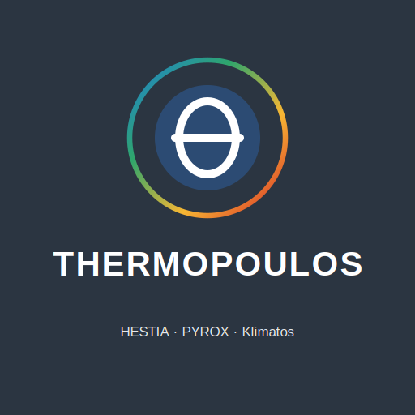
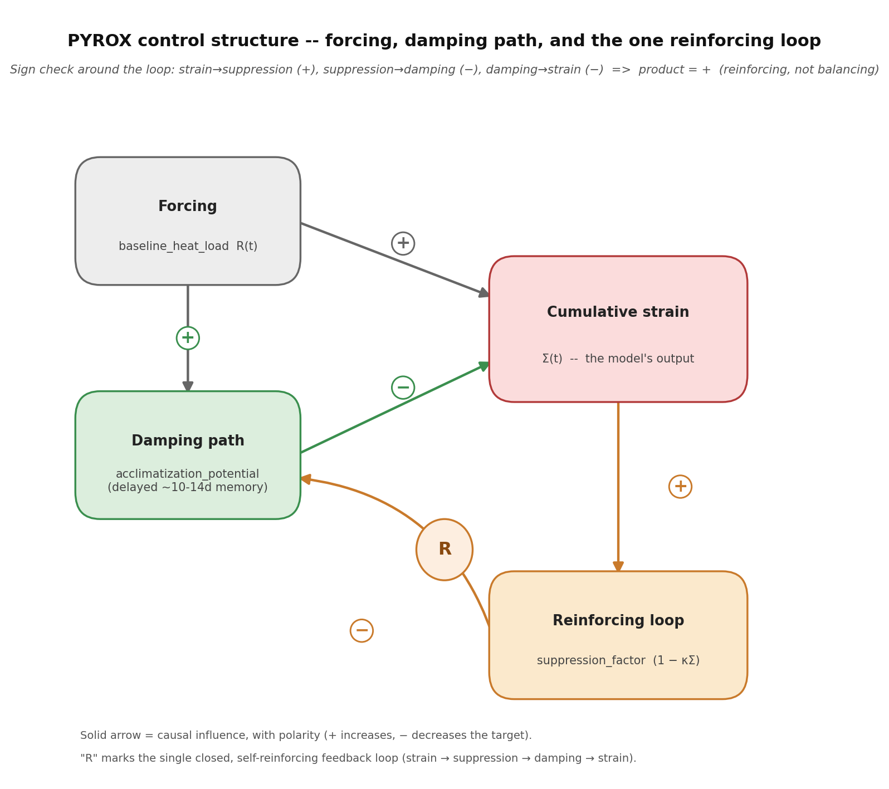
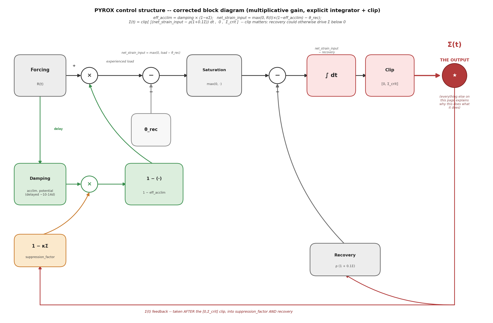
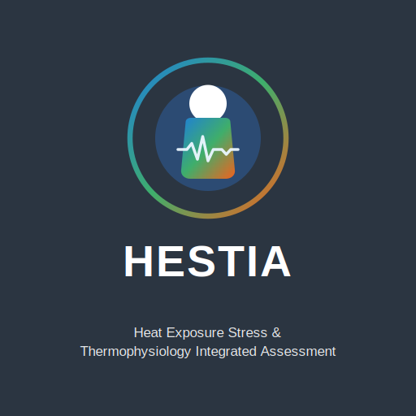
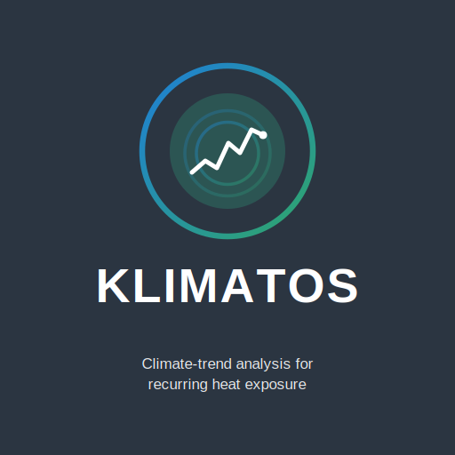

{width=1.8in}

# Technical Reference — HESTIA–PYROX–Klimatos Suite

*Reference for release 2026.10.27. First written 2026-08-30 from the
codebase itself and kept up to date since: every equation, threshold and
citation below was checked against the source rather than reconstructed from
memory. Where a value could not be verified, that is stated. Dated notes such
as "[2026-10-19]" record when a part changed; `CHANGELOG.md` has the full
history.*

**Release 2026.10.27.** Adds to 2026.10.25: Klimatos liveability floor and hours-per-year projection (§5.9), and the JOS-3 cold-skin limit as a setting, off by default (§8.x); model results with default settings are unchanged.

**Release 2026.10.25 in brief.** Model results are identical to the frozen
calibration version of 2026-10-24 (golden-output test, `tests/test_golden.py`).
The release merged the duplicated weather physics into `thermal_env.py`,
moved the interactive console out of `hestia_model.py`
(`hestia_console.py`, `hestia_model_plots.py`), removed prompts from library
code, fixed seed 42 as the default at the entry points, pinned
pythermalcomfort to 4.6.2 (§4.1.1) and rounds absolute probabilities in
reports. Validation status per output: README.md, *Validation status*;
field comparisons: §8a, *Thermo Clinic results*.

---

## 1. Purpose and scope

This suite answers three related but distinct questions about heat risk for
outdoor endurance events and heat exposure more broadly:

1. **PYROX** — *"How does accumulated heat strain evolve over a multi-day
   heatwave, for a given population group?"* A control-theoretic dynamical
   model (not a physiological simulation) operating on a scalar heat-load
   signal, built around a single reinforcing feedback loop
   [2026-09: corrected from an earlier "two competing loops" description --
   see section 3.1].
2. **HESTIA** — *"What happens physiologically to an individual runner (or a
   Monte Carlo population of them) during and after a specific race, given
   the weather?"* A minute-by-minute thermophysiological simulation (JOS-3 +
   a cardiovascular response module) producing core temperature, cardiac
   output reserve, and dose-based risk endpoints per participant.
3. **Klimatos.ClimateShift** — *"Is a recurring event's fixed calendar slot
   becoming systematically riskier as the climate changes, by how much, and
   what does a specific intervention (earlier start time) buy back?"* A
   climate-trend tool built on real historical reanalysis data, feeding
   HESTIA's own machinery to project EHS/EHE/collapse-risk forward.

None of the three replaces day-of-event decision-making (WBGT flag systems,
on-site medical judgement). All three are explicitly analysis/planning tools,
not real-time safety systems — see §9 for what each is not validated to do.

---

## 2. Architecture overview

```
                          ┌─────────────────────────────┐
                          │  Thermopoulos_Data_Engine.py │  (fetch + physics chain:
                          │  (Open-Meteo: forecast/      │   solar position, globe
                          │   archive/geocoding)         │   temp, MRT, WBT, WBGT,
                          └───────────────┬──────────────┘   UTCI)
                                          │
                                          ▼
                          Thermopoulos_*.xlsx (on disk)
                                          │
                                          ▼
                          ┌─────────────────────────────┐
                          │     thermopoulos_loader.py    │  (shared loader)
                          └──────┬───────────────┬────────┘
                                 │               │
                    ┌────────────▼───┐   ┌───────▼────────────┐
                    │  run_pyrox.py   │   │   run_hestia.py     │
                    │  → PYROX        │   │   → HESTIA adapter  │
                    │  (population,   │   │   (individual +     │
                    │   23 groups)    │   │    Monte Carlo)      │
                    └─────────────────┘   └──────────┬──────────┘
                                                      │
                                        hestia_model.py (shared core)
                                        HESTIA_CVR_Module_v2.py
                                        HESTIA_ControlFailure_Module.py
                                        individual_engine.py (EHS/EHE/EAC)


          ┌───────────────────────────────────────────────────────┐
          │              Klimatos_ClimateShift.py                  │
          │  (own weather fetch — ERA5 archive + KNMI/ECMWF        │
          │   forecast — independent of Thermopoulos_Data_Engine)  │
          └───────────────────────┬─────────────────────────────────┘
                                  │
                    klimatos_ehs_worker.py (parallel, per scenario-year)
                                  │
                          hestia_bridge.py
                                  │
                    hestia_model.run_monte_carlo_adult()
                    (SAME shared core as run_hestia.py above)
```

Klimatos shares the underlying physiological engine with HESTIA
(`hestia_model.py`, `HESTIA_CVR_Module_v2.py`) but has its own, independent
weather-fetch path and its own entry point. It is designed to keep working
with zero HESTIA/PYROX files present (`HESTIA_AVAILABLE` flag degrades
gracefully) — see `Klimatos_ClimateShift.py`'s own import-guard near the top
of the file. Since 2026-10-25 Klimatos and the Data Engine share
`thermal_env.py` (outdoor radiant physics, wind profile, UHI, geocoding), so
Klimatos needs that one file next to it.

### 2.0 Module map (release 2026.10.27)

| Layer | Modules |
|---|---|
| Weather | `Thermopoulos_Data_Engine.py` (fetch + thermal indices), `thermal_env.py` (shared physics and geocoding), `thermopoulos_loader.py` (reads the Excel format) |
| HESTIA core | `hestia_model.py` (JOS-3 setup, population, Monte Carlo, post-finish, collapse endpoints), `jos3_leeftijd.py` (age effect, patches JOS-3 in memory), `HESTIA_CVR_Module_v2.py` (cardiovascular response), `HESTIA_ControlFailure_Module.py` (TCF dose) |
| HESTIA entry points | `run_hestia.py` (event Monte Carlo + report), `hestia_console.py` (the engine's own console), `hestia_model_plots.py` (console figures), `individual_engine.py` / `hestia_loper.py` / `run_loper.py` (one runner), `hestia_bridge.py` (Klimatos and app adapter), `intercept_estimation.py` (endpoint calibration) |
| Field validation | `fit_lezer.py`, `clinic_invoer.py`, `inspanning_uit_fit.py`, `hestia_reconstructie.py`, `dynamiek.py`, `clinic_validatie.py`, `clinic_rapport.py`, `criteria.json`, `fit_loop.py` (one run, no pre-registration), `groep_lopers.py` (known runners through a chosen run), `aanmelding.py` (sign-up list + FIT files to codes) |
| PYROX | `pyrox_model.py`, `pyrox_groups.py`, `run_pyrox.py`, `pyrox_plots.py`, `paris2003.py`, `verify.py` |
| Klimatos | `Klimatos_ClimateShift.py`, `klimatos_ehs_worker.py`, `HEATLim.py` |
| Reports | `generate_event_report.py`, `generate_klimatos_report.py`, `generate_recommendation_report.py`, `generate_pyrox_report.py`, `hestia_loper_rapport.py`, `report_to_docx.py` + `build_report_docx.js` (Word, needs `npm install`) |
| Menu and tests | `start_thermopoulos.py` (main menu), `rapportpakket.py` (report later), `run_all_tests.py`, `tests/` (pytest), `test_*.py`, `suite_smoke_test.py` |


### 2.1 Why `hestia_bridge.py` exists as a separate file

`hestia_bridge.py` is a **de-Streamlit-ified** analysis layer. A parallel,
Streamlit-UI-based branch of this suite (five `app_*.py` files, since
retired for being too slow to run) had its own version of this file using
`@st.cache_data` for UI responsiveness. This suite's copy has that decorator
removed (a worker process evaluating one weather-scenario-year has nothing
to cache against) but is otherwise the same analysis layer: the Falmouth
epidemiological regression, true-EHE/clinical-criterion detection from raw
simulation output, and the margin-to-threshold calculation. It is named
`hestia_bridge.py` — not something else — because `individual_engine.py`
imports several names from it by that exact module name.

### 2.2 Three report generators, two philosophies

| Generator | Produces | Contains recommendations? |
|---|---|---|
| `generate_event_report.py` | Fixed-template report for one HESTIA Monte Carlo run | **No** — facts only |
| `generate_klimatos_report.py` | Fixed-template report for one Klimatos climate-trend run | **No** — facts only |
| `generate_recommendation_report.py` | Advisory report on timing interventions (start time, season/date) for a specific event | **Yes**, explicitly labelled as such |

All three deliberately produce **Dutch-language** report text (the intended
audience is Dutch stakeholders — GHOR, event organisers) even though the
underlying code is English. This is not a translation gap.

### 2.3 Wind profile, terrain, and event distance (shared plumbing)

[2026-09] `Thermopoulos_Data_Engine.py`'s `wind_speed_at_height()`
(logarithmic 10m→1.5m wind-profile correction) divides by
`ln(z_target/z0)`. `ROUGHNESS_Z0_TERRAIN`'s "Stedelijk/binnenstad"
(dense-urban) option had `z0=1.5` — identical to the 1.5m target height
used everywhere in this suite — so `ln(1.5/1.5)=ln(1)=0` and that terrain
choice silently returned exactly 0 m/s regardless of the true wind speed;
the function only guarded `z0<=0`, not `z0>=z_target`. Fixed two ways:
the function now explicitly rejects `z0>=z_target` (and `z0>=z_ref`),
falling back to the reference wind with a warning instead of a silent
zero; and the "Stedelijk/binnenstad" value itself was lowered to `z0=1.2`
so it no longer sits on that boundary at all.

Event distance was previously hardcoded or inconsistent in three separate
places — `hestia_model.py`'s `validate_population()` always checked
against the marathon distance regardless of what was actually simulated;
`Klimatos_ClimateShift.py` had a fixed 16.1 km (Dam tot Damloop) with no
console entry point; `run_hestia.py` asked for a duration with no link to
distance or pace at all. All three now expose an explicit,
console-adjustable `event_dist_km` (default 16.1 km, matching the
suite's most common use case, but not hardcoded to it): `validate_
population(event_dist_km=...)` scales its expected finish-time bounds
proportionally and treats the pass/fail gate as informational for
non-marathon distances (so a legitimately different event is never
reported as a validation "FAIL" against marathon-shaped expectations);
`run_hestia.py` derives its duration prompt's default from distance ×
the chosen activity's own pace instead of an unrelated fixed number; see
§4.6 for how `event_dist_km` also now drives HESTIA's per-person
`sample_pace` distribution via Riegel scaling, and §5.7 for the same
distance parameter in Klimatos.

---

## 3. PYROX — population strain dynamics

{width=1.3in}

### 3.1 Theoretical basis

PYROX is a **control-theoretic**, not physiological, model: a scalar
`cumulative_strain` (Σ) state variable per population group. [2026-09:
corrected below -- this was previously described as "two competing
feedback loops"; verified against the model's own paper abstract
(doi:10.21203/rs.3.rs-8626369/v1), which describes "a closed loop"
(singular), and against the equations in the paper's methods section,
which match `equilibrium_strain()`/`feedback_gain()` in `pyrox_model.py`
exactly, including the 0.1 coefficient (`HOMEOSTATIC_DRIVE_COEFFICIENT`).
See `pyrox_model.py`'s own module docstring for the full plain-language
account, reproduced in summary here.]



*Block diagram, [2026-09]. Solid arrows are causal influences with an
explicit polarity (+ increases, − decreases the target variable). Forcing
(external heat exposure) has two effects: directly on cumulative strain,
and — with an ~10-14 day delay — on the damping path (acclimatization).
The damping path itself closes no loop; it is a straight-through
inhibitory effect driven by forcing, not by strain. The single closed
loop runs strain → suppression_factor (+) → damping path's effective
output (−) → strain (−); the product of those three signs is positive,
i.e. reinforcing (marked "R"), not balancing. This is the same structure
implemented in `pyrox_plots.py`'s `plot_feedback_race()` and derived
analytically in `equilibrium_strain()`/`feedback_gain()` below.*

A second, equivalent view, in classical control-block-diagram form
(summing/multiplying junctions and an explicit integrator), for readers
who find that notation more direct:



*Block diagram, [2026-09], second form. The two junctions on the damping
path are multiplications, not sums — `eff_acclim = damping × (1 − κΣ)`,
then `1 − eff_acclim` — a parameter-varying gain on the forcing path, not
a linear subtraction. `θ_rec` is subtracted BEFORE the `max(0, ·)`
saturation (it gates whether strain accumulates at all); `ρ(1+0.1Σ)`
recovery is subtracted AFTER saturation, outside the max() (recovery is
not gated the same way input is). The integrator's output is explicitly
clipped to `[0, Σ_crit]` — without this, the diagram would imply recovery
could drive Σ arbitrarily far below zero, which the code does not permit
(`np.clip(updated, 0.0, critical_strain)`); the Σ(t) feedback into
`suppression_factor` and `Recovery` is taken from after this clip, not
from the raw integrator output. The output itself — Σ(t), what the whole
model is ultimately for — is marked with a filled star, not just a bare
arrow-end, since a non-specialist reader could otherwise reasonably ask
"so which of these boxes is the actual answer?" This closes the one
reinforcing loop shown as the "R" marker in the first diagram above.*

**Block-by-block glossary** (applies to both diagrams above — the causal
labels on the left match the first diagram's box names; the code/paper
symbols on the right match the second):

| Block | Plain-language meaning |
|---|---|
| **Forcing** / `R(t)` | Today's external heat exposure (`baseline_heat_load`) — the only input the model doesn't compute itself; it comes from the weather pipeline. |
| **Damping path** / `acclimatization_potential` | How much protective adaptation the group has built up from *past* exposure. Driven by an ~10-14 day memory of prior days' forcing (a FIR kernel), not by today's forcing directly — this is the delay that lets a heatwave "outrun" the body's adjustment early on. |
| **1 − κΣ** / `suppression_factor` | The gate that closes the one reinforcing loop. Starts at 1 (full protective benefit available) and shrinks toward 0 as cumulative strain Σ rises — at Σ = critical_strain it reaches exactly 0, cancelling the damping path's benefit entirely regardless of how much adaptation has built up. |
| **× (damping path)** | Combines the two above: `eff_acclim = damping × suppression_factor`. Multiplicative, not additive — a large damping potential is worth nothing if the gate has already closed. |
| **1 − (·)** | `1 − eff_acclim` — turns "how much protection is left" into "what fraction of the load still gets through." |
| **× (main path)** | `R(t) × (1 − eff_acclim)` — today's forcing, reduced by whatever fraction of it the (possibly suppressed) damping path absorbs. This is the "experienced load" — what the group actually has to deal with today, as opposed to the raw weather. |
| **θ_rec** / `recovery_threshold` | A floor, not a signal that varies over time: below this experienced load, nothing accumulates at all — the group can fully handle that much load on an ordinary day. |
| **Saturation** / `max(0, ·)` | Only load *above* θ_rec ever counts toward strain; this block discards the (necessarily non-negative, since it's already past a subtraction) rest, giving `net_strain_input`. |
| **Recovery** / `ρ(1 + 0.1Σ)` | Strain the group clears today regardless of today's weather — driven by rest/sleep, not exposure. Rises slightly with existing strain (`0.1Σ` term): a body under more strain works a little harder to recover, but not enough to outpace a reinforcing loop already in motion. |
| **∫ dt** | The accumulator: today's cumulative strain is yesterday's plus today's net change (`net_strain_input − Recovery`). This is the model's memory of everything that has happened so far in the heatwave. |
| **Clip** / `[0, Σ_crit]` | Strain can't go below 0 (there's no such thing as "negative heat strain") and is capped at `critical_strain` (beyond that point the group is defined as being in runaway decompensation — see §3.4). |
| **Σ(t) — the output** | Cumulative strain: the one number this entire model exists to produce. Everything else on the page explains how it gets there, and it alone feeds back into `suppression_factor` and `Recovery` above — the mechanism that makes this a dynamical system rather than a one-shot calculation. |


- **Damping path (acclimatization)**, not a loop on its own: repeated heat
  exposure builds short-term adaptation, which lowers the *experienced*
  load. This path has a start-up delay — adaptation is driven by an
  ~10-14 day exposure memory (Périard, Racinais & Sawka 2015), so it
  cannot act on day one of a heatwave. It is driven by the external
  forcing, not by strain, so on its own it does not close a loop.
- **The one reinforcing loop**: once load exceeds a group-specific
  `recovery_threshold`, strain accumulates. Rising strain then *erodes the
  net protective benefit* of acclimatization via a coupling term
  `(1 - kappa * Sigma)` — an effective description of the net outcome, not a
  claim about a specific physiological blocking mechanism. Tracing the
  polarity around this cycle (strain -> suppression: +; suppression ->
  effective acclimatization: -; acclimatization -> strain: -) gives a
  positive product: a single, self-reinforcing loop, not two loops in a
  race.

Because the damping path starts late and the one reinforcing loop acts
from day one, the outcome depends on which gets ahead first: under mild
load, damping gets ahead before the loop can bite, and strain stabilises
(an `equilibrium_strain` exists below critical); under severe load, the
reinforcing loop overtakes the damping path before it can engage, net
protection collapses to zero, and the system "runs away" to
`critical_strain` regardless of starting point (no equilibrium exists —
see `equilibrium_strain()`'s three-way "safe"/"equilibrium"/"runaway"
result). The critical strain level is not a tuned threshold — it falls
out of the algebra of the suppression term.

**Reference**: de Boer, K. (2026). "A Control-Theoretic Framework for
Dynamic Heat Risk Assessment: Modeling Acclimatization, Cumulative Strain,
and Stability Thresholds During Multi-Day Heat Exposure." Research Square.
https://doi.org/10.21203/rs.3.rs-8626369/v1

### 3.2 Symbol reference (paper notation → code name)

| Paper | Code | Meaning |
|---|---|---|
| R1 | `baseline_heat_load` | Tier-1 input |
| R2 | `final_risk` | Tier-3 output |
| α | `acclimatization` | current adaptation level |
| α_max | `max_acclimatization_capacity` | group-specific ceiling |
| Σ | `cumulative_strain` | the state variable |
| Σ_crit | `critical_strain` | runaway threshold (derived, not tuned) |
| κ | `strain_suppression_strength` | net-protection erosion rate |
| θ_rec | `recovery_threshold` | load above which strain accumulates |
| ρ | `base_recovery_rate` | |
| γ | `strain_amplification` | |
| u(t) | `exposure_signal` | |
| s(t) | `acclimatization_stimulus` | |
| h[k] | `exposure_memory_weights` | FIR kernel over ~10-14 days |
| Δ | `net_strain_input` | |

### 3.3 The 23 population groups, and what changed 2026-08

`pyrox_groups.py` defines 23 demographic/occupational groups (age bands,
outdoor workers by exertion level, endurance athletes, and others), each
with its own `recovery_threshold`, `max_acclimatization_capacity`,
`base_recovery_rate`. Three real defects were found and fixed (2026-08,
prior to this suite's own 2026-08-29 merge — see
CHANGELOG.md for the full provenance):

1. **Resilience double-counted**: `recovery_threshold` was evaluated *after*
   acclimatization's load reduction was applied, making the *effective* flip
   load `recovery_threshold / (1 - max_acclimatization_capacity)` rather
   than the threshold alone. Outdoor workers, for example, had an effective
   tolerance far above any achievable weather load.
2. **Unreachable thresholds**: several groups had raw `recovery_threshold`
   values exceeding any load the model could ever produce, meaning strain
   could structurally never accumulate for them regardless of real-world
   plausibility.
3. **Endurance athletes had `max_acclimatization_capacity = 1.00`** —
   literal, complete immunity to heat, not a physiologically defensible
   claim.

**[2026-09] Correction to the paragraph below**: this snapshot's own
"verified: zero of 23 groups" claim, made after the August 2026 fix, is no
longer accurate — `endurance_athletes` currently has
`max_acclimatization_capacity = 1.00` again. A later review (documented in
`pyrox_groups.py`'s own extensive comment block at that group's
definition) re-confirmed this value deliberately, on the grounds that
empirical elite-sport EHS incidence is very low, consistent with a
capacity in the 0.95–1.00 range. That empirical grounding is reasonable,
but the specific value 1.00 was not re-checked against what the value
*mathematically forces*: `net_strain_input`'s flip point is
`recovery_threshold / (1 - capacity)`, undefined (division by zero) at
capacity=1.00 — meaning this group cannot accumulate ANY strain at ANY
load, by construction, not merely "rarely." Checked against the weather
pipeline's own achievable load ceiling
(`daily_weather_to_heat_load()`, `thermopoulos_loader.py`: load =
(feels-like − 22°C) × 0.10, giving a realistic Dutch/European maximum
around 2.3–2.8): `outdoor_workers`, `recreational_athletes`, and
`elite_athletes` have the same structural problem at a finite but still
unreachable flip point (8.5, 12.0, and 40.0 respectively, all far above
the ~3.0 pipeline ceiling) — confirmed via `plot_three_regimes()`
(§3.4 below): these three groups show **zero runaway occurrences across
123 tested load values up to R1=2.5**, not because runaway is rare for
them, but because it is unreachable given how this pipeline generates
`baseline_heat_load`. Not yet fixed in `pyrox_groups.py` itself — flagged
here since the "verified: zero of 23 groups" claim otherwise overstates
what was actually re-confirmed as still true.

Verified in this snapshot (historically, at the time of the August fix):
zero of the 23 groups had
`max_acclimatization_capacity = 1.0` (`verify.py`'s own "matches the
corrected paper" check exercises this against the then-current values;
it has not been re-run against the current `endurance_athletes` value).

**[2026-09, resolved]** All four groups named above were recalibrated
this session. Grounded in a literature finding that reframes the whole
premise: endurance athletes have the *highest* exertional heat illness
incidence of any sport studied (674 per 10,000 athlete-exposures —
Périard, DeGroot & Jay 2022, PMC9826288), not the lowest — the "very-low-
incidence... well supported" reasoning in the August review above was
based on an incomplete reading of the literature (population-wide base
rates, not the per-athlete-exposure or per-finisher rates that actually
describe this group). Checked against real-world extremes, not just the
pipeline's own typical range: the highest heat index ever confirmed on
Earth is 81.1°C (Dhahran, Saudi Arabia, 2003) — `outdoor_workers` alone
required 107°C, `endurance_athletes` required an infinite temperature at
any load. Recalibrated (capacity lowered, `endurance_athletes` no longer
at the literal 1.00 ceiling), preserving the relative resistance ordering
(endurance > elite > recreational > outdoor_workers) while bringing every
threshold to a finite, empirically-verified (via `equilibrium_strain()`
bisection, not the flip-point formula alone — see the note on why they
differ, next to the code itself) value: 68.5°C (outdoor_workers), 77.0°C
(recreational_athletes), 80.5°C (elite_athletes, just under the confirmed
record), 97.0°C (endurance_athletes, deliberately left as the single most
resistant group in the 23-group taxonomy, above the confirmed record but
not absurdly so). Full account, including the broader pattern this
exposed (`adults_18_45` and three other groups share the same structural
issue, not yet addressed), in `CHANGELOG.md`'s final
2026-09-11 entry.

**[2026-09, follow-up] All 23 groups checked, not only the four above.**
The same empirical method applied to every group: **20 of 23 were already
plausible** (within the confirmed 81.1°C world record) as a direct
consequence of the four-group fix above. Three borderline cases remained:
`youth_10_18` (84.5°C), `endurance_athletes` (97.5°C, already deliberately
positioned as the most extreme of the 23, not touched again), and
`adults_18_45` (112.0°C). `youth_10_18` was corrected (capacity
0.72→0.68, threshold unchanged) — empirically verified at 77.0°C after
the fix, without reversing the literature this group's parameters are
otherwise grounded in (adolescent thermoregulation is not meaningfully
inferior to adults' — Falk & Dotan 2008). **`adults_18_45` was
deliberately left unchanged**: it is one of only three groups with
`evidence="paper"` status, its values taken directly from the paper's
own Section 2.3 (already once corrected for a printed-table transposition
error). Changing it without the author's sign-off would create an
inconsistency with the published source itself — a different and more
serious problem than the "illustrative, not validated" groups this
session otherwise recalibrated. Final state: 21/23 groups within the
confirmed real-world range; the remaining two are a deliberate design
choice (`endurance_athletes`) and a paper-constrained value awaiting an
explicit decision (`adults_18_45`), not oversights.

**Important labelling note, stated directly in the source**: the majority of
these 23 groups (per the code's own comments) are *"illustrative, not
validated, do not cite as empirical values"* — parameter values are
physiological-plausibility estimates, not measured constants. Only the
overall dual-loop *structure* (validated against the 2003 French heatwave's
age-graded, cumulative excess-mortality pattern — Fouillet et al. 2006) has
a direct empirical anchor.

**[2026-09] Console group selection**: `run_pyrox.py`'s `main()` previously
always assessed all 23 groups with no way to pick a subset from the
console, even though `assess_population()` itself already accepted a
`group_names` argument (used programmatically by `generate_event_
report.py`). A new `_select_groups()` prompt lists all 23 (marking the
three paper-specified ones and each group's `evidence_status`) and
accepts comma-separated numbers, `all`, or blank (falls back to the three
paper groups — the previous programmatic default).

### 3.4 The three-regime plot and `equilibrium_strain()`'s safe/equilibrium/runaway result

[2026-09] `equilibrium_strain()` (bisection for the steady-state strain at
a constant load) previously returned a bare `Optional[float]`: `None`
whenever `daily_change(strain)` had the same sign at both ends of
`[0, critical_strain]` — but that happens in two opposite situations that
were indistinguishable to any caller: `daily_change` negative throughout
(strain always decays to 0 — **safe**) and `daily_change` positive
throughout (strain always grows to `critical_strain` — **runaway**, the
case the function's old docstring's "None = runaway" was describing,
incorrectly, for both). Now returns `(state, value)` with `state` one of
`"safe"` / `"equilibrium"` / `"runaway"`.

`plot_three_regimes()` (previously a brute-force 80-day-simulation
approximation of the steady state, edge-detected via a `> 0.9 ×
critical_strain` heuristic that mislabelled any group with a genuine
but sub-90%-of-critical equilibrium as still "dead-zone safe") now calls
`equilibrium_strain()` directly — exact rather than approximated, and
much faster (bisection vs. simulating 80 days per tested load). When no
runaway state occurs anywhere in the tested load range (the
`outdoor_workers`/`elite_athletes` case described in §3.3 above), the
plot now says so explicitly instead of drawing a red "runaway" zone
starting at the edge of the tested range, which would otherwise imply
that edge is a real transition point rather than simply where testing
stopped.

---

### 3.5 Nocturnal recovery and its timing [2026-10-17]

PYROX's day *d* is that day's exposure followed by that night's recovery
(`advance_one_day`: Σ ← Σ + input(d) − recovery(q[d])). The optional
sleep-quality factor q[d] = `night_sleep_quality(T_night)` (1.0 at ≤ 18 °C,
linear to 0.4 at ≥ 26 °C) must therefore use the night AFTER day *d*.
`get_daily_heat_loads()` now returns `t_night_min`, the minimum of the urban
air temperature over 18:00 day *d* → 08:00 day *d*+1 (local); a day whose
next night is not in the sheet falls back to its own calendar minimum.
Before 2026-10-17 the calendar-day minimum was used, which mostly falls in the
early morning of day *d* — the night before, one day too early.

Use: **ON by default** in `assess_population()` and in every PYROX report
plot (author's decision, 2026-10-17: the night always counts; there is no
off-switch in the console). Report section 2b lists the night minimum and
sleep quality per day. `use_nocturnal_recovery=False` is kept only for
checking against the paper (`verify.py`; the conceptual three-regime plot
uses constant loads and full recovery).

Paris 2003 check (`paris2003.py` now carries the measured Paris-Montsouris
Tmin, 1–20 Aug; record 25.5 °C on 11 and 12 Aug):

| Group | Emergency day off → on | Critical day off → on | Corr. with excess deaths |
|---|---|---|---|
| 65–85 y | 9 → 8 | 10 → 9 | 0.83 → 0.83 |
| 85+ | 5 → 5 | 5 → 5 | 0.67 → 0.66 |

The shape barely changes because Σ saturates at Σ_critical (the paper's
clip) within the plateau; the earlier crossing for 65–85 y matches the
"~1 day earlier" found for Maastricht. Made the default on 2026-10-17
(author). The Paris validation plot now shows it as the solid line, the
paper's full-recovery assumption dashed. Side findings: the Paris validation plot drew every strain
value one day late (x = index + 1; fixed), and the PYROX report said the
emergency zone starts at 95 % of Σ_critical while the code uses 90 % (text
fixed). The reconstructed Paris Tmax (`PARIS_2003_TMAX`) runs 1–5 °C below
the measured Montsouris maxima on several days; the bridge was calibrated on
the reconstructed series, which is kept.

## 4. HESTIA — individual thermophysiology

{width=1.3in}

### 4.1 JOS-3

HESTIA's thermal engine is JOS-3 (Takahashi et al. 2021), a 17-segment
multi-node human thermoregulation model computing core/skin temperatures,
sweat rate, and blood flow redistribution from ambient conditions, activity
level (MET), and clothing insulation (`clo_value`).

**Known calibration history (relevant to trusting any specific number)**:
`clo_value` was for a period hardcoded at 0.5 (light indoor clothing)
instead of 0.2 (typical warm-weather running kit) — correcting this dropped
median simulated peak race-phase core temperature from 41.4°C to 40.0°C and
the fraction exceeding the clinical EHS threshold from 93% to 8%, checked
against Veltmeijer et al. (2015, J Sci Med Sport 18:333–337) Zevenheuvelenloop field data (mean T_rect
39.2°C, 15% ≥40°C at WBGT 11°C). This fix is present in this snapshot.

#### 4.1.1 Age in JOS-3 — gradual instead of a step [2026-10-16]

JOS-3 lowers heat loss with age in steps: the sweat signal (×0.40–0.75 per
segment) and skin vasodilation (×0.31–0.91) from exactly 60 y, and the
cardiac index (×1.00/0.85/0.75/0.70) for <50/50s/60s/≥70 y. At marathon
effort this gives +1.0 °C T_rect between 59 and 60 y. `jos3_leeftijd.py`
replaces the steps by linear transitions — sweat/vasodilation factor
1 − w(age)(1 − f_JOS3) with w = 0 at ≤40 y and 1 at ≥75 y; cardiac index
interpolated through the group mid-points — keeping JOS-3's magnitude.
Onset follows Larose et al. (2013), the full value lies between the two
groups of Bongers et al. (2014). Known limitation: the effect is probably
too small at 40–55 y and above 75 y. See CHANGELOG.md
2026-10-16. [2026-10-23] For trained runners it proved too large; it is now
scaled by fitness and heat acclimatisation (§4.1.3).

#### 4.1.2 Rest core 37.0 °C [2026-10-23, author's decision]

JOS-3's set points are the passive steady state of a nude person at the
operative temperature where PMV = 0, at 1.25 × BMR, without regulation
(`models/jos3.py`, `_reset_setpt`). That is a computed rest state, not a
measured one. For the nine evaluable ThermoClinic runners (Emmen, 17 Oct
2026) it put the pelvis core at rest at 37.2–37.7 °C. The CORE read 36.8–37.0 °C.
Rectal norms are 36.7–37.5 °C for men and 36.8–37.1 °C for women
(Sund-Levander et al. 2002, Scand J Caring Sci 16:122).

`maak_jos3()` now shifts every deep node (artery, vein, core, muscle, fat)
and all core set points by the same amount, so that the pelvis core at rest
is `JOS3_REST_CORE_C` = 37.0 °C (`JOS3_REST_CORE_SHIFT = True`). Skin nodes
and skin set points are unchanged.

Shifting only the initial state does not work. The sweat signal is
371.2 W per °C of head-core error above its set point, so the regulator
steers back to its own set point. In the clinic test the peak stayed at
+0.99 °C (against +1.02); with the set points moved along it fell to
+0.80 °C. The rest state is now independent of whether the runner waited
inside or outside.

#### 4.1.3 Age decrement scaled by fitness and heat acclimatisation [2026-10-23, author's decision]

With the full JOS-3 age decrement (§4.1.1) the model ran about 1.0 °C too
hot at the peak for nine trained runners aged 49–67 on a cool day (WBGT 12).
The fit improved monotonically as the decrement was weakened, down to none
at all: peak +0.80 °C (100 %), +0.62 (50 %), +0.40 (0 %), with rest at
37.0 °C.

The decrement is now multiplied by a person factor (`jos3_leeftijd`):

    person = g_fit(VO2max / VO2max_norm(age, sex)) × (1 − 0.5 × acclimatisation)
    g_fit  = 1 at a ratio ≤ 0.80, 0 at ≥ 1.00, linear between

- `VO2max_norm` is the suite's own runner mean: 52 (men) or 44 (women)
  − 0.5 × (age − 35).
- The person factor scales the sweat, skin-vasodilation and cardiac-index
  decrements alike.
- Anchors 0.80 / 1.00 and the heat factor 0.5 are model choices (author,
  23-10). Untrained, unacclimatised older people keep JOS-3's own decrement.
- Basis: Kenney (GSSI Sports Science Exchange 44). In fit older athletes,
  heat storage and core temperature do not depend on age once VO2max is
  accounted for. Roberts, Wenger, Stolwijk & Nadel 1977 (J Appl Physiol
  43:133): training and acclimation lower the sweating and vasodilation
  thresholds.
- Population runs: the per-person sampled VO2max and the event's
  `acclimatization_factor` set the factor.
- Individual runs: the known or estimated VO2max, and acclimatisation 1 if
  the runner reports being heat-acclimatised.
- Clinic reconstruction: the HESTIA heart-rate/speed estimate, else Garmin,
  else the population mean.
- `set_person()` is called right before a person's JOS-3 model is built.
  `reset_person()` (factor 1) is the default, so code that does not call it
  gets JOS-3 as before.

Effect on the clinic (real weather, 9 runners): median peak +0.40 °C
(was +1.02); excess rise +0.31 °C (was +0.70); 40 min after the finish
+0.47 °C (was +1.03). The cooling after the finish already matched the
measurement (1.3 °C in 40 min); only the level was wrong.

**Remaining gap and limits.** The remaining +0.3 to +0.4 °C correlates with
relative intensity (r = −0.66 with %VO2max, 9 runners, exploratory).
Runners who ran at about 60 % of VO2max are overestimated most. A study in
J Sports Sci 2004 (22:1083) found rectal temperature follows relative, not
absolute, intensity. JOS-3 has no exercise or training term in its sweat
drive. A fitness-dependent sweat threshold is a candidate next step, but it
needs more data (a warm day, chest-strap heart rate).

The anchors are not tested in the heat: Larose et al. 2013 measured age
effects in warm conditions. One cool clinic, 9 runners; the CORE is itself
an estimate.

**Recalibration (2026-10-23, N = 5000).**

| Endpoint | New intercept | Was | Runs |
|---|---|---|---|
| ehs (Boston) | −8.892508 | −9.210416 | seed 42 |
| hospitalisation (DtD) | −7.510106 | −8.080096 | mean of seeds 42 (−7.506197) and 43 (−7.514014) |
| first_aid (DtD) | −6.402039 | −6.926663 | mean of seeds 42 (−6.398324) and 43 (−6.405754) |
| `EAC_LN_K` (DtD) | 3.786865 | 3.808518 | seeds 42 (3.786517) and 43 (3.787212) |

*The three DtD values above were superseded on 2026-10-24 (real DtD weather with measured radiation), see §4.4.*

**Effect after recalibration.**
- Amsterdam test (N = 1000): median peak T_rect 39.18 °C (was 39.38).
  Collapses 0.199 per 1000 (was 0.200). EAC 1.28 per 1000 (was 1.22).
- Hot test day (16.1 km, N = 200, by mean race WBGT), per 1000:

| WBGT (°C) | Collapse, before | Collapse, now | EAC, before | EAC, now |
|---|---|---|---|---|
| 15.4 | 0.27 | 0.30 | 1.28 | 1.29 |
| 19.0 | 0.41 | 0.37 | 1.88 | 1.86 |
| 22.6 | 1.19 | 0.60 | 4.03 | 3.90 |
| 26.3 | 10.8 | 5.1 | 12.4 | 12.8 |
| 28.1 | 46.4 | 32.6 | 24.4 | 26.5 |

With the same reference points (Boston, DtD) the collapse curve is now
flatter. The model gives about half the collapses at WBGT 22–26 °C, because
the older runners in the population no longer run 0.8 °C hotter than the
younger ones. EAC hardly changes: its core term stops at 38.3 °C.

### 4.2 The cardiovascular response (CVR) module

`HESTIA_CVR_Module_v2.py` implements Lloyd et al. (2022)'s cardiovascular
response equations — cardiac output (CO), heart rate, stroke volume, and
CO_reserve (available cardiac capacity above resting demand) as a function
of JOS-3's own thermal state, the runner's workload (current MET), and the
Cardiac Heat Strain Index (CHSI).

**Key fixed defects, present in this snapshot** (both discovered and fixed
2026-08, in the parallel Streamlit-based branch, merged into this suite
2026-08-29 — full account in CHANGELOG.md):

- **CO_reserve froze incorrectly to NaN, not to its last value**, for any
  participant who stopped mid-race (RPE ≥ 19.5) — the rest of that
  participant's trace was silently invisible to every conjunctive
  criterion (EHE, EHS, EAC — see §4.3), regardless of their true
  physiological state at the point they stopped.
- **CO_reserve was non-monotonic at extreme heat strain** (a sign-inversion
  bug: two negative factors in the CO_reserve formula multiplied to give a
  spuriously positive value at the highest CHSI values) — meaning every
  conjunctive criterion requiring `CO_reserve < 0` silently stopped firing
  in exactly the most severe simulated scenarios. Verified in this snapshot
  (`test_cvr_freeze_fix.py`): CO_reserve now strictly decreases through
  CHSI 1–10, reaching −7.73 at the extreme.
- Earlier (2026-07): JOS-3's own `cardiac_output` field was found to
  **overstate the heat-driven CO increase during exercise by roughly
  5–25×** relative to Lloyd et al.'s own measured figures (their Fig. 2D:
  −3% to +15% during exercise in heat, versus JOS-3's own field showing
  +80% at fixed MET across a tdb 20→38°C range). Fixed by computing CO
  directly via Lloyd's Eq. 12–31 (workload response + CHSI) rather than
  reading JOS-3's own output.
- A **law-of-cosines apparent-wind correction** was added: JOS-3 was being
  fed ambient wind alone, discarding the runner's own forward speed
  entirely. Wind direction (untracked anywhere in this pipeline) is
  represented as a per-participant Monte Carlo variable, Uniform[0, 2π).
  This resolved most of a large asymmetry between two historical Falmouth
  Road Race years (2003 vs. 2015) that had been ~35× in the model versus a
  documented ~1.7× in the opposite direction in the literature; with the
  runner's own speed included, the model's gap narrowed to ~1.5× (still in
  the reverse direction of the documented figures — plausibly attributable
  to definitional differences between the two years' source studies, not
  fully resolved).

### 4.2.1 Heat acclimation: sweating and plasma volume [2026-11-01, author's decision]

**Problem.** Until 2026-11-01 heat acclimation acted in HESTIA through the
fluid bookkeeping only: the sweat factor that multiplies JOS-3's water loss
was drawn around 0.8 + 0.3 × acclimatisation (0.8 → 1.1, +37.5 % water
loss). JOS-3 itself sweated the same, so an acclimatised runner lost more
water and gained no cooling; via the dehydration term of the cardiac heat
strain index (§4.2) the heart rate rose and the cardiac reserve fell. In a
group run (45 km, dry desert weather) the two acclimatised runners came out
with the highest fluid loss (3.0 and 3.3 %), the highest heart rates and an
orange signal: the opposite of what acclimation does.

**Literature** (magnitudes; text read where marked *, abstract otherwise).
Exercise heart rate −17 bpm (154 → 137) and end-exercise rectal temperature
−0.5 °C (38.9 → 38.4) after 8 days in humid heat, whole-body sweat rate +20 %
(Buono et al. 2009, J Therm Biol 34:127*). Resting heart rate −8 bpm and
plasma volume +7.3 % after 5 days, endurance athletes (Snape et al. 2026,
PLoS One 21:e0345346*). Plasma volume +2.9 % on average, +5 % in summer;
reported range 0–30 % (Loeppky 2015, Acta Physiol Hung 102:282*). Plasma
volume > 5 % within 4–5 days, sweating needs > 10 days (Corbett et al. 2023,
J Physiol Sci 73:26*). Meta-analysis of 135 studies: resting core and heart
rate fall, plasma volume rises (moderate or larger effects), the rise in
sweat rate is smaller than earlier thought (g = 0.4) (Tyler et al. 2024,
J Sci Sport Exerc 6:195). Drinking does not rise by itself: one small study
found fewer drinks after 6 weeks (Ormerod et al. 2003, Int J Sport Nutr
Exerc Metab 13:15).

**What HESTIA does now.**
1. *Sweating in JOS-3.* `jos3_leeftijd` multiplies the JOS-3 sweat signal by
   1 + `ACCLIM_SWEAT_GAIN` × acclimatisation, with `ACCLIM_SWEAT_GAIN` = 0.20
   (Buono et al. 2009). The extra sweat cools where it can evaporate; JOS-3
   caps skin wettedness (since 2026-11-04 at the whole-body w_max of §4.2.2),
   so in humid heat it hardly helps; the excess drips and is counted as fluid
   loss (§4.2.2). The
   sweat factor of the fluid bookkeeping no longer depends on acclimation
   (0.8 for everybody; `hestia_model`, `individual_engine`,
   `hestia_reconstructie`). The thirst threshold is unchanged.
2. *Plasma volume in the CVR module.* `CVRModel.ACCLIM_SV_GAIN` = 0.05:
   plasma volume +5 %, mapped 1:1 onto stroke volume at rest and at maximum,
   times the acclimatisation factor. Resting cardiac output is kept, so an
   equation-based resting heart rate falls by the same factor; a measured
   resting heart rate already contains the effect and is left alone
   (SV_rest then unchanged too). VO2max is not changed. MODEL CHOICE: the
   1:1 mapping is conservative; Snape et al. measured −8 bpm at rest with
   +7.3 % plasma volume, which is more than this gives.
3. Acclimatisation 0 gives bit-identical results to before.

**Effect.** JOS-3, 35 y, 75 kg, 9 MET, 2 h: dry heat (30 °C, RH 30 %,
3 m/s) pelvic core 38.64 → 38.52 °C, mean skin 35.69 → 35.26 °C, water loss
+2 % (a cooler body sweats less, which offsets most of the 20 %); humid heat
(30 °C, RH 80 %, 1 m/s) no change. Group run above, the two acclimatised
runners: core −0.12 °C, peak heart rate −10 /min, lowest cardiac reserve
+1.6 and +2.0 L/min, fluid loss 3.0/3.3 → 1.5/1.6 %; non-acclimatised
runners unchanged. The reference populations carry partial acclimatisation
(Boston 0.35, Dam tot Damloop 0.60), so all endpoints were recalibrated
(§4.4.3).

**Not modelled.** Lower sweat onset threshold and lower set point (part of
the −0.5 °C of Buono et al. follows from points 1 and 2), lower sweat sodium,
decay of acclimation, and the build-up over days (PYROX uses a FIR kernel
for that, §3; a candidate for HESTIA). Test: `test_hittegewenning.py`.

### 4.2.2 Maximum skin wettedness and dripping sweat [2026-11-04, author's decision]

Taken from HUTAS (N. Ravanelli, nicholasravanelli.ca/hutas, "Thermal Audit
Simulation"; equations after Parsons, *Human Thermal Environments*, 3rd ed.,
and *The Biophysics of Human Heat Exchange*, 2019; equation list supplied by
the author). Implemented in `jos3_leeftijd.py` inside the JOS-3 evaporation
function; `HUTAS_SWEAT_ENABLED = False` restores JOS-3.

1. **Maximum skin wettedness.** HUTAS: w_max 0.72 unacclimatised, 0.84
   partly acclimatised (Ravanelli et al. 2018), 1.0 fully acclimatised
   (Candas et al. 1979). JOS-3 capped every segment at 1.0 for everybody.
   Now the whole-body wettedness, Σ(w·E_max)/ΣE_max, is capped at w_max,
   interpolated linearly over the acclimatisation factor (0 → 0.72,
   0.5 → 0.84, 1 → 1.0). When the cap binds, the sweating part of every
   segment is scaled by the same factor (whole body, as in HUTAS; author's
   choice over a per-segment cap).
2. **Dripping sweat.** Sweating efficiency η = 1 − w²/2 for w < 1 and
   (2 − w)²/2 above; required sweat = required evaporation / η. In JOS-3 terms
   w is the uncapped whole-body wettedness and the required evaporation is the
   summed sweat signal. The part that does not evaporate drips: it is added to
   the fluid loss (main engine, finish zone, clinic reconstruction) and does
   not cool, as in HUTAS (E_sk = E_req below the cap). Guards from the ISO 7933
   PHS model as implemented in pythermalcomfort 4.6.2 (`models/phs.py`):
   η ≥ 0.05; w ≥ 1.7 gives the maximum sweat rate; maximum sweat rate
   400 W/m² unacclimatised and 500 W/m² acclimatised (ISO 7933:2023 branch),
   interpolated over the factor. HUTAS names a maximum sweat rate but not its
   value.

**Effect** (JOS-3, 35 y, 75 kg, 9 MET, 90 min): 20 °C/50 % and 30 °C/30 %
with 3 m/s wind: core unchanged, fluid loss +8 % and +15–25 %. 30 °C/80 %
with 1 m/s: unacclimatised core 40.43 → 41.75 °C, acclimatisation 0.35
→ 41.29 °C, fully acclimatised unchanged; dripping sweat 0.6–0.8 kg.

Not read: Ravanelli et al. 2018 and Candas et al. 1979 themselves (values as
given by HUTAS). Test: `test_hutas_zweet.py`.

### 4.3 EHS / EHE / EAC — three distinct, non-interchangeable endpoints

A prior single "collapse" concept was split into three properly-grounded,
clinically distinct endpoints (`individual_engine.py`), **each with its own
temporal window** — this is enforced in code, not just documentation:

| Endpoint | Full name | Criterion | Window | Calibration status |
|---|---|---|---|---|
| **EHS** | Exertional Heat Stroke | T_rect ≥ 40.5°C **AND** CO_reserve ≤ 0 (at the ceiling, §4.3.1) | during exertion | Calibrated against Falmouth/Boston pooled data |
| **EHE** | Exertional Heat Exhaustion | T_rect > 39.5°C **AND** CO_reserve < 0 (at the ceiling, §4.3.1) | during exertion only | Uncalibrated (mechanistic only) |
| **EAC** | Exercise-Associated Collapse | [2026-10-20] EAC-staan: standing load against orthostatic tolerance, core counted up to 38.3 °C, heat-independent base share (§4.3.6); old CO_reserve-deficit criterion kept as legacy | post-finish (standing) | Calibrated: 1.5 per 1000 starters (Naidoo 2022); no number above WBGT 28 °C |

**A naming collision worth knowing about**: `hestia_bridge.py`'s own field
`pct_true_ehs_criterion` uses the *same numeric threshold* as EHS above
(T_rect ≥ 40.5, CO_reserve ≤ 0) and is the mechanistically correct one — an
*earlier* naming convention in this suite's own reporting layer had, for a
period, called the *Falmouth epidemiological regression* "EHS" instead
(`falmouth_ehs_per_1000` — a population-level statistical estimate with no
mechanistic criterion at all) and referred to the mechanistic 40.5°C
criterion as "the clinical criterion" to avoid confusion. Both quantities
still exist in the code under those two different names
(`falmouth_ehs_per_1000` and `pct_true_ehs_criterion`) — they are **not the
same thing** despite the overlapping "EHS" language, and any report
surfacing both should say explicitly which is which (see
`generate_klimatos_report.py`/`generate_event_report.py`'s own margin
sections for the pattern to follow).

EAC citations: Asplund & O'Connor (2011); Roberts (2007); StatPearls. The
Gothenburg Half Marathon reports 1.53 EAC cases per 1000 runners, and EAC
accounts for 59–85% of finish-line medical-tent visits — making it, by
incidence, the *most common* of the three endpoints in real events, despite
being the most recently added to this suite and the least represented in
its own historical reporting.

### 4.3.1 Forced pace reduction at the cardiovascular ceiling (2026-10-19)

**Author's decision.** CO_reserve has a hard physical limit at 0: the heart
cannot deliver more than the heat-reduced maximum cardiac output. A runner
whose chosen pace would need more slows down whether he wants to or not.
Before this change the model let VO2 run above the heat-reduced VO2max, so
CO_reserve could go negative during the race (Amsterdam 2026-10-18: 2.6 % of
runners, down to −0.6 L/min).

**Evidence.** González-Alonso & Calbet 2003 (Circulation 107:824): during
heavy exercise in heat, VO2max falls 8 % and cardiac output, leg blood flow
and O2 delivery fall 5–11 % before exhaustion. Périard et al. 2011 (Exp
Physiol 96:134): self-paced power output is lower in 35 °C than in 20 °C.

**Implementation.**
- `CVRModel.met_at_ceiling(state)` returns the MET at which VO2 equals the
  heat-reduced VO2max (Lloyd 2022 Eq. 15/32). That is where CO_demand reaches
  CO_max_heat and CO_reserve reaches 0.
- Each 10-min step, `hestia_model` caps the MET at that value (switch
  `CV_CEILING_FORCED = True`). The voluntary pacing terms (thermal P-term,
  CV P-term, integral term) act first; the cap acts on top.
- **Feed-forward** (`CV_CEILING_ANTICIPATE = True`). The cap is computed from
  the previous step's state, but the ceiling keeps falling during the step.
  The cap is therefore lowered by the fall seen in the previous step. Without
  this, 26 of 1000 Amsterdam runners still went below −0.05 L/min; with it, 2.
- **Crossed regime.** At very high heat strain plus dehydration, the resting
  cardiac output (+31.3 %/CHSI) rises above the reduced maximum
  (−8.3 %/CHSI). CO_reserve is then negative at any pace;
  `met_at_ceiling` returns 0 and the runner is forced to the MET floor
  (1.5 MET). Seen once in Amsterdam: a 45-kg runner at 5.7 % dehydration in
  the last race step.
- Export columns `met_forced_reduction` (per step), `cv_plafond_stappen`
  (number of forced steps) and `cv_plafond_max_met` (largest cut).

**"At the ceiling" (`CO_RESERVE_CEILING_TOL = 0.05` L/min, domain choice).**
With the cap the race reserve settles at about 0 instead of going clearly
negative. A literal `≤ 0` then fires by chance and a strict `< 0` hardly
ever. All race-window conjunctive criteria therefore read
`CO_reserve ≤ 0.05 L/min` as "at the cardiovascular ceiling": EHS (race and
post-finish), EHE, `conjunctie_ooit_bereikt`, `gemist_door_bestaande_criteria`,
`pct_true_ehs_criterion`, `pct_zero_or_negative`, and the Klimatos scatter
colouring. 0.05 L/min is about 0.25 % of a typical maximum cardiac output,
far below what can be measured. The deficit doses (`cumulative_deficit_dose`,
`participant_trace`, `ehe_dose`) measure depth from the same line
(`ceiling_depth = max(0, 0.05 − CO_reserve)`). A runner held at the ceiling
while hot therefore builds dose in proportion to the **time** spent there.
EAC and the post-finish TCF dose are unchanged: after the finish the
ceiling does not apply, and EAC is a postural, not a workload, deficit.
Setting the tolerance to 0 restores the literal tests.

**Interpretation of the conjunction.** "T_rect > 40.5 AND CO_reserve ≤ 0"
now means *hot and at the cardiovascular ceiling*. It no longer means
*VO2 above what the heart can supply*, which is physically impossible.

**Effect, Amsterdam 2026-10-18 (N = 1000, seed 42, same intercepts).**

| | no ceiling | ceiling + feed-forward |
|---|---|---|
| runners forced to slow | – | 26 (2.6 %) |
| largest forced cut | – | 1.13 MET |
| race CO_reserve below −0.05 L/min | 26 | 2 |
| lowest race CO_reserve | −0.60 | −0.26 (crossed regime, last step) |
| EHE (peak approximation) | 1.2 % | 0.3 % |
| collapse risk, mean per 10,000 | 2.44 | 2.33 |
| collapse risk, P99 per 10,000 | 14.1 | 11.6 |

Peak T_rect, heart rate, dehydration and finish times are unchanged: the
forced cuts are small and occur late, in few runners.

**Known limitations.** Points 1–3 of the first version (race not longer
after slowing, RPE stop freezes the state, no T_rect overshoot after
slowing) are addressed in §4.3.2.
- One-step lag. When the ceiling falls faster than in the previous step
   (rapidly rising T_rect), the reserve can still dip to about −0.13 L/min
   for one step before the cap catches up.
- Not validated against field data. The size of the forced cut follows
   from Lloyd 2022's equations, not from measured pace drops.

Tests: `test_cv_ceiling.py` sections 1–3 (the cap is where the reserve is 0;
the cap falls with heat; the crossed regime; three Amsterdam runners are
forced and held at the ceiling; consistent tolerance use).

### 4.3.2 Race length, RPE stop and after-glow on slowing (2026-10-19, evening)

Author's decision: add the three open points of §4.3.1 so that slowing has
all its consequences. Each has its own switch in `hestia_model.py`.

**1. The race is a distance (`RACE_DISTANCE_MODE = True`).** In runs with a
planned pace (`sample_pace=True`), speed follows the current MET through
Daniels & Gilbert (1979). It is anchored so that the planned MET gives
exactly the planned pace. A runner who slows, voluntarily or forced, covers
less ground per step and is out in the weather longer. The last step is
shortened to the whole minutes still needed, so the planned time is now exact
(the old slice was rounded to 10-min steps). The engine gets the whole
weather window and ends the race at the distance.
- **Sweep (domain choice): `RACE_SWEEP_FACTOR = 1.25`.** The window is
  1.25 × the slowest planned time (`race_window_hours()`): Dam tot Damloop
  2.0 → 2.5 h, marathon 5.2 → 6.6 h. Without this room, the 138 of 1000
  Amsterdam runners whose pace sits at the sampler's ceiling were swept as
  soon as they slowed at all. A runner still short of the distance at the
  end of the window is flagged `dnf_cutoff`.
- Runs without a planned pace (personal runner module, bridge, fixed-pace
  Boston calibration) keep the fixed duration.

**2. The RPE stop ends the race (`RPE_STOP_ENDS_RACE = True`).** A runner who
reached RPE ≥ 19.5 used to be frozen: the last state was copied to the end of
the race. Now the race ends at the stop and `simulate_post_finish()` follows
the runner from that moment: after-glow, venous pooling, passive cooling and
CO_reserve recovery, exactly as after a finish. The stop time is exported
(`stop_min`).

**3. After-glow on slowing (`SLOWDOWN_AFTERGLOW = True`, model choice, not
validated).** JOS-3 switches heat production to the new MET instantly. In
reality, heat already produced in the working muscles still reaches the
core, while heat loss falls (less self-generated air flow, less skin blood
flow). After a full stop the suite already adds an after-glow of
`PF_DELTA_T_NAGLOED` = 0.40 °C (author's choice; clinic 11 Oct measured
0.23 °C). The same after-glow is now applied to every MET drop during the
race, scaled to the drop:

    ΔT = PF_DELTA_T_NAGLOED × ΔMET / (MET_initial − PF_MET_RUST)

A drop from race pace to rest gives the full 0.40 °C; a 1-MET drop of a
10-MET runner about 0.05 °C. The heat is added to the 17 JOS-3 core
compartments at the start of the step. JOS-3's own thermoregulation then
removes it, and the CVR module sees it through CHSI. The thermal pacing term
also sees it, which closes the loop the author described: slowing →
after-glow → higher T_rect → more slowing. Only drops count; speeding up gives
no undershoot. The evidence is for stopping (Kenny & Niedre 2002, Eur J Appl
Physiol 86:342; Journeay, Carter & Kenny 2006, Aviat Space Environ Med
77:1174). The scaling to partial slowing is an assumption.

**Export columns.**
- `race_actual_h`, `race_extension_min`, `race_distance_km`
- `race_finished`, `dnf_cutoff`, `gestopt_rpe`, `stop_min`
- `nagloei_vertraging_totaal_c`, `nagloei_vertraging_max_c`

`finish_time_h` stays the planned time.

**Effect, Amsterdam 2026-10-18 (N = 1000, seed 42, each at its own calibrated intercepts).**

| | before 19-10 | + ceiling | + race length, RPE stop, after-glow |
|---|---|---|---|
| runners forced to slow | – | 26 | 35 |
| race CO_reserve below −0.05 L/min | 26 | 2 | 2 |
| race longer than planned, median / P95 / max | – | – | 1.8 / 3.8 / 11.6 min |
| swept (`dnf_cutoff`) | – | – | 0 |
| stopped on RPE (median after) | 65 (frozen) | 65 (frozen) | 65 (30 min, followed post-finish) |
| after-glow on slowing, median / max per runner | – | – | 0.005 / 0.40 °C |
| peak T_rect P99 | 40.43 °C | 40.43 °C | 40.42 °C |
| collapse risk, mean per 10,000 | 2.44 | 2.53 | 2.86 |
| collapse risk, P99 per 10,000 | 14.1 | 12.6 | 14.5 |

The collapse risk rises 17 % over the day's start because a slowed runner is
out longer and drinks and sweats longer. The Boston reference, which sets the
ehs intercept, is a fixed-pace run, so it does not absorb the extra time.
After-glow is small for most runners because the cuts are spread over many
steps (largest single step 0.021 °C). The exception is the crossed regime:
one runner was forced from race pace to 1.5 MET and received the full
0.40 °C.

**Finding the old freeze hid: early RPE stops (resolved in §4.3.3).** 65 of 1000 Amsterdam runners (6.5 %) stop on RPE ≥ 19.5, at a median of 30
min. They are young (median 28 y), run at 75–82 % VO2max, and have ample
CO_reserve (2–5 L/min) and T_rect of 39.2–39.9 °C. This happens in mild
October weather. The old freeze hid it, because those runners stayed "in the
race" with their state at the moment of stopping. Six and a half per cent
quitting on exertion in the first half hour is not plausible for a marathon.
The RPE formula (HR/10 via Swain and Tanaka, plus thermal terms) and/or the
19.5 threshold need review. That is a domain choice for the author and has
not been changed here.

**Side finding (resolved in §4.3.3).** The line
`jos3_model.t_core[:] = 37.0` at the start of each simulation does nothing.
pythermalcomfort's `t_core` returns a copy, so the assignment never reaches
the model. Every run has therefore started from JOS-3's own default
temperatures: core segments 34.6–37.1 °C, mean 36.0 °C. The starting T_rect
is about 36.5 °C instead of the intended 37.5 °C. The line is left as it is,
because changing it would shift every calibration and validation. It is
recorded here so it is not mistaken for an active setting.

Tests: section 4 of `test_cv_ceiling.py`.

### 4.3.3 Foundation repair, drinking and RPE stop (2026-10-19, night)

Author's decision after the suite assessment: repair the foundation and
revise the RPE stop. During the work a third fault turned up (drinking) and
was fixed as part of it.

**1. Foundation (README issues 1–2): clinic variant B3.**
- `par = MET × 58.2 / BMR_JOS3` (`JOS3_PAR_FROM_BMR`). JOS-3 multiplies `par`
  by its own basal rate (~44 W/m² for a 35-year-old), not by 1 MET; heat
  production during exercise was 24–33 % too low.
- `T_rect` = JOS-3 pelvis core, segment 4 (`T_RECT_FROM_PELVIS`). This
  replaces the mean of 17 core segments + 0.5 °C, which includes the hand
  and foot cores.
- The no-op `jos3_model.t_core[:] = 37.0` is removed; runs start from
  JOS-3's set-point state (T_rect ≈ 37.1 °C).
- B3 was pre-registered before the clinic data and was best on both data
  sets: pilot 18 Sept bias +0.21 °C / RMSE 0.24 °C; Thermo Clinic 11 Oct
  (6 runners) bias +0.05 °C / RMSE 0.18 °C. The old definition (B1) was
  −1.18 °C over the whole session.
- Going beyond B3: the CVR module's core temperature (CHSI, Lloyd 2022
  Eq. 22) uses the same pelvis core (`CHSI_CORE_FROM_PELVIS`). Lloyd's T_core
  is a rectal/oesophageal temperature, not a limb average. Effect on 100
  Amsterdam runners: small (median minimum CO_reserve 0.56 vs 0.51 L/min
  before the drinking fix).
- Helpers `jos3_par()`, `jos3_t_rect()` and `jos3_core_for_chsi()`. The
  pediatric path is not changed (own OMNI scale, no validation data).

**2. Drinking bug (found during the work).** `can_drink_again` was meant
as one drink per thirst episode, but it only reset once the runner was no
longer thirsty. One 120–180 g drink never brings a sweating runner back below
the threshold, so after the first drink nobody ever drank again.
- Measured on 20 Amsterdam runners: 1.2 drinks per runner, intake
  0.04 L/h. After the foundation repair this gave a net loss of 4.2 %, and
  30 % of the runners hit the cardiovascular ceiling in mild weather.
- Now a thirsty runner drinks 120–180 g every step
  (`DRINK_EVERY_STEP_WHEN_THIRSTY`), up to ~0.9 L/h.
- Result: gross sweat 0.73 L/h (P10–P90 0.53–0.87), intake 0.42 L/h, net
  loss 1.8 %.
- Field data: recreational marathon finishers lost 2.3 % on average
  (Zouhal et al. 2011, Br J Sports Med 45:1101, 643 runners). Elite
  marathoners drank 0.55 L/h, range 0.03–1.09 (Beis et al. 2012, Clin J
  Sport Med 22:254).

**3. RPE from the CVR heart rate (`RPE_FROM_CVR_HR`).**
- Borg designed the 6–20 scale to run linearly with heart rate from rest to
  maximum. Applied per person with the CVR model's own heart rate:
  `RPE = 6 + 14 × (HR − HR_rest) / (HR_max − HR_rest)`.
- That heart rate already rises with heat and dehydration (CHSI) and reaches
  HR_max at the cardiovascular ceiling, so the separate heat penalty of the
  old formula (1.8 per °C above 38 °C) is dropped. Tested on 100 Amsterdam
  runners (before the wind fix): with half the penalty 38 % "stopped", with
  none 6 %.
- Training modifier as before. The old formula (Swain/Tanaka plus heat
  penalty) stays as the fallback when no CVR heart rate is available.

**4. Motivation sign bug.** `rpe_total = rpe_physical + motivation_effect`
made a more motivated runner stop *earlier*. That is the opposite of what
`mf_score` means elsewhere in the suite. Fixed (`−`) in both the adult and
the pediatric formula.

**5. Motivation-dependent stop limit (domain choice:
`RPE_STOP_MOTIVATION_SPAN = 2.0`).** Near the ceiling the heart rate goes to
~96 % of the reserve and RPE to 19.5–20. With a fixed limit every runner who
approached the ceiling stopped before the forced slowing could act.
- The stop now compares `rpe_physical` with
  `19.5 + 2.0 × max(0, mf_score − 0.5)`.
- Up to mf 0.5 the limit is 19.5, as before. Runners above mf 0.75 never quit
  on effort alone and are slowed by the ceiling instead.
- A symmetric version (18.5–20.5) made 11 % stop in Amsterdam and was
  rejected.

**6. Heading-averaged relative wind (`WIND_ANGLE_AVERAGED = True`, model
choice, found during the work).** Each runner had one fixed wind angle for the
whole race (`wind_angle_rad`, uniform 0–2π).
- A runner with a near-perfect tailwind as fast as his own speed then had
  ~0.1 m/s air flow for hours. With the repaired heat production this gave
  runaway core temperatures in cool weather. Amsterdam 13 °C: one runner went
  from 40.1 to 42.9 °C in 70 min at constant pace while the air flow fell
  from 0.82 to 0.10 m/s. The same population had 4.0 % above 40.5 °C in
  Amsterdam against 1.0 % on the warmer Boston reference.
- Real courses turn, and all runners on one course share its heading, so a
  per-runner random angle never represented anything real.
- Now the convective effect is averaged over all headings:
  `v_eff = (mean over θ of v_rel(θ)^0.62)^(1/0.62)`, with JOS-3's convection
  exponent 0.62.
- Result for the same 300 runners: Amsterdam 1.3 % above 40.5 °C, Boston
  0.7 %.
- `WIND_ANGLE_AVERAGED = False` restores the per-runner angle, for example for
  a straight point-to-point course with a known heading.

**7. Boston calibration with sampled pace** over 42.195 km, like Dam tot
Damloop and every event run, so the calibration population has the same pace
and duration spread.

**Effect, Amsterdam 2026-10-18 (N = 1000, seed 42, each at its own calibrated intercepts).**

| | before (evening version) | after the foundation repair |
|---|---|---|
| T_rect at the start | 36.6 °C | 37.2 °C |
| peak T_rect: mean / P95 / P99 | 39.30 / 39.90 / 40.42 °C | 39.43 / 40.02 / 40.40 °C |
| runners above 40 °C | 3.6 % | 5.7 % |
| net fluid loss, mean | 2.7 % | 1.8 % |
| minimum CO_reserve: median / P05 | 1.94 / 0.12 L/min | 1.84 / 0.64 L/min |
| forced to slow | 35 | 0 |
| stopped on RPE (median after) | 65 (30 min) | 27 (150 min) |
| collapse risk per 10,000: mean / median / P99 | 2.86 / 1.19 / 14.5 | 2.11 / 1.36 / 6.5 |

Intercepts (fresh, N = 5000):
- ehs (Boston, sampled pace, seed 42): −9.356118 → −9.151532
- hospitalisation (Dam tot Damloop, mean of seeds 42 and 43): −7.238066 → −7.899772
- first_aid (Dam tot Damloop, mean of seeds 42 and 43): −6.135430 → −6.764406

Boston reference after the repair: 0.74 % of runners above 40.5 °C, P99 40.45 °C.

In mild Amsterdam weather the ceiling is no longer reached. Fewer and later
stops follow from the drinking fix, the motivation fix and the heading-averaged
wind together. The share above 40 °C rises towards the 15 % Veltmeijer
measured at a 15-km race, though it stays well below it.

**What this does not settle.**
- The pace sampler still allows 75–82 % VO2max for a 4-hour marathon; the
  late stoppers come from that group.
- The heart-rate time constant is still too short (issue 3).
- A hot-day check on synthetic weather (36 °C air in sun, 16.1 km, 200
  runners) shows a mean peak T_rect of 41.3 °C, 21 % forced to slow and 49 %
  stopping on RPE after a median of 40 min. That weather is
  extreme, but the heat end of the model needs an independent check
  (Dam tot Damloop 2017–19 hindcast against Sewry 2023).

Tests: `test_cv_ceiling.py` section 5.

### 4.3.4 Heart lags the load (2026-10-20)

Author's decision: improve the too-fast heart response (README issue 3), as
planned in "Planned after the clinic", item 1 and 3.

**Measured.** Heart-rate time constant 5.6 min (pilot 18 Sept) and about 3 min
(Thermo Clinic 11 Oct, 6 runners), against 0.3–0.6 min in the model.

**Implementation (`CV_LAG_ENABLED = True`).** The MET that drives the CVR
module is a first-order lag of the real MET, discretised exactly:

    MET_cv(t + dt) = MET + (MET_cv(t) − MET) × exp(−dt / tau)

- `CV_TAU_RISE_MIN` applies when the load rises and `CV_TAU_FALL_MIN` when it
  falls; both are 3.0 min (clinic median). The pilot's 5.6 min is the
  sensitivity value. They are kept separate so they can be estimated apart
  once the clinic data allow it.
- At the start `MET_cv` is `PF_MET_RUST` (standing).
- After the finish or an RPE stop, `simulate_post_finish(met_cv_finish=…)`
  lets `MET_cv` decay towards rest instead of jumping to it.
- HR, and so RPE, lags too.
- The forced ceiling still compares the real MET with `met_at_ceiling()`:
  the lag is in the heart's response, not in the oxygen the muscles need.

**Effect.**

| | instant | tau 3.0 min | tau 5.6 min |
|---|---|---|---|
| Amsterdam, post-finish CO_reserve median at 0 / 1 / 2 / 5 / 10 min (L/min) | 2.2 / 11.1 / 11.2 / 12.0 / 12.4 | 2.2 / 4.3 / 6.4 / 10.0 / 12.1 | 2.2 / 3.1 / 4.6 / 7.8 / 10.8 |
| Hot test day (36 °C, 16.1 km, 200 runners): post-finish EHS conjunction | 2.5 % | 11.5 % | – |
| Hot test day: post-finish CO_reserve below 0 | 4.0 % | 9.5 % | – |
| Hot test day: EAC | 1.0 % | 1.5 % | – |

- **During the race nothing measurable changes** at 10-min steps: after one
  step 96 % of a load change has passed through. The peak T_rect, the
  minimum race CO_reserve, the peak HR and the calibrated collapse risk (a
  logistic on race values) are identical to three decimals. The intercepts
  therefore stay as they are.
- **The effect is in the finish zone.** CO_reserve no longer jumps back the
  moment a runner stops. The venous-pooling dip now falls into a reserve
  that is still low, so the conjunction "hot and at the ceiling" lasts
  longer after the finish.

**Not fixed.**
- The model HR was about 15 /min too low at the clinic (level, partly
  terrain).
- After the main segment the measured HR stayed 22 /min above the model.
  That is a cardiovascular after-glow (skin perfusion, lower stroke volume),
  not a lag, and needs its own term.
- The level gap and the cardiovascular after-glow stay as they are until
  there are data from an event on a paved surface (author's decision,
  2026-10-20; the clinic was on loose sand, README issue 4).
- The collapse logistic now also reads the finish zone: §4.3.5.

Tests: `test_cv_ceiling.py` section 6.

### 4.3.5 Collapse risk counts the finish zone (2026-10-20)

Author's decision: "collapskans moet ook na de finish".

- The two-phase logistic used the maximum T_rect and the minimum CO_reserve
  of the **race** only. The finish-zone dynamics (after-glow, venous
  pooling, the lagged cardiac recovery of §4.3.4) therefore reached only the
  conjunctive criteria.
- `collapse_extremes(res)` now takes both extremes over race +
  post-finish window (`COLLAPSE_INCLUDES_POSTFINISH = True`). The engine
  statistics and `intercept_estimation.run_calibration_simulation()` use the
  same function, so calibration and application read the same quantity.
- New export column `cvr_co_reserve_min_incl_postfinish`. `max_t_rect_incl_postfinish`
  already existed.
- Effect at the old intercepts:
  - Amsterdam (200 runners): mean collapse risk 2.20 → 2.24 per 10,000.
  - Hot test day (36 °C, 16.1 km): 29.5 % → 40.8 %.
- Intercepts re-estimated (N=5000): ehs −9.151532 → −9.428980 (Boston, seed 42); hospitalisation −7.899772 → −8.553130 and first_aid −6.764406 → −7.355230 (Dam tot Damloop, mean of seeds 42/43). The Dam tot Damloop intercepts move most: on a short, fast course with a warm finish the finish zone carries a large part of the risk.

**Amsterdam 2026-10-18 (N = 1000) at the new intercepts:** mean collapse risk
2.11 → 1.65 per 10,000, median 1.36 → 1.05, P99 6.5 → 5.9. The milder the
day, the less of the risk lies in the finish zone. The Boston reference is
warmer, so it gained more finish-zone risk than Amsterdam; the recalibration
therefore lowers Amsterdam's absolute number.

Tests: `test_cv_ceiling.py` section 7.

### 4.3.6 Finish zone with JOS-3 and EAC-staan (2026-10-20)

Author's decisions after the study "Collaps na de finish: onderzoek en
aanbevelingen" (Claude Docs, 20 Oct 2026): option B, the old EAC endpoint
replaced, 5 min walking and 5 min standing, calibration at 1.5 EAC per 1000
starters, the 3 % standing deficit on CO_reserve removed.

**Finish zone (`PF_JOS3 = True`, `simulate_post_finish_jos3()`).** After the
finish or an RPE stop, the runner's own JOS-3 model runs on for 30 min in
half-minute steps, in the weather at the finish time.
- Heat: air temperature, sun (MRT) and the ambient wind only.
- After-glow: the same rule as during the race. 0.40 °C × ΔMET / (MET_start −
  1.5) goes into the core with τ = 2 min, both at the finish and when walking
  stops.
- Activity:
  1. 5 min walking at 2.8 MET (`PF_WALK_MIN`, `PF_MET_WALK`), with +0.8 m/s
     air flow from walking.
  2. 5 min standing (`PF_STAND_MIN`).
  3. Sitting or lying (1.5 MET).

  A runner who stopped on RPE does not walk and stands at once.
- Sweat continues; a thirsty runner drinks at most one 120–180 g drink per
  5 min.
- Heart: lagged MET and the CVR module on the JOS-3 core and skin
  temperatures. The acute pooling dip on CO_reserve starts when walking
  stops. The sustained 3 % standing deficit was removed: CO_reserve
  measures pump capacity, not filling or blood pressure.
- `PF_JOS3 = False` restores `simulate_post_finish()`.

**EAC-staan.** Collapse after the finish is a filling and blood-pressure
problem. Blood pools in the legs when the muscle pump stops (Asplund,
O'Connor & Noakes 2011, Br J Sports Med 45:1157). The old EAC endpoint
(sustained CO_reserve deficit) could not see it: after the finish the
reserve at rest rises to 12–16 L/min. It is kept only as
`eac_hit_legacy` / `eac_dose_legacy`.

    tol(t) = exp(−0.176·(T_skin − 34.3)⁺) · exp(−0.387·(min(T_rect, 38.3) − 36.8)⁺) · exp(−0.20·dehydration%)
    R      = ∫ over standing minutes of dt / tol(t)          (min)
    P(EAC) = EAC_BASE_P + (1 − EAC_BASE_P) · Φ((ln R − EAC_LN_K) / EAC_SIGMA)

- Skin and core coefficients come from Pearson e.a. 2017 (Exp Physiol
  102:255; LBNP tolerance). Skin +3.3 °C and core +1.5 °C each left about
  56 %. With both raised, 25 % was measured against 27 % predicted.
- The dehydration coefficient comes from Schlader e.a. 2015 (Exp Physiol
  100:926): 0.9 % and 1.9 % body-mass loss left 81 % and 69 %.
- `EAC_CORE_CAP = 38.3` °C [2026-10-20 late, author's decision]: the core
  counts only up to the highest core temperature Pearson tested (passive
  heating at rest). Runners stand at 39–41 °C, so in practice the core term
  is the same for every runner and sits in the calibration; skin
  temperature and dehydration make the difference between days.
- `EAC_BASE_P = 0.0010` [2026-10-20 late, author's decision, value is a
  model choice]: a heat-independent share. EAC is principally postural
  hypotension after the muscle pump stops; heat and dehydration aggravate it
  but are not the primary cause (Asplund 2011). Naidoo 2022 found no WBGT
  effect within 12–18. Of the 1.5/1000 at the DtD reference, 1.0 does not
  depend on heat.
- `EAC_SIGMA = 0.35` is the spread of individual tolerance (model choice).
  It sits between the LBNP spreads of 0.24 (Pearson) and about 0.43
  (Keller e.a. 2009).
- `EAC_LN_K` is the only calibrated value. Target: 1.5 EAC per 1000 starters,
  base share included (Naidoo, Sewry e.a. 2022, J Sports Med Phys Fitness
  62:1519; Two Oceans 21/56 km, WBGT 12–18), on the Dam tot Damloop
  reference population (N = 5000, mean of seeds 42 and 43). Result:
  `EAC_LN_K` = 3.808518 (seed 42: 3.808401, seed 43: 3.808634; was 4.234274 without cap and base). The hospitalisation and first_aid intercepts from the same runs were reproduced to six decimals.
- Export columns `eac_kans`, `eac_staanbelasting`, `eac_tolerantie_min`;
  population statistics `eac_per_1000`, `wbgt_race_max_p50` (median of
  each runner's highest race WBGT) and `eac_buiten_bereik`. In
  `individual_engine`, `eac_fraction` is the mean probability.
- **Reporting.** Above `EAC_WBGT_VALID_MAX = 28` °C (ACSM black flag) the
  console and the event report (section 6) show "zeer hoog" and no number:
  no field data exist there, because such races are cancelled or stopped.
  Below 28 °C the number is shown as **provisional: calibrated at one
  reference point, not validated**. The constant's name is kept for
  compatibility; nothing in the EAC model is validated. It is calibrated at
  the DtD reference and checked for plausibility against field data
  (table below).

**Why the core cap and the base (second EAC analysis, Claude Docs "EAC bij
hitte — tweede analyse", 20 Oct 2026).** Without them the curve was far too
steep: from WBGT 13.6 to 22.6 °C the standing load grew 1.7× but P(EAC)
107×. The calibration puts the threshold three standard deviations into the
tail, where a small error in the extrapolated core coefficient becomes a
factor 10. Field data against which the shape was checked:

| Source | Count | Per 1000 |
|---|---|---|
| Naidoo 2022, Two Oceans 2008–2015 | physician-confirmed EAC, WBGT 12–18 | 1.50; high vs low WBGT 1.44 vs 1.55 |
| Lüning 2019, Göteborgsvarvet 2013–2017 | severe collapse (tent, not recovering, or ambulance) | 1.53; per year 1.19–2.21 |
| Khorram-Manesh 2020, Göteborgsvarvet | all medical encounters, "strongly weather dependent" | 10–50 |
| Roberts 2010, Twin Cities | all medical encounters, cool average vs start WBGT 22 (2007) | 23 vs 40 per 1000 finishers |
| Boston 2012 (Boston Globe 2024) | all medical treatment, high 89 °F | ≈ 100 |

**Limits.**
- The coefficients come from supine LBNP tests at rest, not from runners
  standing after a race.
- Skin above 38.8 °C is still an extrapolation (black-flag days only).
- The size of the base share (1.0 of 1.5) is not measured. Dutch first-aid
  records split by severity, with the weather per year, would fix it.
- Carlström e.a. 2019 (Int J Sports Med 40:312), cited by Khorram-Manesh
  2020 as "1.8 times more collapses per degree PET", could not be read.
- Sex is not a factor; Naidoo 2022 found women at 2.25× the rate on 21 km.

**Results (2026-10-20 late, final code).** Hot test day (Thermopoulos_SmokeTest, 16.1 km, start 11:00)
with the temperature lowered in steps, N = 200 per step, seed 42; Amsterdam marathon test N = 1000.
The ehs collapse figures are unchanged by this EAC change.

| Scenario | WBGT, race mean (°C) | Standing load R, median (min) | EAC per 1000, before (4.234274, no cap/base) | EAC per 1000, now | Reported | Collapse per 1000 (ehs) |
|---|---|---|---|---|---|---|
| DtD reference (calibration, N = 5000) | — | 13.8 | 1.50 | 1.50 (target) | number | — |
| Amsterdam marathon test | max 11.3 | 12.4 | 0.13 | 1.22 | number | 0.20 |
| Hot test day, −18 °C | 15.4 | 12.9 | 0.36 | 1.28 | number | 0.27 |
| Hot test day, −16 °C | 17.2 | 13.5 | 0.91 | 1.49 | number | 0.32 |
| Hot test day, −14 °C | 19.0 | 14.2 | 2.8 | 1.88 | number | 0.41 |
| Hot test day, −12 °C | 20.8 | 15.1 | 7.7 | 2.66 | number | 0.63 |
| Hot test day, −10 °C | 22.6 | 16.1 | 19 | 4.03 | number | 1.19 |
| Hot test day, −8 °C | 24.4 | 17.3 | 46 | 6.67 | number | 3.13 |
| Hot test day, −6 °C | 26.3 | 18.6 | 107 | 12.4 | number | 10.8 |
| Hot test day, −4 °C | 28.1 | 20.9 | 231 | 24.4 | "zeer hoog" | 46.4 |
| Hot test day | 31.7 | 26.3 | 615 | 97.7 | "zeer hoog" | 337 |

From cool to WBGT 22.6 °C EAC now rises a factor 3 (field: severe collapse varies about a factor 2 between
years in Göteborg; all encounters a factor 2–5). In the red-flag range (23–28 °C) the model gives 5–25
per 1000, still above the 5–10 inferred in the analysis; that inference is not a measurement.

Tests: `test_cv_ceiling.py` section 8; `test_individual_engine.py`
(`test_eac_staan`, legacy tests renamed).

### 4.4 The collapse-risk endpoints (calibrated, logistic)

`hestia_model.py`'s `COLLAPSE_ENDPOINTS` table holds three **separately
calibrated, logistic-model** endpoints — a different mechanism from EHS/
EHE/EAC above (those are hard conjunctive thresholds; these have a
calibrated intercept and never floor at exactly zero):

| Key | Label | p_obs | Source | Intercept (current) | Status |
|---|---|---|---|---|---|
| `ehs` | EHS (clinical, Boston Marathon) | 4.5/10,000 (author's choice; source: 3.7/10,000 pooled 2015–2019) | Breslow RG et al. (2021) Med Sci Sports Exerc 53(9):1818–1825, doi:10.1249/MSS.0000000000002652 | −8.892508 (2026-10-23) | PROVISIONAL |
| `hospitalisation` | Hospital admission (DtD 2024) | 50/35,000 | Data provided by GHOR Noord-Holland Noord and Le Champion (Dam tot Damloop 2024) | −7.922109 (2026-10-24) | PROVISIONAL |
| `first_aid` | (renamed from `ehbo`) | 150/35,000 (estimate) | DtD 2024, same origin as `hospitalisation` | −6.771391 (2026-10-24) | PROVISIONAL |

**What is calibrated and what is not.** The collapse score is
z = intercept + W_T1·max(0, T_rect−39.5) + W_T2·max(0, T_rect−40.5)
+ W_C·max(0, 2.0−CO_reserve) + W_D·max(0, dehydration−3 %), with
W_T1 = 1.0, W_T2 = 4.0, W_C = 0.8, W_D = 0.5 (`hestia_model.py`,
`run_monte_carlo_adult`). **These four weights are the author's expert
judgement, not fitted to data and without a confidence interval.** Only the
intercept is calibrated, per endpoint, so that the mean probability equals the
observed rate on one reference event. The level is therefore anchored at one
point, but how the risk changes with weather, pace or fitness (the shape of
the dose-response) has not been tested against incidence data. This is the
main reason why absolute rates in other conditions are provisional.

**Calibration architecture history worth knowing**: all three endpoints
were, for a period, calibrated against a *single shared reference scenario*
(Boston Marathon conditions: 4h, 18–22°C, MET 11.0) — even though
`hospitalisation` and `first_aid` are DtD-observed numbers under DtD's own,
quite different conditions (~1.63h, Amsterdam, September). This was found to
be a real, non-harmless problem: `intercept − logit(p_obs)` was nearly
constant across all three endpoints purely because they shared one
reference z-distribution, not because of any genuine relationship between
event duration and incidence. Fixed via a generalizable per-endpoint
architecture (`REF_CONDITIONS_BY_KEY`, in `intercept_estimation.py`) so each
endpoint is now calibrated against its own matching reference conditions.

**Boston target corrected [2026-10-17].** Until 2026-10-17 the `ehs`
target was 9.0/10,000 with the reference "Breslow RG et al. (2021) Am J
Sports Med 49(10):2696–2703, Boston 2012–2019 pooled". That reference does
not exist (Crossref: those pages hold two ankle-surgery papers) and the
number is not in the real paper. Breslow et al. (2021) Med Sci Sports Exerc
53(9):1818–1825 report 50 EHS cases in 136,161 starters, Boston 2015–2019 =
3.7/10,000 (95 % CI 2.7–4.8), all at mean WBGT 17–20 °C; risk higher under
30 y and in the first two start waves; no sex difference. Because the
reference scenario is one warm edition (2017, 18→22 °C), the rate under
those conditions is above the pooled mean: ~6.1/10,000 (95 % CI 4.5–8.1) if
all cases fell in 3 of the 5 editions (own inference; the per-year table of
the full paper has not been read). Target now **4.5/10,000, author's
choice** between both. All absolute ehs-based risks fall by a factor 2
(9/4.5); relative comparisons are unchanged; the DtD endpoints are not
affected.

**Current calibration [2026-10-16].** `intercept_estimation.py` now has
`REF_CONDITIONS_BY_KEY` and runs deterministically (per-participant seed in
the worker). ehs: Boston reference (4 h, fixed marathon pace, intensity
ceiling applied), N=5000 (first production-scale ehs run, 2026-10-16 late). hospitalisation and first_aid: Dam tot Damloop
reference (16.1 km, `sample_pace=True`, widened time window), mean of two
N=5000 runs (seeds 42 and 43; spread ≤ 0.006), plus the paired seed-42 shift (+0.011) from setting `K_P_NSAID_FACTOR = 1.0`. Environment variables
`HESTIA_CAL_N`, `HESTIA_CAL_SEED`, `HESTIA_CAL_KEYS`,
`HESTIA_CAL_NONINTERACTIVE` allow unattended runs. Raw results of the
current calibration: `intercept_controle_2026-10-24.json` (earlier result
files are kept in the author's frozen archives, not in this release). The
reference distributions still contain the open JOS-3 `par`/T_rect choice
(§8a), so absolute rates remain PROVISIONAL. (Earlier snapshots used N=200
fits; superseded.)

**DtD reference = real weather, measured radiation [2026-10-24, author's decision].**
Until 2026-10-24 the Dam tot Damloop reference (`REF_CONDITIONS_DTD`) was a
synthetic linear ramp (19.5→21.5 °C, RH 68 %, 10-m wind 1.5 m/s, 40 % cloud)
and carried no radiation, so the engine estimated the sun from cloud cover.
It now replays the real Data Engine hindcast of 22-09-2024 (Amsterdam,
`DtD2024_Amsterdam_hindcast.xlsx` in the suite folder) through
`hestia_bridge.build_interp_data`, the same builder the runner and event
paths use: T_air_urban 20.2→23.1 °C over 11:30–13:50, RH ~72 %, 10-m wind
~2.8 m/s, measured global radiation ~490 W/m² with the Data Engine's sun
elevation, globe temperature and MRT. ERA5 reported 89–99 % cloud over that
window while 450–550 W/m² was measured (thin high cloud); the cloud-based
estimate gave only ~145 W/m². Population T_rect max (seed 42): P50 39.46 °C
(was 39.31), P95 40.32 (was 40.11), >40.5 °C 2.4 % (was 0.7 %).
Recalibrated, mean of N=5000 seeds 42/43: hospitalisation −7.922109
(−7.890647/−7.953570; was −7.510106), first_aid −6.771391
(−6.752007/−6.790776; was −6.402039), `EAC_LN_K` 3.803705
(3.803608/3.803802; was 3.786865); first_aid sensitivity table refreshed
entirely. The Boston (ehs) reference is unchanged: still a synthetic ramp
without a weather file, so its radiation still comes from cloud cover
(tier 3 below). Raw results: `intercept_controle_2026-10-24.json`.
*These intercepts were superseded on 2026-10-31 (globe model and humidity), see §4.4.2.*

### 4.4.1 Solar radiation: measured or forecast first [2026-10-24, author's decision]

`hestia_model.radiation_series()` decides the radiation inputs of every
simulation, in this order:
1. Data Engine values complete (`ghi`, `solar_elevation`, `globe_temp`,
   `mrt`): used as they are (unchanged; runner, event and clinic paths).
2. Measured or forecast global radiation (`ghi`) only: sun position from
   pvlib, globe temperature and MRT computed from that ghi. Cloud cover is
   then only an input of the globe model, never an estimate of sunshine.
   Below the horizon ghi is set to 0.
3. No radiation at all: the old clear-sky × (1 − cloud) estimate, a last
   resort.
Paths changed: the console Excel loader (`load_weather_from_thermopoulos_excel`)
now carries `solar_radiation`, `solar_elevation`, `T_globe`, `MRT`,
`T_wetbulb`, `WBGT`, `UTCI`; the Open-Meteo forecast (`get_weather_forecast`)
requests `shortwave_radiation_instant`; `analyze_met_thresholds` and the
5-day WBGT export use `radiation_series()`; `interpolate_weather` accepts
entries without the optional dicts. Test: `test_straling.py`.
Open point (author decides): the Data Engine stores Open-Meteo
`shortwave_radiation`, documented as the mean of the PRECEDING hour, at the
hour stamp; the radiation in the whole suite therefore lags by ~30 min. The
instantaneous variant exists (`shortwave_radiation_instant`). The Data
Engine itself is not changed.

### 4.4.2 Globe temperature, MRT and humidity [2026-10-31, author's decision]

**What JOS-3 receives.** JOS-3 gets the mean radiant temperature
(`jos3_model.tr = MRT`), not the globe temperature. MRT is derived from the
globe temperature with the ISO 7726 forced-convection conversion
MRT⁴ = Tg⁴ + h_c/(εσ)·(Tg − Ta), h_c = 6.3·v^0.6/D^0.4, D = 0.15 m, v the
1.5 m wind (`thermal_env._calculate_mrt_scalar`, `hestia_model.calculate_mrt`).
Air temperature is `T_air_urban`, wind the relative wind including running
speed.

**Globe model (daytime).** Until 2026-10-30 the globe absorbed 0.95·GHI/4,
saw surroundings at air temperature and was clipped at air +15/20 °C. That
ignores the direct-beam geometry, the ground reflection and the cooler sky,
and underestimated the globe temperature in strong and low sun. Since
2026-10-31 the daytime globe follows Liljegren et al. (2008):

εg σ Tg⁴ + h_c (Tg − Ta) = εg σ ½(εa Ta⁴ + εsfc Ts⁴)
  + ½(1 − αg) S [fdir (1/(2 cos θz) − 1) + 1 + αsfc],  Ts = Ta

i.e. direct beam DNI/4, sky diffuse (1 − fdir)·S/2, ground-reflected
αsfc·S/2, half the long-wave from the sky (εa = 0.575·e^0.143, e in hPa),
half from the ground at air temperature. Direct fraction
fdir = exp(3 − 1.34 s − 1.65/s), s = S/(1367 cos θz) capped at 0.85, fdir
clipped to 0…0.9; no direct beam below 0.5° sun elevation. Constants as in
the authors' code: αg 0.05, αsfc 0.45, εsfc 0.999, εg 0.95. Source checked:
wbgt.c (UChicago Argonne, 2008) as distributed in github.com/mdljts/wbgt;
re-implemented from the equations, no code copied. The compiled C code and the
Python version agree to 0.001 °C on six cases (`test_globe_liljegren.py`).
Deliberate differences: h_c is the ISO 7726 value for the standard 0.15 m
globe (Liljegren: 0.0508 m globe with a sphere Nusselt correlation), so the
same h_c converts globe into MRT; the earth–sun distance is not applied
(≤ 3.4 %); sanity clip air −3 … air +30 °C. Night unchanged. MRT clip in sun
widened from Tg+15 to Tg+30 and the `calculate_mrt` plausibility limit from
70 to 90 °C, because desert MRT of 70–80 °C is physical.
Not modelled: ground hotter than the air (sand, asphalt), cloud in the sky
emissivity during the day (Liljegren uses clear-sky εa), shade.

**Humidity.** The loaders now pair `T_air_urban` with `RH_urban` (same dew
point as the rural air). Before, the rural RH was passed with the urban
temperature, overstating the vapour pressure by about 6–7 % per °C of heat
island (conservative direction; no effect where there is no population).
The rural chain in `interpolate_weather` keeps the rural RH
(`humidity_rural`).

**Older weather files.** The Data Engine writes `globe_model` in Metadata.
Files without it, written by the Data Engine (`model_version`
Thermopoulos…), are recomputed on loading by
`thermal_env.actualiseer_straling` (T_globe, MRT, WBGT, UTCI from the stored
inputs; a console note says so). Synthetic files keep their values.
`DtD2024_Amsterdam_hindcast.xlsx` was rewritten with the new values.

**Effect** (hours with GHI > 200 W/m², mean, old → new): DtD 2024 Tg
27.8 → 38.2, MRT 36.5 → 56.3, WBGT 19.4 → 21.5 °C; Emmen hindcast
Tg 19.4 → 25.3, MRT 29.0 → 47.0, WBGT 13.9 → 15.1; Singapore forecast
Tg 35.4 → 45.8, MRT 48.6 → 73.3, WBGT 26.7 → 28.8.
Emmen clinic, mode B3, ten runners with a valid core measurement (median):
peak core error +0.47 → +0.41 °C; chest skin temperature against the CORE
sensor −3.4 → −0.7 °C; fluid loss model 0.87 → 0.98 % against 0.998 %
measured. Skin temperature was not used to tune anything; its improvement is
an independent sign that the radiation load is now closer to reality.
Heart-rate bias of the HESTIA estimate rose slightly, −0.1 → +0.8 bpm.

**Recalibration (N = 5000, mean of seeds 42 and 43).** Both references were
rerun with the new globe model; the targets are unchanged.

| Endpoint | New | Was | Seeds 42 / 43 |
|---|---|---|---|
| ehs (Boston) | −9.567524 | −8.892508 | −9.591405 / −9.543643 |
| hospitalisation (DtD) | −8.677948 | −7.922109 | −8.616264 / −8.739631 |
| first_aid (DtD) | −7.471756 | −6.771391 | −7.437290 / −7.506223 |
| `EAC_LN_K` (DtD) | 3.970524 | 3.803705 | 3.970447 / 3.970601 |

Population T_rect max, DtD: P50 39.75 °C (was 39.46), P95 40.58 (was 40.32),
> 40.5 °C 6.7–6.9 % (was 2.4 %). Boston: P50 39.41–39.42 °C, P95 40.08,
> 40.5 °C 0.52–0.54 %. The model now places more heat load on both reference
days, so the intercepts fall and the calibrated incidence at the reference
conditions stays the same; on hot, sunny days the predicted risks rise
relative to cool, overcast ones. The first_aid sensitivity table was
refreshed. Raw results: `intercept_controle_2026-10-31.json`.

*These intercepts were superseded on 2026-11-01 (heat acclimation), see §4.4.3.*

Reference: Liljegren JC, Carhart RA, Lawday P, Tschopp S, Sharp R (2008).
Modeling the wet bulb globe temperature using standard meteorological
measurements. J Occup Environ Hyg 5(10):645–655. doi:10.1080/15459620802310770

### 4.4.3 Recalibration after the heat-acclimation change [2026-11-01]

*Superseded by §4.4.4 (2026-11-04); kept as history.*

Heat acclimation now acts in JOS-3's sweating and in the CVR module's stroke
volume (§4.2.1). The reference populations carry partial acclimatisation
(Boston 0.35, Dam tot Damloop 0.60), so all endpoints were rerun; targets
unchanged. Boston with seed 42 only (author's decision; the workspace had
two CPU cores and both seeds no longer fitted the run time).

| Endpoint | New | Was (2026-10-31) | Runs |
|---|---|---|---|
| ehs (Boston) | −9.130380 | −9.567524 | seed 42 |
| hospitalisation (DtD) | −8.490417 | −8.677948 | seeds 42 / 43: −8.429063 / −8.551770 |
| first_aid (DtD) | −7.262350 | −7.471756 | seeds 42 / 43: −7.231262 / −7.293437 |
| `EAC_LN_K` (DtD) | 3.891821 | 3.970524 | seeds 42 / 43: 3.891628 / 3.892014 |

Population T_rect max, DtD: P50 39.64 °C (was 39.75), P95 40.52 (was 40.58),
> 40.5 °C 5.3–5.5 % (was 6.7–6.9 %). Boston: P50 39.37 °C (was 39.41–39.42),
P95 40.04 (was 40.08), > 40.5 °C 0.44 % (was 0.52–0.54 %). The partially
acclimatised reference populations now run a little cooler, so the
intercepts rise again. The first_aid sensitivity table was refreshed. Raw
results: `intercept_controle_2026-11-01.json`.

### 4.4.4 Recalibration after the wettedness and dripping-sweat change [2026-11-04]

The HUTAS maximum skin wettedness and dripping sweat (§4.2.2) change the core
temperature in humid heat and the fluid loss everywhere, so all endpoints
were rerun with unchanged targets. Boston with seed 42 only (author's
decision of 2026-11-01).

| Endpoint | New | Was (2026-11-01) | Runs |
|---|---|---|---|
| ehs (Boston) | −11.082597 | −9.130380 | seed 42 |
| hospitalisation (DtD) | −10.660990 | −8.490417 | seeds 42 / 43: −10.553809 / −10.768171 |
| first_aid (DtD) | −9.264148 | −7.262350 | seeds 42 / 43: −9.210233 / −9.318062 |
| `EAC_LN_K` (DtD) | 3.972239 | 3.891821 | seeds 42 / 43: 3.972088 / 3.972391 |

Population T_rect max, DtD (20–23 °C, RH 73 %, 9.8 MET, acclimatisation 0.60,
so w_max 0.88): P50 39.75 °C (was 39.64), P95 40.99 (was 40.52), > 40.5 °C
15.2–16.1 % (was 5.3–5.5 %); end dehydration P50 1.55–1.57 % (was 1.52 %).
Boston (18–22 °C, RH 55 %, 11 MET, acclimatisation 0.35, so w_max 0.80):
P50 39.40 °C (was 39.37), P95 40.55 (was 40.04), > 40.5 °C 5.66 % (was
0.44 %); end dehydration P50 2.55 % (was 2.34 %). In both reference events
evaporation is limited by the new wettedness cap, so the upper tail of the
core distribution rises by about 0.5 °C and the intercepts fall by about 2
to keep the observed rates. The first_aid sensitivity table was refreshed.
Raw results: `intercept_controle_2026-11-04.json`.

Emmen clinic (B3, cool day, cap not reached): core unchanged (peak +0.34,
mean +0.20 °C), heart rate +0.4 → +0.5 /min, fluid loss −0.07 → +0.09
%-point (model median 0.82 → 1.04 % against 1.00 % measured), chest skin
unchanged. No field data in humid heat exist yet to check the cap itself
(README, Known issue 13).

### 4.5 The Thermoregulatory Control Failure (TCF) metric

`HESTIA_ControlFailure_Module.py` implements an experimental, mechanistic
dose measure: `control_failure_increment()` computes
`thermal_excess(T_rect) × co_deficit(CO_reserve)` per timestep, integrated
over the race and post-finish window (`ControlFailureConfig`'s
`t_rect_crit=40.5`, `co_reserve_limit=0.0` by default — matching EHS's own
threshold, not EHE's). This is *not* a raw temperature-times-reserve
product (which has no physically meaningful zero-point — see
`hestia_plots.py`'s `plot_conjunctive_dose_extreme_cohorts()` docstring for
why) but a purpose-built dose function with defensible units.

### 4.6 Per-person pace, MET, and exposure duration (`sample_pace`)

[2026-09, new] Until this addition, `run_monte_carlo_adult()` gave every
simulated participant the **same** `met_value` and the **same**
`interp_data` weather window (hence the same exposure duration),
regardless of who they were. The existing VO2max/`pct_vo2max` Monte Carlo
variation only changes how hard that one shared pace *feels* to a given
participant (relative intensity, RPE), not how fast they actually move
or how long they are exposed to the weather — confirmed by tracing
`generate_base_population()`'s met_value branch (`vo2_at_event_pace =
met_value * VO2MAX_TO_MET_FACTOR`, the *same* `met_value` for every
participant) through to `run_monte_carlo_adult()`'s `worker_args`
construction (the same `interp_data`/`met_value` tuple entries for every
`params` in the population loop).

`generate_base_population(sample_pace=True, event_dist_km=...)` now
gives each participant their own pace, sampled from
`sample_recreational_pace_min_per_km(gender, event_dist_km)` — a
gender-conditioned lognormal distribution anchored on real Dam tot
Damloop finish-time data (median 5.35 min/km men / 6.15 min/km women at
the 16.1 km anchor distance), Riegel-scaled (`(D2/D1)^1.06`, Riegel
1977/1981) to whatever `event_dist_km` is given so the distribution
itself — not just the resulting duration — shifts correctly for other
event distances. **Known limitation, not yet addressed**: Vickers &
Vertosick (2016, n=2,303 recreational runners) found Riegel's marathon
predictions came in at least 10 minutes too fast for about half of
runners; no separate, larger marathon-specific exponent is implemented,
so `sample_pace` results for `event_dist_km` well beyond half-marathon
(21.1 km) should be read as an optimistic bound, not a precise estimate.

Each participant's pace converts to their own MET (`_acsm_met_from_pace()`,
the ACSM running/walking equations — see §5's Klimatos MET-conversion
note, which uses the same function) and their own `duration_hours =
pace × event_dist_km`. `run_monte_carlo_adult(sample_pace=True)` widens
the fetched weather window to the slowest participant the pace sampler
can produce (`PACE_MIN_PER_KM_CEILING × event_dist_km`), then gives each
participant a *slice* of that shared `interp_data` sized to their own
duration (via each entry's own timestamp, not a hardcoded interval
assumption) and their own derived MET, instead of the shared tuple every
participant received before.

**Architectural consequence, fixed in the same change**: population-level
per-timestep arrays (`t_rect_sims`, `water_sims`, `hr_sims`, `cvs_sims`,
and three others) assumed every participant's result list was the same
length — true by construction before `sample_pace`, false the moment
durations vary. Ragged results are padded to the longest participant's
length with NaN for the purpose of building these arrays only; a
separate, unpadded copy of the raw results is kept for every place that
reads a participant's own *final* value (`res[-1]...]`), so a
short-duration participant's real last reading is never confused with
padding. `_calculate_threshold_stats()` (percentage of the population
above a T_rect threshold, per timestep) divides by the number of
participants still active at that timestep, not the fixed population
size — otherwise participants who already finished would silently count
as "below threshold" and dilute the percentage as more of the field
finishes. This entire ragged-duration path is off by default
(`sample_pace=False`); the pre-existing shared-duration behaviour is
unchanged when it is not explicitly requested.

**Not yet done**: `sample_pace=True` has not been used to (re)generate any
of this suite's existing event reports, and its effect on the three
calibrated `COLLAPSE_ENDPOINTS` intercepts (§4.4) — all fit under the
shared-duration assumption — has not been assessed.

### 4.6.1 Pace–VO2max correlation (fixed) and a second, unresolved issue it exposed

[2026-09] `sample_pace`'s cardiovascular output looked weather-insensitive
in practice: an Amsterdam 2026-09-20 forecast (mild, WBGT 16.1–16.3°C)
produced a collapse-risk figure (3.868/1,000) nearly identical to the much
more severe 2024-09-22 hindcast (WBGT 20.7–21.1°C, the real event was
halted for 50 hospitalisations) at 3.892/1,000. Investigated directly:
pace and `vo2max` were sampled **fully independently** of each other —
measured correlation r=−0.158 in a 1,000-person test population, when
physiologically it should be strongly negative (fitter people genuinely
run faster; a real race's observed pace distribution already reflects
this self-selection). Concretely, a participant at `vo2max=24` (this
model's own floor for women) still landed at `pct_vo2max=0.95` (the
enforced ceiling) even at fast-for-her sampled paces, because pace was
drawn from the population-wide distribution with no reference to her own
fitness.

**Literature-grounded target correlation, researched before implementing**:
a classic ACSM study (Costill et al., *Medicine & Science in Sports and
Exercise* 1981, N=50 recreational male marathoners) found marathon time
inversely correlated with VO2max at r=−0.63. Supporting figures: VO2max is
commonly cited as explaining ~70% of inter-individual race-performance
variance (R²≈0.70 → r≈0.84; TrainingPeaks, summarising the wider
literature), and Gordon et al. (2017, recreational marathoners) found race
speed correlated with lactate-threshold markers (a closer determinant of
sustainable pace than VO2max alone) at r=0.72–0.79. −0.63 was used as the
most direct, peer-reviewed VO2max-specific match, not rounded toward the
stronger supporting figures.

**Fix**: `sample_recreational_pace_min_per_km()` now accepts an optional
`vo2max_z` (the participant's own z-score within the same age/gender
normal distribution `vo2max` was drawn from). When given,
`generate_base_population()`'s `sample_pace` branch draws pace via a
Gaussian copula correlated with it at `PACE_VO2MAX_CORRELATION = -0.63` —
a direct bivariate-normal construction (`z_pace = ρ·vo2max_z +
√(1-ρ²)·noise`, then `pace = exp(log(median) + σ·z_pace)`), which leaves
pace's own marginal (lognormal) distribution exactly as calibrated;
only its pairing with `vo2max` changes.

**Measured after the fix, not assumed**: correlation r=−0.628 (matches the
−0.63 target, confirming the copula works as intended). The
95%-VO2max-ceiling-pinned share dropped from 37.0% to **31.3%** — a real
but modest improvement, not a resolution. The same ten lowest-`vo2max`
participants from the original test now consistently receive slow paces
(6.4–7.45 min/km, most at the 7.45 ceiling) — the coupling works — yet
remain pinned at the 95% ceiling regardless, because even the *slowest*
pace this distribution can produce is not sustainable for someone at
`vo2max=24` over ~100 minutes.

**A second, distinct, unresolved issue this exposed**: whether the
`vo2max` distribution's own lower tail (floor 24 for women, 28 for men —
§4.6's `generate_base_population`) is realistic for people who actually
*finish* an event at this distance/pace range at all. Event participation
is itself a selection effect — real finishers of a 16.1 km mass
participation run are very unlikely to be drawn from as low a fitness
floor as a general-population reference distribution would suggest. Fixing
the pace↔fitness correlation does not address this; it is a separate
question about the `vo2max` marginal distribution itself, requiring its
own literature basis, not undertaken this session.

#### 4.6.2 From a floor-clip to rejection sampling — the correct fix

[2026-09] Investigated on the hypothesis that an event's organisational
time limit is a natural, literature-groundable way to derive a realistic
`vo2max` floor for finishers. Researched the duration↔%VO2max relationship
first: trained-athlete figures (training4endurance.co.uk, summarising
Costill et al. 1973 and others) show sustainable %VO2max falling from
~98% (5 km) to ~92% (10 km) to ~78% (marathon), explicitly noting
recreational populations sustain "significantly lower" fractions at a
given duration; direct recreational-population marathon data (§4.6.1's
PMC9566186 citation) found 74–81% sustained over ~4 hours. Computed
directly: at `PACE_MIN_PER_KM_CEILING` (7.45 min/km, the 2-hour course
limit), the required VO2 is `_acsm_met_from_pace(7.45) ×
VO2MAX_TO_MET_FACTOR` ≈ 30.34 mL/kg/min — for the *original* floor
(`vo2max=24`), that is **126% of the person's own maximum**, not merely
strenuous but physiologically impossible; the pre-existing
`pct_vo2max=0.95` ceiling clip silently absorbed this rather than
surfacing it.

**First attempt (superseded): a derived floor clip.** Raising
`vo2max_clip`'s floor to ≈42.1 (from `required_vo2_at_ceiling /
SUSTAINABLE_VO2MAX_FRACTION_LONG_EVENT`, 0.72 chosen as a literature-
grounded conservative estimate) did reduce the 95%-ceiling-pinned share
(37.0% → 22.0% combined with the §4.6.1 correlation fix) — but introduced
a *third* problem: the derived floor sits only 0.27 SD below the
*existing* female mean (44.0, Scharhag-Rosenberger et al. 2010), and
since `np.clip()` maps every below-floor draw to the exact same value,
**56.7% of the female population ended up clipped to one identical
vo2max** — not a smooth distribution tail, but an artificial spike.

**Investigated whether sex-specific treatment was the right fix instead**
(a natural next question given the female-specific severity of the
spike). A running-specific narrative review (*Sex Differences in Maximal
Oxygen Uptake Adjusted for Skeletal Muscle Mass in Amateur Endurance
Athletes*) states explicitly that "males and females do not differ in
terms of running economy or endurance (i.e. percentage VO2max
sustained)" — evidence against making `SUSTAINABLE_VO2MAX_FRACTION_
LONG_EVENT` itself sex-specific. The real defect was the *mechanism*
(clip → point mass), not the target value or its uniformity across sexes.

**Fix**: the floor-clip approach was reverted. Instead,
`generate_base_population()` now **rejects** (via the same `continue`-
based rejection this loop already uses for e.g. its BMI-plausibility
check) any `(age, gender, vo2max, pace)` draw whose deterministic
`pct_vo2max_det = vo2_at_event_pace / vo2max` exceeds 0.95, *before*
adding economy-variability noise or clipping — applied universally (not
only under `sample_pace`), since a >95% deterministic requirement is
implausible regardless of which code path produced it. A rejected draw
is simply redrawn (fresh age, gender, `vo2max`, *and* pace), rather than
having any of its values forced to a boundary.

**Measured after this fix (replacing the §4.6.1-only correlation
figures)**: 95%-ceiling-pinned share **5.8%** (down from 37.0% originally,
22.0% with the superseded floor-clip approach). No pile-up: the largest
share of participants sharing one (rounded) `vo2max` value is 1.3% (male)
/ 2.0% (female) — an ordinary, smooth distribution. Minimum accepted
`vo2max` in a 1,000-person test population: 32.0, an emergent value from
rejection, not an arbitrary chosen cutoff. Measured correlation between
`vo2max` and pace: **r=−0.764** — stronger than the §4.6.1 literature
target of −0.63, an expected consequence of rejection preferentially
removing exactly the low-`vo2max`/fast-pace combinations, compounding
with the copula already in place. Rejection rate: 1,430 attempts for
1,000 accepted profiles (43%), comfortably inside the existing
`max_attempts = n_simulations × 30` budget.
**[2026-10-17] Re-measured with the current code** (intensity ceiling, pace
from absolute fitness; n=5000, seed 42): r = −0.835 (marathon) and −0.840
(16.1 km); within sex −0.81 (male) / −0.78 (female); within male age bands
−0.78 to −0.84. With `PACE_FITNESS_ABSOLUTE = False` −0.821. So the
selection steps (rejection, ceiling redraw, truncated economy noise) push the
correlation well past the copula's −0.63. Whether −0.8 is realistic must be
checked against real participant data (finish times with measured VO2max);
open, noted after the external review of 2026-10-17.

**Also fixed as part of this investigation**: the pre-existing
`pct_vo2max=0.95` clip did not only round a displayed statistic — it
changed *which MET was actually simulated* for a capped participant (to
whatever 95% of their own `vo2max` implies), leaving their recorded
`pace_min_per_km` inconsistent with their simulated effort. Rejecting the
draw upstream, instead of clipping its consequence downstream, removes
this inconsistency too: every accepted participant's simulated effort now
matches their own recorded pace.

#### 4.6.3 Duration-dependent intensity ceiling and demographics-preserving redraw [2026-10-14]

The fixed 0.95 bound of §4.6.2 does not depend on how long a participant
runs. For a marathon it still let 28.5% of the field run at >=85% VO2max
for 3-5 hours (Amsterdam 2026-10-18 run), which drove most of that run's
cardiovascular strain (r=-0.85 between `pct_vo2max` and minimum
CO_reserve). The bound is now duration-dependent:
`sustainable_vo2max_fraction(t)` = Daniels & Gilbert (1979) drop-dead
curve, 0.8 + 0.1894393·e^(-0.012778 t) + 0.2989558·e^(-0.1932605 t)
(t in min; ~0.86 at 90 min, ~0.81 at 4 h), consistent with the 74-81%
recreational-marathon range cited in §4.6.2. When a (vo2max, pace) pair
exceeds the ceiling, only that pair is redrawn for the same person, so the
documented field composition (58% male, median age ~40) is kept; the
§4.6.2 whole-draw rejection had shifted it to 62% / 37. Economy noise is
truncated at the ceiling. Switch: `USE_DURATION_INTENSITY_CEILING`.
See CHANGELOG.md 2026-10-14 for measurements.

#### 4.6.4 Pace follows absolute fitness, not age-relative fitness [2026-10-16]

The Gaussian copula of §4.6.1 coupled pace to the z-score of VO2max
*within the runner's own age/sex group* (`(vo2max - vo2max_mu) / vo2max_sigma`,
where `vo2max_mu` already contains the age correction 0.5·max(0, age−35)).
A 62-year-old at the top of the 60+ group therefore drew the same pace
quantile as a 30-year-old at the top of the young group — the age decline of
VO2max did not reach the finish time (corr(age, finish) = 0.09; 60+ runners
finished mid-field). A Radboudumc exercise physiologist (pers. comm. 2026-10-16) expected clearly
fewer 60+ runners among fast finishers.

The z-score is now taken against the *sex-level* distribution before the
age correction, widened by the spread the age correction itself adds:

```
mu = vo2max_base_mu - AGE_VO2_CORRECTION_MEAN          # 3.31 mL/kg/min
sd = sqrt(vo2max_sigma^2 + AGE_VO2_CORRECTION_SD^2)    # 3.62 mL/kg/min
z  = (vo2max - mu) / sd
```

`AGE_VO2_CORRECTION_MEAN/SD` are the population mean and SD of
0.5·max(0, age−35) for the sampled age distribution, so the overall pace
distribution (male/female medians 4.15/4.76 → 4.13/4.73 h) is essentially
unchanged; only its allocation over age changes. Measured (marathon, n=5000,
seed 42): corr(age, finish) 0.09 → 0.22; median finish 18–40 y 4:19 → 4:15,
40–50 4:28 → 4:26, 50–60 4:31 → 4:43, 60+ 4:18 → 5:00 h; 60+ runners among
the 2:30–3:30 finishers 4 → 0; share 60+ in the field 1.3 → 2.1 % (fewer
rejections of older runners);
median %VO2max 0.734. Dam tot Damloop 16.1 km: corr 0.26.
Switch: `PACE_FITNESS_ABSOLUTE` (False = previous behaviour). The Boston
fixed-pace calibration population (ehs) does not use this path. Tested in
`test_plausibility_2026_10_14.py`.

---

### 4.6.3 Walkers' population [2026-11-02, author's decision]

`generate_base_population(population="wandelaars")` (and the question
"Population: runners or walkers" in `run_hestia.py`) draws participants of a
mass walking event of the Nijmegen Four Days Marches type instead of
recreational runners. JOS-3, the CVR module, the pacing loop and the risk
logistic are unchanged; only who is drawn differs. The runners' population
stays the default and is bit-identical, so the calibration is unaffected.

| Property | Runners (default) | Walkers |
|---|---|---|
| Sex | 58 % men | 58 % men (Vierdaagse 2019: 26,095 of 44,702) |
| Age | N(40, 10), 18–65 | finishers' age bands 2019 per sex, 18–90; 35 % over 60 |
| BMI men / women | 23.0 / 21.5 (± 2) | 27.3 ± 3.3 / 23.5 ± 3.0 (Terink et al. 2018) |
| Body fat | 17.7 / 19.6 % | Deurenberg et al. 1991 from BMI, age, sex, ± 4 % (model choice) |
| VO2max | 52 / 44 − 0.5 per year over 35 | LowLands median to 65 y, then to de Wild et al. 1995; SD 0.19 × mean |

VO2max of walkers: up to 65 y the median equations of the LowLands Fitness
Registry (van der Steeg & Takken 2021, Eur J Appl Physiol 121:1189; 4,612
Dutch/Flemish healthy subjects, cycle ergometer): men
−0.0049·a² + 0.0884·a + 48.263, women −0.0021·a² − 0.1407·a + 43.066. From
65 y linear to the 153 Four Days walkers aged 69–87 of de Wild et al. 1995
(Eur J Appl Physiol 72:134; cycle ergometer; men 26.8 ± 4.9 at 76.7 y, women
24.6 ± 4.7 at 72.8 y) and beyond with their decline (0.46 and 0.38 per
year). At 65 y the two sources agree within 1–2.5 mL/kg/min. SD = 0.19 × mean
(coefficient of variation 18–20 % in both). Both sources used cycle
ergometry, which gives somewhat lower values than a treadmill, so the walkers
are if anything slightly unfit in the model. Generated population (seed 42,
N = 4000): men 40–49 y 41.8, men 69–87 y 28.0 mL/kg/min.

Sources read: Vierdaagse statistics 2019 (official PDF); Terink R et al.
2018, Eur J Appl Physiol 118:2349–2357 (98 walkers, 2015: age 58.9 / 50.9 y,
speed day 1 4.8 / 4.6 km/h, 67 % of HRmax); van der Steeg & Takken 2021
(text); de Wild et al. 1995 (abstract). Not read: Deurenberg et al. 1991
(formula from the general literature). Not covered: clothing and daypack
(set clo and MET; level walking at 4.6–4.8 km/h is 3.8 MET, activity 14, after
the walking rows were aligned with the 2024 Compendium of Physical Activities
on 2026-11-02), the military with load, and individual walking speeds
(`sample_pace` samples running paces and is refused for walkers). Test:
`test_wandelaars.py`.

## 5. Klimatos.ClimateShift — climate-trend analysis

{width=1.3in}

### 5.1 Data sources

- **Historical**: Open-Meteo's Archive API (ERA5 reanalysis), no `models=`
  parameter (KNMI's regional forecast model has no multi-decade historical
  archive equivalent — irrelevant to this code path).
- **Forecast** (used only by the event-window's near-term context, not the
  historical trend): Open-Meteo's Forecast API, explicitly requesting
  `models=knmi_seamless` for higher resolution over the Netherlands/Belgium
  (2 km native, 2.5-day window, blended with ECMWF beyond that), with an
  automatic fallback to Open-Meteo's own default model for any location
  outside KNMI's coverage (confirmed via a documented Open-Meteo GitHub
  issue: an out-of-domain model request returns HTTP 400 with a specific,
  checkable error body).

### 5.2 Annual maxima and sliding windows

For each of four variables (T_air, WBT, WBGT, UTCI), annual maxima are
computed and analysed in **sliding 30-year windows, 5-year steps**
(`WINDOW_LENGTH=30`, `WINDOW_STEP=5`), against a fixed
**1951–1980 reference period** (`REFERENCE_PERIOD`, the NASA GISS
pre-warming baseline convention). Both a **Normal** and a **GEV**
(Generalized Extreme Value, `scipy.stats.genextreme`) distribution are
fit to each window, reported side by side rather than the GEV being
presented as unconditionally superior.

### 5.3 Trend detection

**Theil-Sen slope estimation** with **Mann-Kendall** significance testing —
chosen over ordinary least-squares specifically for robustness to the
non-normal, heavy-tailed behaviour of annual extremes. An optional trend-
acceleration check (`check_trend_acceleration()`) scans for a breakpoint
year using bootstrapped before/after slope comparison; see that function's
own docstring for why a found breakpoint should not be causally attributed
to a specific mechanism (e.g. aerosol dimming/brightening) outside
Europe/North America, where that mechanism was originally characterised.

### 5.4 Urban Heat Island correction

`calculate_uhi_oke()` implements Oke's (1973) population-based UHI model
with a modern correction and diurnal weighting — applied optionally
(`apply_uhi` flag), producing `T_air_urban = T_air_rural + UHI_delta`
alongside the unmodified rural signal, so a report can show both the clean
regional climate signal and the urban lived-environment value.

### 5.5 The event-window module

For a fixed annual event (a specific calendar date, start time, duration),
Klimatos computes the mean of each heat-stress variable over that
event-specific window across the same 30-year record — deliberately
**not** the annual maxima. A recurring, empirically confirmed finding
across the runs conducted with this suite: the event-window mean warms
noticeably *more slowly* than the annual maxima (roughly a factor of 3-4 in
several real city analyses), because the annual maxima are driven by
whichever week of the year happens to produce the summer's peak heatwave —
which does not necessarily coincide with any specific fixed calendar date.
This is why event-specific analysis, not a generic climate-trend headline,
is the relevant input for a recurring-event risk question.

### 5.6 EHS-evolution and the margin-to-threshold analysis

Klimatos' own worker (`klimatos_ehs_worker.py`) runs each weather-scenario-
year through `hestia_bridge.run_quick_estimate()` (small ensemble,
deliberately n≈5, since weather dominates realisation-to-realisation
variance at this scale — see the module's own CONFIG note) and
deliberately **pools and subsamples** (T_rect, CO_reserve) pairs across many
realisations (`SCATTER_PAIRS_PER_DAY_CAP`) rather than preserving full,
ordered, per-participant traces — a deliberate trade-off keeping IPC/memory
costs manageable across thousands of realisations, at the cost of not being
able to directly feed the same pooled data into `hestia_plots.py`'s
individual-trace plotting functions without a further architectural change.

The **margin-to-threshold** calculation
(`hestia_bridge.margin_to_threshold_stats()`, and an independent copy in
`Klimatos_ClimateShift.py`'s own `_ehe_margin_stats()` for the same reason
`hestia_bridge.py` cannot be hard-imported there — see §2.1) answers a
question a bare percentage cannot: when EHE/EHS reads 0%, *how close* did
the sampled population actually come? Because EHE/EHS are **conjunctive**
(both T_rect and CO_reserve must cross simultaneously), the relevant
distance is the *harder-to-close* of the two margins, not either axis in
isolation — `max(t_threshold − T_rect, CO_reserve − c_threshold)`,
minimised across all sampled points. This has repeatedly changed the
practical reading of a "0%" result from reassuring to concerning across
real analyses conducted with this suite (observed margins as small as a
few hundredths of a degree/L·min⁻¹ in some real runs, versus multiple
degrees/L·min⁻¹ in others).

### 5.7 Pace, MET, and duration consistency (`EHS_MET_VALUE`/`EVENT_DURATION_MIN`)

[2026-09] `klimatos_ehs_worker.py`'s pace-driven MET (`EHS_MET_VALUE`) and
event duration (`EVENT_DURATION_MIN`) were previously two independent
hardcoded constants that did not actually agree with each other: the
5:30 min/km pace implied by `EHS_MET_VALUE`'s own comment corresponds to
88.5 minutes over the 16.1 km Dam tot Damloop distance, not the
`EVENT_DURATION_MIN=100` default both were shipped with. Separately, the
pace-to-MET conversion itself was a linear scale (`0.733 × speed_kmh`)
fitted so it happened to reproduce the existing `EHS_MET_VALUE=8.0`
constant at that one anchor pace — self-calibrating, not derived from a
physiological model; the code's own prior comment already noted the
ACSM running equation gives a "noticeably higher MET" at the same pace.

Both fixed together: pace now converts to MET via `_acsm_met_from_pace()`
(the ACSM running/walking equations directly — same canonical function
§4.6 describes for HESTIA's `sample_pace`), and a new `EVENT_DIST_KM`
constant lets duration be derived from pace × distance whenever a pace is
entered, instead of drifting independently. At the 5:30 min/km anchor,
this moved the defaults from MET=8.0/duration=100min to MET=11.4/
duration=89min — a real, ~30% change in the MET default, not a rounding
adjustment; treat any climate-shift run predating this fix as using the
old, internally-inconsistent pair.

### 5.8 HEAT-Lim liveability matrix — the non-compensable-but-survivable zone

`compute_mmax_met()`/`plot_liveability_matrix()` wrap `HEATLim.py`
(Vanos et al. 2023's published model, validated to <1e-14 against the
authors' own matrices — not modified). [2026-09] A visual gap between the
coloured `Mmax` region and the red `Survivability()` boundary — reported
as looking like missing data — is in fact a third, real physiological
zone the plot previously left unlabelled: `livability_Mmax()` has its own,
*stricter* compensability check (`Ereq < Emax_constrain`) than the
broader survivability boundary, and returns NaN wherever it fails — "can
survive, but zero activity is sustainable without storing heat," by the
function's own docstring. Confirmed numerically for Amsterdam at RH=60%:
`Mmax` already goes NaN at Ta=35.75°C, while `Survivability()` does not
flip to non-survivable until Ta=38.75°C. `plot_liveability_matrix()` now
shades this zone explicitly (grey dotted hatch, its own legend entry)
instead of leaving it blank. Unrelated rendering fix in the same
function: the non-survivable zone's own red hatching had `alpha=0`,
which silently zeroed the hatch strokes along with the intentionally
transparent fill — edge colour is now set explicitly on the returned
contour set instead (also fixes a matplotlib ≥3.8 API change: `QuadContourSet`
no longer exposes `.collections`).

### 5.9 Worst-hour Mmax has a floor; hours per year instead (2026-10-26)

`livability_Mmax()` returns Mmax = Emax_constrain − Ereq + M_rest, with
M = M_rest (1.8 W/kg). Wherever heat can be compensated, Mmax is therefore
at least the resting rate, 1.8/1.225 = 1.47 MET (`rest_floor_met()`);
worse hours are NaN and drop out of the yearly minimum
(`liveability_year_metrics()` uses `nanmin`). The worst-hour Mmax is thus a
censored quantity: once a profile sits on the floor (older adults in
Amsterdam: 13 of 72 years), it cannot show further worsening, and a trend
fitted through it must not be extrapolated below the floor.
`plot_liveability_timeseries()` draws the floor and clips the trend and the
projection at it.

The uncensored measures are the counts already computed per year:
`hrsBelow_*` (hours with Mmax below `LIVEABILITY_ACTIVITY_MET` = 3 MET,
NaN counted as below) and `hrsNonLiv_*` (survivable but not compensable,
"even rest not sustainable"). `liveability_hours_trend()` fits an ordinary
least-squares line over `EVENT_TREND_PERIOD` (1995–2025), anchored at the
period mean, and extends it to `LIVEABILITY_HOURS_TARGET_YEARS`
(2030, 2040) with the 95% CI of the slope, clipped at 0 h;
`plot_liveability_hours()` draws it. Theil-Sen is not used here because the
not-liveable counts are zero in most years (Sen's slope 0 despite a
significant Mann-Kendall increase); a log-linear Poisson fit was rejected
because it turns a short, noisy record into very large 2040 values. All of
this is a statistical extrapolation, not a climate scenario; the hours are
for an outdoor person in full sun at Ta ≥ 25 °C (`LIVEABILITY_SUN`,
`LIVEABILITY_TA_MIN`).

**Projection by temperature shift (author's decision, 2026-10-26).** The
hours for 2030 and 2040 are not extended from the counts but recomputed:
`run_liveability_projection()` warms every hour of each 1995–2025 year by
b·(T − y), with b the Theil-Sen slope of `T_air_warm_season` (mean daily
maximum of the 25 % warmest days, rural) and its 95 % CI for the low/high
variants, reruns `process_weather_data()` (UHI, globe temperature, MRT,
wet-bulb) and HEAT-Lim, and averages the hours over the years. This is the
EHS-evolution method applied to the whole warm season. HEAT-Lim uses air
temperature, vapour pressure, wind and MRT (not the wet-bulb temperature);
how humidity changes under warming is the setting
`LIVEABILITY_PROJ_HUMIDITY`: `constant_rh` (default, author's choice
2026-10-27, as in the EHS module) or `constant_vapour` (water vapour
unchanged, RH falls; fewer hours, a lower variant). The KNMI'23 scenarios
(user report, table 1) give a summer RH decrease of only 1-4 percentage
points for 1.1-5.1 degC warming, i.e. the water-vapour content rises by
roughly 5-30 %; constant RH is much closer to that than constant vapour
(which would lower RH by 5-21 points). Raw hours are stored down to
25 − 6 − `LIVEABILITY_PROJ_STORE_MARGIN` (12) °C; a larger shift prints a
warning. The least-squares extension of the counts remains as a fallback.

---

## 6. Key equations quick-reference

- **Falmouth epidemiological EHS regression** (`hestia_bridge.
  falmouth_ehs_per_1000`), DeMartini et al. (2014), fit on n=12 individual
  race-years at the Falmouth Road Race:
  `EHS per 1000 finishers = 0.004 × exp(0.250 × T_amb,°C)`, R²=0.653, P=.001.
- **Heat-attributable admissions ERF** (Klimatos), van Loenhout et al.
  (2018): log-linear exposure-response function, MMT (minimum-mortality
  temperature) ≈ 21°C, β ≈ 0.0158/°C — plus a β-free heat-degree-day
  robustness check reported alongside it in every Klimatos run, so the
  admissions ratio is never presented as dependent on the β estimate alone.
- **HR_max** (age-predicted): Tanaka et al. (2001), `HR_max = 208 − 0.7 × age`.
- **CO = SV × HR** (Lloyd et al. 2022, Eq. 2), with CO/HR/SV computed via
  the full Eq. 12–31 workload-and-CHSI-dependent system, not JOS-3's own CO.

---

## 7. Glossary / abbreviations

| Term | Meaning |
|---|---|
| CHSI | Cardiac Heat Strain Index |
| clo | Clothing insulation value (dimensionless, ISO 9920 units) |
| CO | Cardiac output |
| CO_reserve | Cardiac output reserve — CO_max minus current CO demand |
| CVR | Cardiovascular Response (module) |
| EAC | Exercise-Associated Collapse |
| EHE | Exertional Heat Exhaustion |
| EHS | Exertional Heat Stroke — **see §4.3 for the naming-collision caveat** |
| ERF | Exposure-Response Function |
| GEV | Generalized Extreme Value (distribution) |
| HR | Heart rate |
| JOS-3 | 17-segment multi-node human thermoregulation model (Takahashi et al. 2021) |
| MET | Metabolic equivalent of task |
| MMT | Minimum-mortality temperature |
| MRT | Mean radiant temperature |
| PYROX | Populational strain model (this suite's population-tier component; also historically expanded as "Populational Yield for Relative Outdoor eXposure") |
| RPE | Rating of Perceived Exertion |
| SV | Stroke volume |
| TCF | Thermoregulatory Control Failure (metric) |
| T_rect | Rectal (core) temperature |
| UHI | Urban Heat Island |
| UTCI | Universal Thermal Climate Index |
| VO2max | Maximal oxygen uptake |
| WBGT | Wet Bulb Globe Temperature |
| WBT | Wet-bulb temperature |

---

## 8. Known open gaps in this snapshot (2026-09-11; partly resolved, see notes)

- **[Resolved 2026-10-15/16]** The two items below on `intercept_estimation.py`
  and N=200 intercepts are superseded: the script now has
  `REF_CONDITIONS_BY_KEY`, is deterministic, and the intercepts were re-run
  at N=5000 with `sample_pace` (see §4.4). Kept for history.
- **`intercept_estimation.py`** was not updated during the 2026-08-29
  Streamlit-branch merge — no newer version was available in that upload.
  The copy in this suite likely predates the `REF_CONDITIONS_BY_KEY`
  per-endpoint architecture described in §4.4. Treat any figure it produces
  with extra caution until reconciled.
- **All three `COLLAPSE_ENDPOINTS` intercepts** are fit at N=200, not
  production scale — re-run `intercept_estimation.py` at full N (once
  reconciled) before treating absolute collapse-risk numbers as final;
  ratios (current-vs-reference, current-vs-projected) are comparatively
  more robust to this than the absolute figures, since a systematic
  calibration bias partially cancels in a ratio.
- **[2026-09] `sample_pace=True` (§4.6) has not been used to regenerate any
  existing event report**, and its effect on the three `COLLAPSE_ENDPOINTS`
  intercepts above (all fit under the old shared-duration assumption) has
  not been assessed — the intercepts and the new per-person exposure model
  have not yet been reconciled with each other.
- **[2026-09] Four PYROX groups had a structurally unreachable runaway
  threshold — resolved.** `endurance_athletes`, `elite_athletes`,
  `recreational_athletes`, `outdoor_workers` (§3.3) required feels-like
  temperatures of 107–∞°C to ever reach runaway — above the highest heat
  index ever confirmed on Earth (81.1°C, Dhahran 2003). Recalibrated
  (§3.3), grounded in a literature finding that endurance athletes have
  the *highest*, not lowest, exertional heat illness incidence of any
  sport studied (674/10,000 athlete-exposures — Périard, DeGroot & Jay
  2022). Empirically verified (not merely estimated) new thresholds:
  68.5–97.0°C, three of the four now within the confirmed world-record
  range.
- **[2026-09] All 23 groups checked (follow-up) — resolved to 21/23, two
  remaining by deliberate choice, not oversight.** The suspicion that the
  pattern extended beyond the original four groups was confirmed and then
  addressed: empirically checking all 23 groups (not just sorting by the
  approximate flip-point formula) found 20/23 already plausible as a
  consequence of the four-group fix above; `youth_10_18` was the one
  remaining case worth correcting and was fixed (84.5°C → 77.0°C).
  `endurance_athletes` (97.5°C) is deliberately the most extreme of the
  23 by design, not an oversight. `adults_18_45` (112.0°C) is one of only
  three `evidence="paper"` groups — its values come directly from the
  published paper and were deliberately left unchanged pending the
  author's explicit decision, since altering them would create an
  inconsistency with the published source rather than merely updating an
  "illustrative, not validated" placeholder.
- **[2026-09] The Riegel fatigue exponent (1.06) used for `sample_pace`'s
  distance scaling (§4.6) is not marathon-specific** — Vickers & Vertosick
  (2016) found it underestimates recreational marathon slowdown for about
  half of runners. No separate, larger exponent is implemented for
  `event_dist_km` beyond half-marathon.
- **[2026-09] `vo2max`'s lower tail for event finishers (§4.6.1–4.6.2) —
  resolved.** An initial fix (a derived floor clip) reduced the
  95%-ceiling-pinned population share (37.0% → 22.0%) but caused a new
  artifact (56.7% of women clipped to one identical value). Replaced with
  rejection sampling (discard and redraw implausible `(age, gender,
  vo2max, pace)` combinations instead of clipping any of their values) —
  95%-ceiling-pinned share now 5.8%, with no pile-up (largest shared
  value ≤2.0% of either sex) and no sex-differential distortion.
- **This document itself** should be checked against the codebase again
  after any future merge — it was written from a single snapshot and, like
  every other piece of documentation in this suite, will drift if not
  actively maintained alongside code changes. See CHANGELOG.md
  for the pattern of keeping a dated, append-only record of what changed
  and why, which is the mechanism that made writing this document possible
  in the first place.

---

### 8.x Cold-skin limit of JOS-3 (2026-10-27, setting, off by default)

JOS-3's skin blood flow is `(1 + Cdil*sig_dilat)/(1 + Cstr*sig_stric) * bfb * 2**(err_sk/6)`
and its sweating `skin_sweat * sig_sweat * 2**(err_sk/10)`, with the cold
skin signal in both drives (`sig_stric = -10.8*(err_cr + wrms - clds)`,
`sig_sweat = 371.2*err_cr + 33.64*(wrms - clds)`). During running in cool
weather (activity ratio 10-16, light clothing, 3 m/s relative wind) the mean
skin falls ~9 K below set point; skin blood flow drops to about a third and
sweating to about half, and the core settles higher in cold than at 20 degC.
`jos3_leeftijd.COLD_SKIN_LIMIT_K = x` passes `max(err_sk, -x)` to these two
functions only (shivering, non-shivering and AVA untouched). Off (None) by
default; 2.0 K is a diagnostic value. Sweep (man 60 y, VO2max 45, 45 min, no
sun): the excess core temperature from the cold skin is < 0.1 degC above
WBGT ~20 (50 % VO2max), ~18 (70 %) and ~16 (90 %), and 0.6-1.3 degC below
WBGT 12. Clinic variant B4 = B3 with the limit; measure `huid_borst_bias`.
Decision on the default after a clinic with a reference (pill) measurement.
The field reference itself (CORE) and its expected error are described in
`CORE_SENSOR.md`.

## 8a. Additions September–October 2026 (documented 2026-10-01)

Added after the 2026-09-11 snapshot above; covered by `test_recent_features.py`.

### HESTIA

- **Gradual cardiovascular pacing term** (`hestia_model.py`). The pacing law is now

  ```
  met_reduction = kp_ind    * max(0, T_rect - T_RECT_PACING_THRESHOLD)        # 38.5 °C
                + kp_ind_cv * max(0, CO_RESERVE_PACING_THRESHOLD - CO_reserve) # 2.0 L/min
  current_met   = max(1.5, met_initial - met_reduction)
  ```

  Previously the cardiovascular term only acted below CO_reserve = 0 (a hard
  knee). The 2.0 L/min onset reuses the existing decompensation reference;
  `K_P_PACING_CV = 0.10` remains **[NOT VALIDATED]**. Paired A/B test (same
  population, seed 42, N=800): EHE −30 %, mean collapse probability −14 %.
  The choice takes a side in an unresolved debate (Périard et al. 2011,
  Exp Physiol 96(2):134–144, versus the published rebuttal in 96(4):476–478).
- **Thermal pacing citation corrected**: Ely BR et al. (2010), Med Sci Sports
  Exerc 42(1):135–141 (the previously cited "Ely 2007, 39:1949–1955" does not
  exist).
- **Point-of-no-return flags** (Monte Carlo export): `conjunctie_ooit_bereikt`,
  `conjunctie_eerste_min`, `conjunctie_ooit_hersteld` — first time step at
  which T_rect > 40.5 °C AND CO_reserve ≤ 0 hold simultaneously, and whether
  that conjunction ever lapses again during the race. Computed after the
  post-loop CVR linking, so it uses the same `co_reserve` values as every
  other reported metric. Race phase only; the post-finish phase is not
  covered. Observed so far: 0 of 10 cases recovered (simulation only).
- **One-sided-extreme diagnostics** (Monte Carlo export): `thermisch_percentiel`,
  `cardiovasculair_percentiel`, `eenzijdig_extreem` (≥ 97.5th percentile on at
  least one axis), `gemist_door_bestaande_criteria`. Percentiles are relative
  *within one run* — the flagged count is fixed by construction and says
  nothing about absolute risk; only the "missed" share is informative.
- **`participant_dose_analysis.py`**: per-participant time series export
  (T_rect, CO_reserve, cumulative AUCs, Roberts flag) at 10-min native or
  5-min interpolated resolution.
- **TCF thresholds** (`HESTIA_ControlFailure_Module.py`): checked against all
  five cited sources — none supports the specific values 5 / 20 / 60 °C·L.
  The construction (product-integral of thermal excess and cardiovascular
  deficit) is physiologically motivated; the thresholds are an internally
  consistent, illustrative scale (**[NOT VALIDATED]**), plausibly built as
  1.0 °C × 0.5 L/min × {10, 40, 120} min. Open research question for a
  clinical partner.

- **CVR below zero (2026-10-04, model choice, not validated)**
  (`HESTIA_CVR_Module_v2.py`). Above zero nothing changed (Lloyd 2022,
  Eq. 29–31). Three changes beyond the heat-reduced VO2max (f > 1):
  1. The workload fraction is no longer clipped at 1.15. That clip made the
     reserve non-monotonic: the deficit *shrank* with more heat (e.g. −0.54 at
     41.6 °C back to −0.01 at 42.8 °C, MET 10), because the reserve became
     −0.15 × (CO_max_heat − CO_rest_heat), a difference that narrows with heat.
  2. Heart rate is capped at HR_max (was 1.05 × HR_max). In exercise to
     exhaustion in the heat, HR reaches maximal values and stroke volume and
     delivered cardiac output fall (González-Alonso & Calbet 2003, Circulation
     107:824–830).
  3. Beyond f = 1 the unmet oxygen demand is converted to blood with Lloyd's
     baseline CO–VO2 relation: g0 = (CO_max − CO_rest)/(VO2max − VO2rest),
     CO_demand = CO_max_heat + g0 × (VO2 − VO2max_heat), so
     CO_reserve = −g0 × (VO2 − VO2max_heat). This follows the real heat curve
     of the ceiling, joins Eq. 30 seamlessly at f = 1, and decreases
     monotonically with heat. It is demand that is *not* delivered; reported
     SV now uses delivered CO (at most the ceiling).
  Effect (paired run, 800 runners, 26→30 °C): the same runners cross zero
  (204), klinisch/EHE/conjunction unchanged, but deficits are deeper (median
  of minimum reserve −0.34 → −0.53 L/min) and TCF doses larger (relevant
  4 → 8, maximum dose 30.4 → 50.7 °C·L). **TCF thresholds and any earlier
  TCF counts (incl. the DtD 2026 comparison) belong to the previous module
  and must be recomputed.**

### Data Engine, loader and PYROX

- **`Historical_Custom` sheet**: the Data Engine can fetch any past period
  (ERA5 archive, 1940 onwards). `ThermopoulosData.sheet_period(sheet)`
  returns its interval; `run_pyrox.py`'s `_select_data_sheet()` offers it
  first when present, otherwise lists Forecast_7d / Hindcast_14d with their
  periods.
- **Half-hour clamp fixed** (`get_hourly_weather`, 2026-10-01): the hourly
  selection now starts at `floor(start)` and ends at `ceil(end)`. Before, a
  09:30 start received the 10:00 values for its first 30 minutes (including
  the hour-10 UHI factor instead of hour 9). Whole-hour starts are unchanged.
  Reports for half-hour waves produced before this date are affected.

### Maintenance

- Minimum Python version recorded: **3.10** (pythermalcomfort ≥ 4 requires
  it; tested on 3.12). `test_recent_features.py` scans all modules for
  f-strings that only parse on Python ≥ 3.12.
- `test_pyrox_report.py` now uses a temporary directory (works on Windows).

### Personal runner module (2026-10-06)

`run_loper.py` / `hestia_loper.py`: one runner enters height, weight, age,
sex, event, date, start time, place, distance and expected pace, plus
optional VO2max (watch), a recent race result, measured HR_max/HR_rest and
body fat, drinking habit, NSAID use, heat acclimatisation, clothing and
weekly training volume. Six health factors (recent fever/infection, poor
sleep, alcohol, previous heat illness, medication affecting HR/BP/sweating,
cardiovascular disease) are asked but NOT modelled; they are listed in the
report.

- Fitness: VO2max priority watch > race (VDOT, Daniels & Gilbert 1979) >
  population mean. %VO2max at the planned pace follows; above 95 % the
  engine clamps and the report warns.
- Measured HR_max/HR_rest are passed to the CVR model (`RunnerProfile.hr_max`,
  `hr_rest`); without them the model uses Tanaka and Lloyd Eq. 9 as before.
- Duration = distance x pace, rounded up to whole 10-min steps (otherwise
  the last partial step is dropped by `build_interp_data`). The engine is
  time-driven: extra time from slowing down is not simulated.
- Collapse probability: the same logistic as `run_monte_carlo_adult()` on
  the race-only T_rect maximum, with the active endpoint's intercept
  (provisional, pre-2026-10-04 CVR). Reported as "per 1000 runners like you".
- Model signal (MODELKEUZE, not a clinical scale): red if >= 5 % of runs
  reach the conjunction (T_rect >= 40.5 °C and CO_reserve <= 0) or the
  Roberts dose > 60 °C·min; orange if the 97.5th percentile T_rect >= 40.5,
  >= 5 % EHE, >= 5 % stop on RPE, or median dehydration > 3 %; yellow if the
  97.5th percentile T_rect >= 39.5, the 2.5th percentile CO_reserve < 2 L/min,
  or the 97.5th percentile dehydration > 2 %; otherwise green.
- What-if: pace +0:30 and +1:00 min/km (half ensemble). Shown as median and
  10 %-worst runs; the 2.5 % tail is too unstable at ~100 runs.

### Validation against real runners: mode B (2026-10-09)

`clinic_validatie.py` runs the validation schema of the Thermo Clinic
(11 October 2026). Mode A is the unchanged runner module per participant
(planned pace, pacing law), frozen before any FIT file is converted. Mode B
(`hestia_reconstructie.py`) reconstructs each runner minute by minute:

- exercise from the measured speed: Daniels & Gilbert (running, ≥ 1.8 m/s),
  ACSM walking equation (0.3–1.8 m/s), 1.5 MET standing; MET = VO2/3.5;
- self-generated wind from the measured speed (law of cosines with the
  ambient 1.5 m wind, as `compute_relative_wind`), not back-computed from MET;
- no pacing law and no RPE stop; drinking = reported millilitres spread over
  the recording; sweat from the last JOS-3 step × sweat factor;
- 1-minute steps from the start of the recording, so the standing time before
  the main segment is part of the simulation;
- ensemble (default 50): air temperature + N(0, 1 °C), RH + N(0, 5), radiant
  temperature from shade to sun, wind direction, + U(0, 0.3) clo while
  standing, sweat factor as in `hestia_model`; central run = Data Engine MRT,
  90° wind, mean sweat factor.

Three variants, fixed before the clinic data:

| Variant | JOS-3 `par` | T_rect |
|---|---|---|
| B1 (primary, as the suite) | MET | mean of 17 core segments + 0.5 °C |
| B2 | MET × 58.2 / BMR | as B1 |
| B3 | MET × 58.2 / BMR | pelvis core (segment 4) |

Development check on the first pilot recording (one runner, 18 Sept 2026;
personal characteristics uncertain):
over the 43-min main segment B3 bias +0.21 °C, RMSE 0.24 °C, warming
1.76 vs 1.49 °C measured; B1 bias −0.11 °C but RMSE 0.66 °C, because the
mean over 17 segments drops to ~34 °C during 110 min of standing at 17 °C
(cooling limbs) and then warms 3.7 °C; B2 is ~0.8 °C too warm. The CORE
signal lags the model by ~4–10 min. The 95 % band (input uncertainty only)
is narrow, so coverage is low for all variants.

### Level versus dynamics (2026-10-10, exploratory)

Per-minute bias and RMSE mix level and timing. `dynamiek.py` fits, for model
and CORE separately, y = y0 + K·x with tau·dx/dt = (u(t−L) − 1.5) − x, u = MET
from the measured speed (identical input for both), dead time L 0–10 min.
Window: 15 min before to 40 min after the main segment; tau also fitted
separately for rise and fall (y0, L fixed). Peak = maximum over the main
segment + 20 min.

Pilot runner (18 Sept 2026):

| | L (min) | tau (min) | K (°C/MET) | tau rise/fall | peak (°C) |
|---|---|---|---|---|---|
| Model B3 | 3 | 19 | 0.28 | 18 / 23 | 38.65 (min 146) |
| CORE | 6 | 28 | 0.30 | 20 / 26 | 38.66 (min 165) |

Second-order fits add a short tau of 1.5–2.6 min that hardly improves the fit.
A first-order sensor (tau 8 min) behind the model reproduces the CORE step
response (tau_total ≈ 19 + 8 ≈ 28), but a pure sensor lag would lower the
measured peak by ~0.1 °C, which was not observed. The late CORE peak falls in
a phase of reduced effort (5–7 MET) with heart rate still 140–145 /min while
the model's heart rate fell to 115–125: either real after-glow during reduced
effort (JOS-3 cools as soon as MET falls; it has no after-glow of its own), or
the CORE algorithm following the heart rate. Separable only with a pill or
rectal reference.

### Heart rate and CO_reserve dynamics (2026-10-10, exploratory)

Same identification with heart rate (chest strap, no algorithm) as output.
Pilot runner: measured K 9.2 /min per MET, tau 5.6 min; CVR model (B3, population
VO2max) K 9.8, tau 0.6 min. The CVR module computes HR and CO_reserve
algebraically from the current MET and temperatures, so CO_reserve recovers
almost instantly when effort drops. After the main segment the measured HR
stayed on average 6 /min above its own first-order fit and 22 /min above the
model (corrected for a 4 /min offset in the 30 min before the start): a
cardiovascular after-glow (skin perfusion while the core stays warm, lower
stroke volume). Measures `dyn_hr_*` in `dynamiek.hartslag_dynamiek()`.

### Damping: overshoot or not (2026-10-10)

No overshoot was found. JOS-3 step response (9.5 MET, 150 min, 17 and 30 °C):
monotone, overshoot <= 0.003 °C. Second-order fits with free damping on the pilot runner:
CORE zeta ~ 1.9, heart rate zeta at the upper bound (5): both overdamped.
Thermoregulation behaves as proportional control on a large heat capacity:
no integrator and little delay, so no overshoot but a steady-state offset
proportional to the load (K ~ 0.3 °C per MET is that offset). The after-glow
is not overshoot but a cascade of heat stores (working muscle -> blood ->
core): the core keeps rising after the input drops until the muscle is no
longer warmer than the core. The model's pacing loops are also strongly
damped: loop gain per 10-min step ~ K_P_PACING x K = 0.1 x 0.3 = 0.03
(thermal) and ~ K_P_PACING_CV x dCO_reserve/dMET = 0.1 x 1 = 0.1
(cardiovascular), pole near -0.1: at most a small alternation that dies out
within one step.

### Planned after the clinic: dynamic CO_reserve and T_rect

Not implemented before the clinic (pre-registration: no model change on the
data used to judge it; one runner is too few).

1. CO_reserve: first-order filter on the MET fed to the CVR module, separate
   tau for rise and fall, discretised as a = 1 - exp(-dt/tau) so it holds at
   10-min population steps. Estimate tau per runner from heart rate (direct
   measurement).
2. T_rect: only if the slower fall and after-glow recur in all runners and
   are not explained by CORE lag (a tau difference roughly constant across
   runners points to the sensor). Part follows automatically: a warmer core
   keeps skin perfusion high and CO_reserve low.
3. Post-finish: let `simulate_post_finish()` (venous pooling,
   `PF_DELTA_T_NAGLOED`) use the same dynamics instead of a separate
   finish-only rule.
4. Effect on risk: with instant CO_reserve recovery the pacing loop acts
   without actuator lag and is too optimistic; with lag, slowing down helps
   later and the conjunction (T_rect >= 40.5 °C and CO_reserve <= 0) lasts
   longer. Then re-estimate the collapse intercepts.
5. Test at the next clinic, preferably with a real 10-min stop and a few pill
   or rectal references.

### Findings 2026-10-09

- **MET passed as JOS-3 `par`.** JOS-3 computes heat production as
  `par × BMR` (`local_q_work = (par − 1) × bmr`); `par` is a multiple of the
  person's own basal rate (~40–45 W/m²), not of 1 MET (58.2 W/m²). The
  engine sets `jos3_model.par = current_met`, so heat production during
  exercise is ~24 % (35 y) to ~33 % (older) too low. Example, 35 y, 10 MET,
  60 min, 22 °C: pelvis core 38.57 vs 39.24 °C; mean+0.5 39.07 vs 39.85 °C.
  The CVR module uses the same number correctly as MET. The suite's
  T_rect definition (mean of 17 segments + 0.5 °C) partly offsets the low
  input; correcting only the input would double-count. Decision deferred
  until after the clinic (variants B1–B3).
- **T_rect = mean of 17 core segments + 0.5 °C** is sensitive to limb
  cooling at rest: after standing in mild weather it falls far below the
  measured core. In race-start simulations (neutral initial state) this
  does not show.
- **Sweat rate averaged over the whole history — FIXED 2026-10-09.** The
  engine used `np.mean(dict_results()['weight_loss_by_evap_and_res'])`, i.e.
  the mean rate since the start, not the rate of the current step. At
  constant work the accumulated loss was ~26–28 % too low in the first hour
  and ~19–20 % after two hours. Now the mean over the minutes of the current
  step. Population effect (600 runners, 100 min, MET 10, seed 42, synthetic
  weather): median net dehydration 1.30 → 1.58 % (22 °C) and 1.52 → 1.86 %
  (30 °C); median minimum CO_reserve 2.29 → 2.07 and 1.61 → 1.38 L/min;
  expected collapses per 1000 0.32 → 0.35 and 2.03 → 2.15; T_rect
  unchanged. The collapse intercepts were calibrated with the old
  accounting and should be re-estimated (`intercept_estimation.py`)
  together with the pending post-CVR recalibration. Test: `test_zweet_fix.py`.

### Thermo Clinic results (2026-10-11 and 2026-10-17)

Group-level results only; participants are pseudonymised and their data are
not part of this release.

*Soestduinen, 11 Oct 2026* (6 runners with valid core data, loose drift sand,
frozen validation version 2026-10-10): variant B3 bias +0.05 °C and RMSE
0.18 °C over the main segment; over the whole session B3 was +0.34 °C and B1
−1.18 °C (issue: T_rect definition). Heart rate ~15 /min too low and VO2max
from the run 23 % below Garmin's estimate: consistent with the missing
terrain cost of sand. After-glow 0.23 °C measured.

*Emmen, 17 Oct 2026* (11 runners aged 49–67, ~45 min at 13–14.5 °C, WBGT
12–13; core temperature usable for 10, heart rate for 10,
weighing for 11). The suite version of 2026-10-21 (after the clinic, before any change based
on these data; not a prospective prediction) computed the peak core
temperature 1.21 °C too high on average. Analysis attributed this to the JOS-3
rest set point (37.2–37.7 °C instead of ~37.0 °C, Sund-Levander et al. 2002)
and to the full JOS-3 age decrement applied to trained runners. Both were
changed (§4.1.2, §4.1.3; author's decision). With the current release (B3,
real weather, fitness estimated from the run), model minus measurement:

| Quantity | n | Mean | Range | 95 % prediction interval |
|---|---|---|---|---|
| Peak core temperature | 10 | +0.46 °C | +0.03 to +0.93 | −0.19 to +1.10 °C |
| Core, mean during the run | 10 | +0.19 °C | −0.11 to +0.84 | −0.46 to +0.83 °C |
| Core RMSE per minute | 10 | 0.39 °C | 0.10 to 0.84 | – |
| Warming during the run | 10 | +0.71 °C | +0.04 to +1.16 | −0.20 to +1.63 °C |
| Heart rate, mean | 10 | −0.3 /min | −5.5 to +2.7 | −6.3 to +5.7 /min |
| Heart rate RMSE per minute | 10 | 7.6 /min | 4.1 to 11.6 | – |
| Fluid loss | 11 | −0.02 %-pt | −0.46 to +0.80 | −0.92 to +0.88 %-pt |

With a population-mean VO2max instead of the runner's own estimate the
heart-rate error per runner reaches ±35 /min. The warming is inflated
because the reconstruction keeps the runners outdoors during the indoor
briefing. The residual is largest for fit runners well within their capacity
(correlation of the peak error with %VO2max about −0.6); the cause is not
established. **Emmen is not an independent validation of the current version.** Of the
two changes, the rest core (§4.1.2) is a literature norm without a free
parameter, prompted but not tuned by these data; the age-decrement scaling
(§4.1.3) rests on the literature, but its anchors were chosen after this
analysis had shown that a weaker decrement fitted better. Decomposition
(median, 9 runners): +1.02 → +0.80 °C (rest core) → +0.40 °C (age
scaling). The CORE sensor itself
has 95 % limits of about −0.4 to +0.7 °C (19 °C) and −0.6 to +0.6 °C (31 °C)
against a rectal probe in laboratory cycling (Verdel et al. 2021).
The next test must use new runners, preferably on a warm day, with criteria
fixed beforehand.

### Still open (from the 2026-10-01 review)

- **UHI diurnal step function** (`Thermopoulos_Data_Engine.py`): factor 0.6
  up to 09:59, 0.2 from 10:00 — a ~2 °C urban drop between 09:00 and 10:00
  while rural air warms. Not yet smoothed.
- **JOS-3 bias** (+0.18 °C, sport-specific validation) is not corrected in
  headline figures.
- **PYROX weather-to-load bridge** calibrated on Paris 2003 only; nocturnal
  recovery was off by default until 2026-10-17 and is now ON (§3.5).
  Amsterdam, 18–29 June 2026, is the natural second test.
- **`PACE_MIN_PER_KM_CEILING = 7.45`** is the Dam tot Damloop course limit and
  is not rescaled for other event distances.
- [2026-10-06] **Post-finish after-glow — FIXED 2026-10-14**: `PF_DELTA_T_NAGLOED = 0.40`
  was documented as a total (°C) but applied as a rate (°C/min) times
  exp(-t/2), so its integral was 0.8 °C. Now added as the exact per-step
  integral PF_DELTA_T_NAGLOED·(e^(−t/τ) − e^(−(t+dt)/τ)); total 0.40 °C.
  Test: `test_plausibility_2026_10_14.py`.
- [2026-10-06] **Missing weather values** are not caught by the population
  paths; the engine silently produces NaN traces.
- [2026-10-06] **Last partial 10-min step** of an event is not simulated in
  the population paths.
- [2026-10-08] **JOS-3 set-point collapse (fixed with `maak_jos3()`)**: in
  pythermalcomfort 4.6.0 the core set point drops to ~35.5 C for people with
  a low BMR per m2 (from ~70 y), because the PMV=0 solver hits the ISO 7730
  limit (tdb <= 30 C). Repaired by recomputing with limit_inputs=False.
  Reported upstream (pythermalcomfort issue #435); **fixed in 4.6.2**, which
  `requirements.txt` now requires. `maak_jos3()` remains harmless on 4.6.2.
- [2026-10-16] **JOS-3 age steps — replaced by a gradual ramp** (§4.1.1,
  `jos3_leeftijd.py`). [2026-10-23] Now also scaled by fitness and heat
  acclimatisation (§4.1.3): for trained runners the full JOS-3 decrement was
  too large (Emmen). For unfit older people the effect may still be too small
  (Larose 2013; Bongers et al. 2014).
- [2026-10-08] **T_rect definition**: mean of the 17 JOS-3 core segments
  + 0.5 C. In warm conditions this is ~0.4 C above JOS-3's pelvis core.
  Check which definition the sport validation (bias +0.18 C) used.
- [2026-10-08] `jos3_model.t_core[:] = 37.0` is a no-op (property returns a
  copy).
- [2026-10-16] **NSAID pacing effect — REMOVED** (`K_P_NSAID_FACTOR` 0.50 → 1.0,
  author's decision). The old setting halved the thermal pacing gain for the
  25 % NSAID users ("PGE2 suppression dulls perception"). Literature check:
  - ibuprofen, naproxen, aspirin alone: no effect on exercise core
    temperature in 7 of 9 studies (Emerson et al. 2021, J Exerc Sci Fit,
    systematic review); naproxen 3 × 220 mg at 35.7 °C no effect (Emerson et
    al. 2021, Sports Med Health Sci 3:243–251); one study with low-dose
    aspirin for 7–10 days found a *higher* Tc;
  - lower Tc (~0.3 °C), consistent with a lower set point (suggested by a Radboudumc
    exercise physiologist), only for rofecoxib (COX-2 selective; Bradford et al. 2007,
    AJP Regul 292:R143) and ibuprofen 400 mg + paracetamol 1000 mg
    (Veltmeijer, Bongers et al. 2016, IJSPP, 21 °C; paracetamol alone no
    effect); paracetamol in the heat −0.15 °C (Mauger et al. 2014, Exp
    Physiol 99:164);
  - no difference in RPE or thermal sensation (Veltmeijer 2016; Nieman 2006);
  - mice: ibuprofen raised Tc,max at collapse (Garcia/Clanton, preliminary).
  Model check (Amsterdam synthetic, n=1000, seed 42, paired): 0.50 vs 1.0
  changed NSAID users' peak T_rect by −0.008 °C on average (range −0.24 to
  +0.17), collapse risk 4.30 → 4.35 per 10,000; the thermal pacing term
  (0.10 MET/°C above 38.5 °C) is too weak at these temperatures for the
  factor to matter. The 48 % NSAID share in that run's hottest 2.5 % was
  chance: among the 25 most intense runners the share is 12–44 % across
  seeds 42–61 (mean 24 %). Non-thermal NSAID risks — gut barrier injury
  (van Wijck et al. 2012, MSSE 44:2257) and hyponatraemia (Wharam et al.
  2006, MSSE 38:618) — are not modelled. The report row "% NSAID-gebruik in
  deze groep" is removed; the runner report notes these risks.
- [2026-10-16] **Thermal pacing is weak.** Median pace reduction in the
  Amsterdam run is ~1 %; the thermal gain K_p = 0.10 MET/°C above 38.5 °C
  barely acts at peak T_rect ~39.3 °C. Field data show clearly larger
  slow-downs in warm races. Open model choice.
- [2026-10-16] **Plausibility gaps (Amsterdam 2026-10-18 analysis).** Share of
  runners with peak T_rect ≥ 40 °C is ~4–5 % at WBGT ≈ 11, against 15 % at the
  Zevenheuvelenloop (Veltmeijer 2015, WBGT 11). The model's rise of incidence
  with WBGT on the cool side is about a factor 2, against ≥ 4.5 in Sewry 2023
  (Dam tot Damloop 2017–19). Hindcast DtD 2017–19 pending.
- [2026-10-16] **CO_reserve pacing threshold 2.0 L/min** barely discriminates
  in practice; **hypothermia** on cold, wet days is not modelled.

---

## 9. What this suite is not

- Not a real-time, day-of-event safety system — no component here replaces
  on-site medical judgement or an official WBGT flag protocol.
- Not validated for outcome prediction in most population groups PYROX
  covers — the majority of its 23 groups are explicitly labelled in source
  as illustrative parameter estimates, not measured constants.
- Klimatos' projections are a **naive linear extrapolation** of an observed
  historical trend, not a physical climate model, and not a forecast for
  any specific year.
- No component in this suite has had independent, external peer review as
  of this snapshot. Internal test suites (`verify.py`, `suite_smoke_test.py`,
  and the others listed in MANIFEST.md) confirm internal consistency and
  regression-safety, not scientific correctness.
